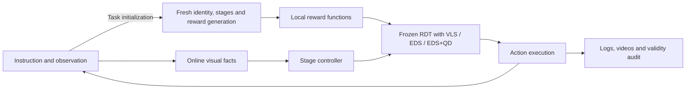

<div align="center">

# VLA-Pilot++

**Inference-Time Steering for Vision–Language–Action Policies**

[](docs/steering/installation.md)
[](LICENSE)

[Overview](#overview) · [Installation](#installation) · [Quick Start](#quick-start) · [Results](#results) · [Development](#development) · [Documentation](#documentation)

</div>

VLA-Pilot++ is a research framework for steering frozen robot policies at inference time. It brings **VLS**, **EDS**, and **EDS with Quality-Diversity (EDS+QD)** into a shared RDT execution and evaluation pipeline.

The research goal is to make inference-time search more diverse and adaptable through behavioral archives and execution feedback. The current implementation supports action-chunk QD archives; persistent learning across chunks or tasks remains a research direction. See the [Research Proposal](docs/research/research_proposal.md) and [Research Progress](docs/research/research_progress.md).

## Overview

All three methods share model loading, observation and action adapters, online Stage control, reward contracts, and evaluation tools. The supported evaluation protocol is **RDT + LIBERO ObjectSwap OOD**.

| Method | Configuration | Steering mechanism |
| --- | --- | --- |
| **VLS** | [`vls`](configs/steering/vls.yaml) | Reward gradients, RBF diversity, and adaptive Feynman–Kac resampling |
| **EDS** | [`eds`](configs/steering/eds.yaml) | Population search with RBF diversity, reward-based parent selection, and truncated denoising |
| **EDS+QD** | [`eds_qd`](configs/steering/eds_qd.yaml) | The EDS search engine extended with a behavioral archive, elite maintenance, and archive-based parent selection |



At task initialization, Codex generates fresh object identity, stage descriptions, and reward functions. During rollout, Stage queries evaluate current images at the configured triggers; candidate rewards and gradients are computed locally using the generated functions. Stage decisions combine visual facts with robot observations, and task success is determined by the environment. The [architecture guide](docs/steering/architecture.md) describes the exact contracts and simulator information used.

## Installation

The supported platform is Linux x86_64 with an NVIDIA GPU, a compatible driver, Conda, Git with Git LFS, a C compiler, and Linux input headers. The reference Python stack uses Python 3.12.12 and PyTorch 2.7.1 with CUDA 12.6. Validation uses NVIDIA H200 NVL GPUs with driver 580.65.06; a minimum GPU memory requirement has not been established. The [installation guide](docs/steering/installation.md) documents host requirements, exact assets, cache placement, and troubleshooting.

Run the following in a new checkout. Create a **new** environment; do not install over an existing research environment.

```bash
git clone --depth 1 --single-branch --branch main --no-tags https://github.com/RIP4KOBE/vla-pilot-plus.git
cd vla-pilot-plus
git submodule update --init --depth 1 third_party/rdt third_party/lerobot

conda env create --prefix "$PWD/.venv" --file environment-steering.yml
conda activate "$PWD/.venv"
export PYTHONNOUSERSITE=1
export PYTHONDONTWRITEBYTECODE=1
export PYTHON_DOTENV_DISABLED=1
unset PYTHONPATH PYTHONHOME
export PIP_CONFIG_FILE=/dev/null
export PIP_INDEX_URL=https://pypi.org/simple
unset PIP_EXTRA_INDEX_URL

python -m pip install -r requirements-steering.txt
python scripts/prepare_steering_assets.py install-runtime-compat
python scripts/prepare_steering_assets.py verify-runtime-compat
python scripts/prepare_steering_assets.py install-libero
python scripts/prepare_steering_assets.py verify-libero
python scripts/prepare_steering_assets.py verify-rng
python -m pip install --no-deps --no-build-isolation \
  -e third_party/libero_pro -e third_party/lerobot

# Both OpenCV distributions share cv2 files: install the headless variant last.
python -m pip install --force-reinstall --no-deps opencv-python-headless==4.12.0.88
python -m pip check
python -c "import cv2.version as v; assert v.headless; print(v.opencv_version, v.headless)"
```

If the public LIBERO download fails, obtain the matching source/asset bundle from the maintainers and use `python scripts/prepare_steering_assets.py install-libero --source /path/to/verified-libero-tree` in place of the download command. The installer verifies and copies the files into this checkout; it does not import from the supplied directory. Record this alternative source in the run report.

`conda activate` requires Conda shell initialization. In a script, first source the `etc/profile.d/conda.sh` file from your Conda installation. Place environments and download caches on a disk with sufficient space; the installation guide gives a separate-prefix example.

### Models and online access

**Exact model assets are not currently distributed as a public download.** Obtain the matching RDT checkpoint, T5/SigLIP snapshots, and DINO source/weights from the maintainers. [Asset requirements](docs/steering/installation.md#固定模型与源码资产) and the [hash manifest](scripts/steering_model_assets_manifest.json) define the required files. Cloning alone does not provide a runnable model.

Install [Codex CLI](https://learn.chatgpt.com/docs/codex/cli) separately, make it available on `PATH`, and sign in using your own account. The evaluated CLI version is **0.156.1**. Existing valid login can be reused; new users complete the interactive login themselves.

```bash
command -v codex
codex --version
codex login status
# Only if not already signed in:
# codex login
# Headless alternative: codex login --device-auth
```

The active protocol is **Codex CLI / `gpt-6-astra` / `ultra`**, with no provider fallback. Account/model access is checked by the API preflight below; login status alone does not establish it. See [official authentication instructions](https://learn.chatgpt.com/docs/auth). Keep credentials out of Git and machine YAML files.

### Machine configuration

Replace the asset paths and device identifiers below. GPU and EGL enumeration are independent: verify their device mapping as described in the installation guide. `configure` checks the fixed assets and writes an ignored local configuration; it does not download model weights.

```bash
STEERING_GPU=REPLACE_WITH_ASSIGNED_GPU
# Read egl_device_id from this identity-based mapping report.
python scripts/list_steering_devices.py --gpu "$STEERING_GPU"
STEERING_EGL=REPLACE_WITH_VERIFIED_EGL_INDEX
python scripts/prepare_steering_assets.py configure \
  --rdt-checkpoint /path/to/rdt \
  --text-encoder /path/to/t5/snapshots/3db67ab1af984cf10548a73467f0e5bca2aaaeb2 \
  --vision-encoder /path/to/siglip/snapshots/9fdffc58afc957d1a03a25b10dba0329ab15c2a3 \
  --torch-home /path/to/torch-cache \
  --gpu "$STEERING_GPU" --egl-device-id "$STEERING_EGL" \
  --output configs/local.yaml

# Asset checks only: no GPU or online request.
python scripts/check_steering.py --local-config configs/local.yaml \
  --output-dir outputs/preflight-assets-001

# Explicit GPU/render and real Codex image request.
python scripts/check_steering.py --local-config configs/local.yaml \
  --output-dir outputs/preflight-online-001 --gpu --api
```

<a id="开始使用"></a>

## Quick Start

Use the activated environment and run from the repository root. Every real run requires a **new output directory**. The commands below use the same scientific protocol and differ only by steering method.

### Configuration previews

These commands resolve configuration without loading models, running simulation, or making API requests. They do not establish environment readiness.

```bash
python scripts/run_steering.py --method vls --local-config configs/local.yaml \
  --output-dir outputs/vls-preview --print-config
python scripts/run_steering.py --method eds --local-config configs/local.yaml \
  --output-dir outputs/eds-preview --print-config
python scripts/run_steering.py --method eds_qd --local-config configs/local.yaml \
  --output-dir outputs/eds-qd-preview --print-config
```

### Single-task diagnostics

Each command performs a real online rollout of task 0. Run them sequentially on the configured GPU. These are optional installation/debugging checks and cannot be combined with other runs to form a ten-task result.

```bash
python scripts/run_steering.py --method vls --local-config configs/local.yaml \
  --output-dir outputs/vls-task0-001 --tasks 0
python scripts/run_steering.py --method eds --local-config configs/local.yaml \
  --output-dir outputs/eds-task0-001 --tasks 0
python scripts/run_steering.py --method eds_qd --local-config configs/local.yaml \
  --output-dir outputs/eds-qd-task0-001 --tasks 0
```

### Full evaluation

Each command runs **all ten fixed ObjectSwap tasks** and the validity audit. Run sequentially on one GPU, or use separate verified local configurations and idle GPUs for parallel runs. Keep source, dependencies, assets, and configuration fixed during evaluation.

```bash
python scripts/evaluate_steering.py --method vls --local-config configs/local.yaml \
  --output-dir outputs/vls-full10-001
python scripts/evaluate_steering.py --method eds --local-config configs/local.yaml \
  --output-dir outputs/eds-full10-001
python scripts/evaluate_steering.py --method eds_qd --local-config configs/local.yaml \
  --output-dir outputs/eds-qd-full10-001
```

### Inspect results

Read-only audits can be repeated without overwriting original evidence:

```bash
python scripts/audit_steering.py outputs/vls-full10-001 --no-write
python scripts/audit_steering.py outputs/eds-full10-001 --no-write
python scripts/audit_steering.py outputs/eds-qd-full10-001 --no-write
```

Use `progress.json` and `console.log` for live progress; use `audit.json` for the final success count, completion count, and validity. A valid task failure is different from an infrastructure error. Metrics are under `output/evaluation/`, Stage requests under `output/captured_stage_inputs/`, and videos under `output/episode_*/`. The manifest records the actual evidence paths and source identity. See [evaluation and evidence handling](docs/steering/evaluation.md) and the [clean-install validation report](docs/steering/onboarding-validation.md).

## Results

Recorded **LIBERO ObjectSwap OOD** results, with one fixed seed per task:

| Method | Reference / low | Reference / ultra | Clean install / ultra |
| --- | ---: | ---: | ---: |
| VLS | 1 / 10 | 1 / 10 | 1 / 10 |
| EDS | **3 / 10** | **3 / 10** | **3 / 10** |
| EDS+QD | 1 / 10 | 0 / 10 | 0 / 10 |

Each column is a separate valid 30-episode comparison using Codex. The clean-install evaluation completed on October 16, 2026, using a fresh clone and a new Python environment: all 30 episodes passed validity checks, with no episode-level infrastructure errors or unfinished episodes. Its task-level success outcomes match the reference ultra evaluation. Matching task outcomes does not establish identical trajectories or future service outputs.

The ultra protocol also changes transport recovery settings relative to low, so this is not a controlled estimate of reasoning-effort effects. Method compute budgets differ. These results do not establish a QD advantage or statistical superiority. See the [clean-install validation](docs/steering/onboarding-validation.md), [low results](docs/steering/results.md), [ultra reference](docs/steering/reasoning-effort-comparison.md), and [source provenance](docs/steering/provenance.md) for task-level outcomes, installation coverage, compute, and evidence identities.

## Development

Start new work from `main`. Preserve the EDS control while extending QD descriptors, archives, parent selection, or feedback.

```bash
git switch main
git pull --ff-only origin main
git switch -c codex/my-steering-change

# Run CPU regressions in the configured environment.
env -u VLA_CODEX_ONLY CUDA_VISIBLE_DEVICES='' PYTHON_DOTENV_DISABLED=1 \
  PYTHONDONTWRITEBYTECODE=1 PYTHONNOUSERSITE=1 \
  python -m pytest tests -q --disable-warnings -p no:cacheprovider
```

The CPU command disables GPU visibility and `.env` loading; it is not a general network sandbox. Scientific changes require appropriate behavior checks and a newly registered online evaluation. See [CONTRIBUTING.md](CONTRIBUTING.md) for review and validation requirements, and [AGENTS.md](AGENTS.md) for coding-agent guidance.

| Path | Responsibility |
| --- | --- |
| `main.py`, `core/env_adapters/` | Episode loop, observation/action conversion, execution feedback |
| `core/rdt_policy_steer.py` | Shared RDT inference and VLS/EDS search |
| `core/qd_ed.py` | Behavioral descriptors, archives, elites, and parents |
| `core/stage/` | Scene observations, Stage decisions, grasp/carry consistency, recovery |
| `core/online/` | Codex transport, invocation policy, request capture |
| `core/diagnostics/` | Explicit offline Stage replay |
| `vlm_query/` | Task content generation and controlled reward prompts |
| `configs/evaluation/`, `configs/steering/` | Shared scientific protocol and method profiles |
| `scripts/` | Launchers, asset preparation, progress, and independent audits |
| `tests/` | CPU regressions, frozen behavior references, and evidence fixtures |

Historical research branches are organized by the local source-directory names. Use the [branch index](docs/maintenance/branch-index.md) to find a previous implementation; start new algorithm development from `main` rather than an archived experiment.

## Documentation

- **Research:** [Proposal](docs/research/research_proposal.md) · [Progress and next steps](docs/research/research_progress.md)
- **Usage:** [Installation](docs/steering/installation.md) · [Architecture](docs/steering/architecture.md) · [Evaluation](docs/steering/evaluation.md)
- **Collaboration:** [Contributing](CONTRIBUTING.md) · [Agent guidance](AGENTS.md)
- **History:** [Research branches and tags](docs/maintenance/branch-index.md) · [All documentation](docs/README.md)

The research and detailed engineering guides are currently written primarily in Chinese.

## Provenance

Runtime commits, historical worktrees, immutable evidence, and naming migrations are recorded in [source and evaluation provenance](docs/steering/provenance.md). Complete recordings are held in maintainer-managed archives; the repository includes compact result summaries and test fixtures.

## Acknowledgments and Citation

VLA-Pilot++ builds on [VLS](https://github.com/Vision-Language-Steering/code) and [Robotics Diffusion Transformer](https://github.com/thu-ml/RoboticsDiffusionTransformer), with evaluation based on LIBERO and the pinned ObjectSwap assets. The RDT adaptation, EDS/QD mechanisms, and current online control protocol are defined by this repository; its results should not be attributed to the upstream VLS evaluation.

When using the upstream VLS method, cite:

```bibtex
@article{liu2026vls,
  title   = {VLS: Steering Pretrained Robot Policies via Vision-Language Models},
  author  = {Shuo Liu and Ishneet Sukhvinder Singh and Yiqing Xu and Jiafei Duan and Ranjay Krishna},
  journal = {arXiv preprint arXiv:2602.03973},
  year    = {2026}
}
```

## License

This repository retains the upstream [MIT license](LICENSE). Third-party code, model weights, and datasets retain their respective licenses and distribution terms.
