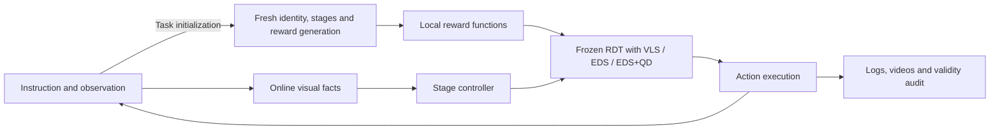

<div align="center">

# VLA-Pilot++

**Inference-Time Steering for Vision–Language–Action Policies**

[](docs/steering/installation.md)
[](LICENSE)

[Overview](#overview) · [Installation](#installation) · [Quick Start](#quick-start) · [Results](#results) · [Development](#development) · [Documentation](#documentation)

</div>

VLA-Pilot++ is a research framework for steering frozen robot policies at inference time. It brings **VLS**, **EDS**, and **EDS with Quality-Diversity (EDS+QD)** into a shared RDT execution and evaluation pipeline, with a π0.5 adapter for VLS.

The research goal is to preserve high-quality behavioral alternatives for changing user preferences, environment constraints, and risks through quality-diversity search and execution feedback. The current implementation supports action-chunk QD archives; persistent learning across chunks or tasks remains a research direction. See the [Research Proposal](docs/research/research_proposal.md) and [Research Progress](docs/research/research_progress.md).

## Overview

The RDT methods share model loading, observation and action adapters, online Stage control, reward contracts, and evaluation tools. π0.5 + VLS reuses the control framework with its own policy adapter and standard LIBERO evaluation. These benchmarks are reported separately.

| Model | VLS | EDS | EDS+QD | Evaluation scope |
| --- | --- | --- | --- | --- |
| RDT | Implemented and accepted | Implemented and accepted | Implemented and accepted; no demonstrated advantage | LIBERO ObjectSwap OOD |
| π0.5 | Implemented and accepted under the ten-task protocol | Not supported | Not supported | Standard LIBERO Object |

| Method | Configuration | Steering mechanism |
| --- | --- | --- |
| **VLS** | [`vls`](configs/steering/vls.yaml) | Reward gradients, RBF diversity, and adaptive Feynman–Kac resampling |
| **EDS** | [`eds`](configs/steering/eds.yaml) | Population search with RBF diversity, reward-based parent selection, and truncated denoising |
| **EDS+QD** | [`eds_qd`](configs/steering/eds_qd.yaml) | The EDS search engine extended with a behavioral archive, elite maintenance, and archive-based parent selection |



At task initialization, Codex generates fresh object identity, stage descriptions, and reward functions. During rollout, Stage queries evaluate current images at the configured triggers; candidate rewards and gradients are computed locally using the generated functions. Stage decisions combine visual facts with robot observations, and task success is determined by the environment. The [architecture guide](docs/steering/architecture.md) describes the exact contracts and simulator information used.

## Installation

Use Linux x86_64, an NVIDIA GPU, Conda, Git/Git LFS, `patch`, a C compiler and Linux input headers. Validation uses Python 3.12.12, PyTorch 2.7.1+cu126 and H200 NVL. Other GPUs and minimum VRAM are not yet validated. Install in a **new environment**:

```bash
git clone --depth 1 --single-branch --branch main --no-tags https://github.com/RIP4KOBE/vla-pilot-plus.git
cd vla-pilot-plus
git submodule update --init --depth 1 third_party/rdt third_party/lerobot
conda env create --prefix "$PWD/.venv" --file environment-steering.yml
conda activate "$PWD/.venv"
export PYTHONNOUSERSITE=1 PYTHONDONTWRITEBYTECODE=1 PYTHON_DOTENV_DISABLED=1
unset PYTHONPATH PYTHONHOME
export PIP_CONFIG_FILE=/dev/null PIP_INDEX_URL=https://pypi.org/simple
unset PIP_EXTRA_INDEX_URL
python -m pip install -r requirements-steering.txt
python scripts/prepare_steering_assets.py install-runtime-compat
python scripts/prepare_steering_assets.py verify-runtime-compat
python scripts/prepare_steering_assets.py install-libero
python scripts/prepare_steering_assets.py verify-libero
python scripts/prepare_steering_assets.py verify-rng
python -m pip install --no-deps --no-build-isolation -e third_party/libero_pro -e third_party/lerobot
python -m pip install --force-reinstall --no-deps opencv-python-headless==4.12.0.88
python -m pip check
python -c "import cv2.version as v; assert v.headless; print(v.opencv_version, v.headless)"
```

The same pinned recipe supports both backends. Keep development environments separate to protect accepted experiments. [Installation](docs/steering/installation.md) provides the complete ordered guide; [troubleshooting](docs/steering/installation-troubleshooting.md) explains compatibility patches and download-cache recovery.

### Download models

| Used by | Required public assets |
| --- | --- |
| RDT: VLS / EDS / EDS+QD | [RDT-1B-LIBERO-Object EMA](https://huggingface.co/TJ-chen/RDT-1B-LIBERO-Object/tree/45f425cfc22108fdf9043dd55b3bb440018db12d), [T5 XXL](https://huggingface.co/google/t5-v1_1-xxl/tree/3db67ab1af984cf10548a73467f0e5bca2aaaeb2), [SigLIP](https://huggingface.co/google/siglip-so400m-patch14-384/tree/9fdffc58afc957d1a03a25b10dba0329ab15c2a3) |
| π0.5: VLS | [π0.5 LIBERO checkpoint](https://huggingface.co/lerobot/pi05_libero_finetuned_v044/tree/dbf8a3f794a9c4297b44f40b752712f50073d945), [PaliGemma tokenizer](https://huggingface.co/google/paligemma-3b-pt-224/tree/35e4f46485b4d07967e7e9935bc3786aad50687c) |
| Both | [DINOv2](https://github.com/facebookresearch/dinov2/tree/7b187bd4df8efce2cbcbbb67bd01532c19bf4c9c) perception source/weights; fixed LIBERO assets installed above |

These exact checkpoints match the local tested assets. π0.5 uses the model selected by [upstream VLS](https://github.com/Vision-Language-Steering/code/blob/b6e87edc217a2a7682caadba285677fc79eb6f81/configs/policy.yaml). The downloader pins revisions, fetches only required files and verifies hashes:

```bash
STEERING_ASSETS=/absolute/path/on/large-disk/vla-assets
python scripts/prepare_public_models.py download --model rdt --directory "$STEERING_ASSETS"
# For PI05: obtain Google's PaliGemma access, then authenticate yourself.
hf auth login
python scripts/prepare_public_models.py download --model pi05 --directory "$STEERING_ASSETS"
```

Download only the model you plan to run. π0.5 includes its visual/language weights; it does not need separate T5, SigLIP or PaliGemma weights. See [exact revisions, directory layout, access requirements and verification scope](docs/steering/model-assets.md). No private model bundle is required; gated tokenizer access remains the user's responsibility.

### Configure paths and online access

Install [Codex CLI](https://learn.chatgpt.com/docs/codex/cli) separately and authenticate with your own account. The validated online condition is **Codex CLI 0.156.1 / `gpt-6-astra` / `ultra`**, with no provider fallback. Keep credentials out of Git and machine configuration.

```bash
codex --version
codex login status
# If needed: codex login
# Authorized headless alternative: codex login --device-auth
STEERING_GPU=4  # Replace with an assigned idle GPU.
python scripts/list_steering_devices.py --gpu "$STEERING_GPU"
STEERING_EGL=6  # Replace with egl_device_id from the mapping report.
mkdir -p .local
python scripts/prepare_steering_assets.py configure \
  --rdt-checkpoint "$STEERING_ASSETS/rdt_checkpoint" \
  --text-encoder "$STEERING_ASSETS/text_encoder" \
  --vision-encoder "$STEERING_ASSETS/vision_encoder" \
  --torch-home "$STEERING_ASSETS/torch_home" \
  --gpu "$STEERING_GPU" --egl-device-id "$STEERING_EGL" --output .local/rdt.yaml
python scripts/check_steering.py --local-config .local/rdt.yaml \
  --output-dir outputs/rdt-preflight-001 --gpu --api
```

This is the RDT configuration path. For π0.5-only setup, use its configuration and preflight below. CUDA and EGL indices need not match; the preflight validates the selected device. Machine files under `.local/` are ignored. Each preflight or real run requires a new output directory.

<a id="开始使用"></a>

## Quick Start

Use the activated environment and run from the repository root. Every real run requires a **new output directory**. The commands below use the same scientific protocol and differ only by steering method.

### Configuration previews

These commands resolve configuration without loading models, running simulation, or making API requests. They do not establish environment readiness.

```bash
python scripts/run_steering.py --method vls --local-config .local/rdt.yaml \
  --output-dir outputs/vls-preview --print-config
python scripts/run_steering.py --method eds --local-config .local/rdt.yaml \
  --output-dir outputs/eds-preview --print-config
python scripts/run_steering.py --method eds_qd --local-config .local/rdt.yaml \
  --output-dir outputs/eds-qd-preview --print-config
```

### Single-task diagnostics

Each command performs a real online rollout of task 0. Run them sequentially on the configured GPU. These are optional installation/debugging checks and cannot be combined with other runs to form a ten-task result.

```bash
python scripts/run_steering.py --method vls --local-config .local/rdt.yaml \
  --output-dir outputs/vls-task0-001 --tasks 0
python scripts/run_steering.py --method eds --local-config .local/rdt.yaml \
  --output-dir outputs/eds-task0-001 --tasks 0
python scripts/run_steering.py --method eds_qd --local-config .local/rdt.yaml \
  --output-dir outputs/eds-qd-task0-001 --tasks 0
```

### Full evaluation

Each command runs **all ten fixed ObjectSwap tasks** and the validity audit. Run sequentially on one GPU, or use separate verified local configurations and idle GPUs for parallel runs. Keep source, dependencies, assets, and configuration fixed during evaluation.

```bash
python scripts/evaluate_steering.py --method vls --local-config .local/rdt.yaml \
  --output-dir outputs/vls-full10-001
python scripts/evaluate_steering.py --method eds --local-config .local/rdt.yaml \
  --output-dir outputs/eds-full10-001
python scripts/evaluate_steering.py --method eds_qd --local-config .local/rdt.yaml \
  --output-dir outputs/eds-qd-full10-001
```

### Inspect results

Read-only audits can be repeated without overwriting original evidence:

```bash
python scripts/audit_steering.py outputs/vls-full10-001 --no-write
python scripts/audit_steering.py outputs/eds-full10-001 --no-write
python scripts/audit_steering.py outputs/eds-qd-full10-001 --no-write
```

Use `progress.json` and `console.log` for live progress; use `audit.json` for the final success count, completion count, and validity. A valid task failure is different from an infrastructure error. Metrics are under `output/evaluation/`, Stage requests under `output/captured_stage_inputs/`, and videos under `output/episode_*/`. The manifest records the actual evidence paths and source identity. See [evaluation and evidence handling](docs/steering/evaluation.md) and the [clean-install validation report](docs/steering/onboarding-validation.md).

### π0.5 + VLS

This path evaluates **standard LIBERO Object**, under this repository's Codex Stage/reward protocol. It is separate from the RDT ObjectSwap OOD evaluation and is not a strict reproduction of upstream VLS scores. EDS and EDS+QD are not implemented for π0.5.

```bash
python scripts/prepare_public_models.py configure-pi05 --directory "$STEERING_ASSETS" \
  --gpu "$STEERING_GPU" --egl-device-id "$STEERING_EGL" --output .local/pi05.yaml
# Asset/dependency/device preflight; no model, API request or episode.
python scripts/run_pi05.py --local-config .local/pi05.yaml \
  --output-dir outputs/pi05-preflight-001 --preflight
# Configuration preview only.
python scripts/run_pi05.py --local-config .local/pi05.yaml \
  --output-dir outputs/pi05-preview --print-config
# Real task-0 diagnostic: model loading, rendering, online access and VLS.
python scripts/run_pi05.py --local-config .local/pi05.yaml \
  --output-dir outputs/pi05-task0-001 --tasks 0
# Complete ten-task online evaluation; diagnostic excluded.
python scripts/run_pi05.py --local-config .local/pi05.yaml \
  --output-dir outputs/pi05-full10-001
# Read-only evidence audit.
python scripts/audit_pi05.py outputs/pi05-full10-001
```

The launcher freezes source, assets and configuration, records progress, and audits the result. PI05-specific gradient/FKD metrics are in `output/evaluation/pi05_metrics.jsonl`; videos and online captures use the same layout as RDT. See [PI05 protocol and results](docs/steering/pi05-evaluation.md).

## Results

Recorded **RDT / LIBERO ObjectSwap OOD** results, with one fixed seed per task:

| Method | Reference / low | Reference / ultra | Clean install / ultra |
| --- | ---: | ---: | ---: |
| VLS | 1 / 10 | 1 / 10 | 1 / 10 |
| EDS | **3 / 10** | **3 / 10** | **3 / 10** |
| EDS+QD | 1 / 10 | 0 / 10 | 0 / 10 |

Each column is a separate valid 30-episode comparison using Codex. The clean-install evaluation completed on October 16, 2026, using a fresh clone and a new Python environment: all 30 episodes passed validity checks, with no episode-level infrastructure errors or unfinished episodes. Its task-level success outcomes match the reference ultra evaluation. Matching task outcomes does not establish identical trajectories or future service outputs.

The ultra protocol also changes transport recovery settings relative to low, so this is not a controlled estimate of reasoning-effort effects. Method compute budgets differ. These results do not establish a QD advantage or statistical superiority. See the [clean-install validation](docs/steering/onboarding-validation.md), [low results](docs/steering/results.md), [ultra reference](docs/steering/reasoning-effort-comparison.md), and [source provenance](docs/steering/provenance.md) for task-level outcomes, installation coverage, compute, and evidence identities.

**π0.5 + VLS / standard LIBERO Object:** **9/10** (90%), with one fixed seed per task, Codex / ultra, fresh task content and online Stage. All ten episodes passed the validity audit; there were no episode-level infrastructure errors or unfinished episodes. Task failures: 4. See [the complete protocol, task results and videos](docs/steering/pi05-evaluation.md).

This is a separate benchmark using a LIBERO-adapted checkpoint, not a direct comparison with RDT ObjectSwap OOD or a reproduction of the upstream multi-trial score. No unguided PI05 control was run, so this result alone does not establish a steering gain.

## Development

Start new work from `main`. Preserve the EDS control while extending QD descriptors, archives, parent selection, or feedback.

```bash
git switch main
git pull --ff-only origin main
git switch -c codex/my-steering-change

# Run CPU regressions in the configured environment.
env -u VLA_CODEX_ONLY CUDA_VISIBLE_DEVICES='' PYTHON_DOTENV_DISABLED=1 \
  PYTHONDONTWRITEBYTECODE=1 PYTHONNOUSERSITE=1 \
  python -m pytest tests -q --disable-warnings -p no:cacheprovider
```

The CPU command disables GPU visibility and `.env` loading; it is not a general network sandbox. Scientific changes require appropriate behavior checks and a newly registered online evaluation. See [CONTRIBUTING.md](CONTRIBUTING.md) for review and validation requirements, and [AGENTS.md](AGENTS.md) for coding-agent guidance.

| Path | Responsibility |
| --- | --- |
| `main.py`, `core/env_adapters/` | Episode loop, observation/action conversion, execution feedback |
| `core/rdt_policy_steer.py` | Shared RDT inference and VLS/EDS search |
| `core/pi05_steer.py` | Strict π0.5 loading, guided flow sampling and effective FKD |
| `core/qd_ed.py` | Behavioral descriptors, archives, elites, and parents |
| `core/stage/` | Scene observations, Stage decisions, grasp/carry consistency, recovery |
| `core/online/` | Codex transport, invocation policy, request capture |
| `core/diagnostics/` | Explicit offline Stage replay |
| `vlm_query/` | Task content generation and controlled reward prompts |
| `configs/evaluation/`, `configs/steering/` | Shared scientific protocol and method profiles |
| `scripts/` | Launchers, asset preparation, progress, and independent audits |
| `tests/` | CPU regressions, frozen behavior references, and evidence fixtures |

Historical research branches are organized by the local source-directory names. Use the [branch index](docs/maintenance/branch-index.md) to find a previous implementation; start new algorithm development from `main` rather than an archived experiment.

## Documentation

- **Research:** [Proposal](docs/research/research_proposal.md) · [Progress and next steps](docs/research/research_progress.md) · [EDS reproduction and QD development workflow](docs/research/eds-qd-development-workflow.md)
- **Usage:** [Installation](docs/steering/installation.md) · [Models](docs/steering/model-assets.md) · [Architecture](docs/steering/architecture.md) · [Evaluation](docs/steering/evaluation.md)
- **Code and collaboration:** [Project Overview](docs/project_overview.md) · [Contributing](CONTRIBUTING.md) · [Agent guidance](AGENTS.md)
- **History:** [Research branches and tags](docs/maintenance/branch-index.md) · [All documentation](docs/README.md)

The research and detailed engineering guides are currently written primarily in Chinese.

## Provenance

Runtime commits, historical worktrees, immutable evidence, and naming migrations are recorded in [source and evaluation provenance](docs/steering/provenance.md). Complete recordings are held in maintainer-managed archives; the repository includes compact result summaries and test fixtures.

## Acknowledgments and Citation

VLA-Pilot++ extends the evolutionary diffusion steering direction of **VLA-Pilot (EDS)** and builds on the **VLS** codebase. These are distinct foundations: VLA-Pilot motivates inference-time evolutionary search, while VLS provides vision-language reward guidance and the original policy/control infrastructure. This repository adapts these ideas to a shared RDT steering framework and studies quality-diversity extensions.

| Foundation | Paper and resources |
| --- | --- |
| **VLA-Pilot / EDS** — Li et al. | [Towards Deploying VLA without Fine-Tuning: Plug-and-Play Inference-Time VLA Policy Steering via Embodied Evolutionary Diffusion](https://arxiv.org/abs/2511.14178) · [Project](https://rip4kobe.github.io/vla-pilot/) |
| **VLS** — Liu et al. | [VLS: Steering Pretrained Robot Policies via Vision-Language Models](https://arxiv.org/abs/2602.03973) · [Code](https://github.com/Vision-Language-Steering/code) |

We also build on [Robotics Diffusion Transformer](https://github.com/thu-ml/RoboticsDiffusionTransformer), with evaluation based on LIBERO and the pinned ObjectSwap assets. The current RDT adaptation, RBF/EDS settings, QD implementation and online control protocol are specific to this repository. Its results are not the upstream papers' reported results.

### Quality-diversity reading and resources

The following reading path connects the project's QD tutorial and human–robot interaction research themes to primary publications. These are research references, not claims that all listed algorithms are implemented here.

| Work | Relevance to steering research |
| --- | --- |
| Mouret & Clune, [Illuminating search spaces by mapping elites](https://arxiv.org/abs/1504.04909), 2015 | MAP-Elites: separate task quality from behavior descriptors and retain an elite in each niche. |
| Chatzilygeroudis et al., [Quality-Diversity Optimization: a novel branch of stochastic optimization](https://arxiv.org/abs/2012.04322) | Survey of repertoire search, descriptors, selection and robotics applications. |
| Fontaine et al., [Covariance Matrix Adaptation for the Rapid Illumination of Behavior Space](https://arxiv.org/abs/1912.02400), GECCO 2020 | CMA-ME: adapt search operators while maintaining a diverse archive. |
| Fontaine & Nikolaidis, [Differentiable Quality Diversity](https://arxiv.org/abs/2106.03894), NeurIPS 2021 | Study how objective and measure gradients can guide archive search. |

For implementation and teaching material, see the [QD community tutorials](https://quality-diversity.github.io/tutorials), [pyribs documentation](https://docs.pyribs.org/en/latest/) and Stefanos Nikolaidis's seminar [Towards Robust Human-Robot Interaction: A Quality Diversity Approach](https://robotics.cornell.edu/seminars/fall-2022/stefanos-nikolaidis/). The seminar concerns diverse scenario generation; adapting that idea to VLA action search remains a research question. The current default EDS+QD archive is local to an action block and has not demonstrated an advantage over EDS on the accepted ObjectSwap protocol.

### Citation

Please cite the relevant upstream methods when using them. The VLA-Pilot entry below identifies its public preprint; it is not a publication record for VLA-Pilot++.

```bibtex
@article{li2025towards,
  title={Towards Deploying VLA without Fine-Tuning: Plug-and-Play Inference-Time VLA Policy Steering via Embodied Evolutionary Diffusion},
  author={Li, Zhuo and Liu, Junjia and Dong, Zhipeng and Teng, Tao and Rouxel, Quentin and Caldwell, Darwin and Chen, Fei},
  journal={arXiv preprint arXiv:2511.14178},
  year={2025}
}

@article{liu2026vls,
  title   = {VLS: Steering Pretrained Robot Policies via Vision-Language Models},
  author  = {Shuo Liu and Ishneet Sukhvinder Singh and Yiqing Xu and Jiafei Duan and Ranjay Krishna},
  journal = {arXiv preprint arXiv:2602.03973},
  year    = {2026}
}
```

## License

This repository retains the upstream [MIT license](LICENSE). Third-party code, model weights, and datasets retain their respective licenses and distribution terms.
