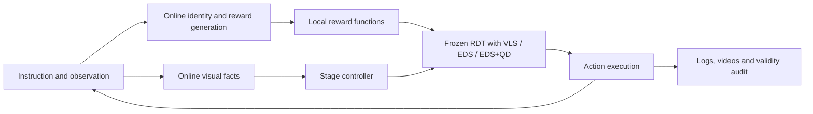

<div align="center">

# VLA-Pilot++

**Inference-Time Steering for Vision–Language–Action Policies**

[](docs/steering/installation.md)
[](LICENSE)

[Overview](#overview) · [Installation](#installation) · [Quick Start](#quick-start) · [Results](#results) · [Development](#development) · [Documentation](#documentation)

</div>

VLA-Pilot++ is a research framework for steering frozen robot policies at inference time. It brings **VLS**, **EDS**, and **EDS with Quality-Diversity (EDS+QD)** into a shared RDT execution and evaluation pipeline.

The research goal is to make inference-time search more diverse and adaptable through behavioral archives and execution feedback. The current implementation supports action-chunk QD archives; persistent learning across chunks or tasks remains a research direction. See the [Research Proposal](docs/research/research_proposal.md) and [Research Progress](docs/research/research_progress.md).

## Overview

All three methods share model loading, observation and action adapters, online Stage control, reward contracts, and evaluation tools. The supported evaluation protocol is **RDT + LIBERO ObjectSwap OOD**.

| Method | Configuration | Steering mechanism |
| --- | --- | --- |
| **VLS** | [`vls`](configs/steering/vls.yaml) | Reward gradients, RBF diversity, and adaptive Feynman–Kac resampling |
| **EDS** | [`eds`](configs/steering/eds.yaml) | Population search with RBF diversity, reward-based parent selection, and truncated denoising |
| **EDS+QD** | [`eds_qd`](configs/steering/eds_qd.yaml) | The EDS search engine extended with a behavioral archive, elite maintenance, and archive-based parent selection |



Online services generate task-specific content and evaluate the current scene. Candidate rewards and gradients are computed locally. Stage decisions combine visual facts with robot observations; task success is determined by the environment. The [architecture guide](docs/steering/architecture.md) describes the exact contracts and simulator information used.

## Installation

The validated environment uses Linux x86_64, Python 3.12.12, and PyTorch 2.7.1 with CUDA 12.6.

```bash
git clone https://github.com/RIP4KOBE/vla-pilot-plus.git
cd vla-pilot-plus
git submodule update --init third_party/rdt third_party/lerobot
```

Follow the [installation and asset preparation guide](docs/steering/installation.md) to:

1. Create a fresh environment with `environment-steering.yml` and install `requirements-steering.txt`.
2. Install the pinned LIBERO source and register the local dependencies.
3. Obtain and verify the RDT checkpoint, text/vision encoders, DINO files, and fixed task assets.
4. Configure your Codex CLI login and generate the ignored `configs/local.yaml` for local paths and GPU/EGL devices.

**Exact model assets and complete experiment recordings are not currently distributed as a public download.** Obtain the matching assets from the maintainers and verify them with the provided manifests. Cloning this repository alone does not provide a runnable model. Credentials and machine configuration must remain outside version control.

The active online protocol uses **Codex CLI / `gpt-6-astra` / `ultra`**, with no provider fallback. Dependency pins, the evaluated CLI version, and setup verification are documented in the installation guide. Retired legacy installation scripts are available through Git history.

<a id="开始使用"></a>

## Quick Start

Run these commands from the repository root after completing installation and creating `configs/local.yaml`.

```bash
# Preview the complete configuration without running a model or calling the API.
python scripts/run_steering.py --method eds \
  --local-config configs/local.yaml \
  --output-dir outputs/eds-preview --print-config

# Verify assets, the selected GPU/EGL mapping, and online access.
python scripts/check_steering.py --local-config configs/local.yaml \
  --output-dir outputs/preflight-001 --gpu --api

# Run all ten fixed ObjectSwap tasks and the validity audit.
python scripts/evaluate_steering.py --method eds \
  --local-config configs/local.yaml \
  --output-dir outputs/eds-full10-001

# Reinspect a completed run without modifying its evidence.
python scripts/audit_steering.py outputs/eds-full10-001 --no-write
```

Switch `--method` to `vls` or `eds_qd` and choose a fresh output directory for each run. Use `scripts/run_steering.py --tasks 0` only for a separately recorded diagnostic; a task subset is not a ten-task cohort. Keep source, assets, configuration, and prompts fixed during a run.

Each run records source/configuration hashes, environment information, online requests, task outcomes, and videos. Metrics are normally under `output/evaluation/` and videos under `output/episode_*/`; the run manifest is authoritative. See [evaluation and evidence handling](docs/steering/evaluation.md).

## Results

Recorded **LIBERO ObjectSwap OOD** results, with one fixed seed per task:

| Method | Codex / low | Codex / ultra |
| --- | ---: | ---: |
| VLS | 1 / 10 | 1 / 10 |
| EDS | **3 / 10** | **3 / 10** |
| EDS+QD | 1 / 10 | 0 / 10 |

Each column is a separate valid 30-episode comparison. The ultra protocol also changes transport recovery settings, so this is not a controlled estimate of reasoning-effort effects. Method compute budgets differ. These results do not establish a QD advantage or statistical superiority.

Results belong to the recorded runtime commits; code organization changes are checked separately and do not constitute new online measurements. See the [low results](docs/steering/results.md), [ultra comparison](docs/steering/reasoning-effort-comparison.md), and [source provenance](docs/steering/provenance.md) for task-level outcomes, configuration, limitations, and evidence identities.

## Development

Start new work from `main`. Preserve the EDS control while extending QD descriptors, archives, parent selection, or feedback.

```bash
git switch main
git pull --ff-only origin main
git switch -c codex/my-steering-change

# Run CPU regressions in the configured environment.
env -u VLA_CODEX_ONLY CUDA_VISIBLE_DEVICES='' PYTHON_DOTENV_DISABLED=1 \
  PYTHONDONTWRITEBYTECODE=1 PYTHONNOUSERSITE=1 \
  python -m pytest tests -q --disable-warnings -p no:cacheprovider
```

The CPU command disables GPU visibility and `.env` loading; it is not a general network sandbox. Scientific changes require appropriate behavior checks and a newly registered online evaluation. See [CONTRIBUTING.md](CONTRIBUTING.md) for review and validation requirements, and [AGENTS.md](AGENTS.md) for coding-agent guidance.

| Path | Responsibility |
| --- | --- |
| `main.py`, `core/env_adapters/` | Episode loop, observation/action conversion, execution feedback |
| `core/rdt_policy_steer.py` | Shared RDT inference and VLS/EDS search |
| `core/qd_ed.py` | Behavioral descriptors, archives, elites, and parents |
| `core/stage/` | Scene observations, Stage decisions, grasp/carry consistency, recovery |
| `core/online/` | Codex transport, invocation policy, request capture |
| `core/diagnostics/` | Explicit offline Stage replay |
| `vlm_query/` | Task content generation and controlled reward prompts |
| `configs/evaluation/`, `configs/steering/` | Shared scientific protocol and method profiles |
| `scripts/` | Launchers, asset preparation, progress, and independent audits |
| `tests/` | CPU regressions, frozen behavior references, and evidence fixtures |

Historical research branches are organized by the local source-directory names. Use the [branch index](docs/maintenance/branch-index.md) to find a previous implementation; start new algorithm development from `main` rather than an archived experiment.

## Documentation

- **Research:** [Proposal](docs/research/research_proposal.md) · [Progress and next steps](docs/research/research_progress.md)
- **Usage:** [Installation](docs/steering/installation.md) · [Architecture](docs/steering/architecture.md) · [Evaluation](docs/steering/evaluation.md)
- **Collaboration:** [Contributing](CONTRIBUTING.md) · [Agent guidance](AGENTS.md)
- **History:** [Research branches and tags](docs/maintenance/branch-index.md) · [All documentation](docs/README.md)

The research and detailed engineering guides are currently written primarily in Chinese.

## Provenance

Runtime commits, historical worktrees, immutable evidence, and naming migrations are recorded in [source and evaluation provenance](docs/steering/provenance.md). Complete recordings are held in maintainer-managed archives; the repository includes compact result summaries and test fixtures.

## Acknowledgments and Citation

VLA-Pilot++ builds on [VLS](https://github.com/Vision-Language-Steering/code) and [Robotics Diffusion Transformer](https://github.com/thu-ml/RoboticsDiffusionTransformer), with evaluation based on LIBERO and the pinned ObjectSwap assets. The RDT adaptation, EDS/QD mechanisms, and current online control protocol are defined by this repository; its results should not be attributed to the upstream VLS evaluation.

When using the upstream VLS method, cite:

```bibtex
@article{liu2026vls,
  title   = {VLS: Steering Pretrained Robot Policies via Vision-Language Models},
  author  = {Shuo Liu and Ishneet Sukhvinder Singh and Yiqing Xu and Jiafei Duan and Ranjay Krishna},
  journal = {arXiv preprint arXiv:2602.03973},
  year    = {2026}
}
```

## License

This repository retains the upstream [MIT license](LICENSE). Third-party code, model weights, and datasets retain their respective licenses and distribution terms.
