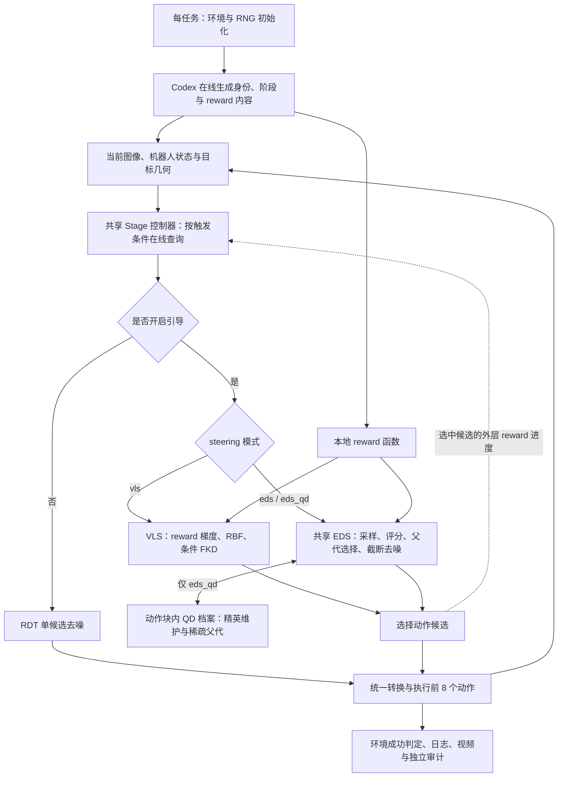

Figure scope: loop ends on environment success or step limit; provider queries occur when scheduled, not for every action. Generated reward is local numeric computation. QD archive is fresh for each guided action chunk. Node order is conceptual; exact prepare/rollout RNG restore boundaries remain defined by the recorded hooks.
