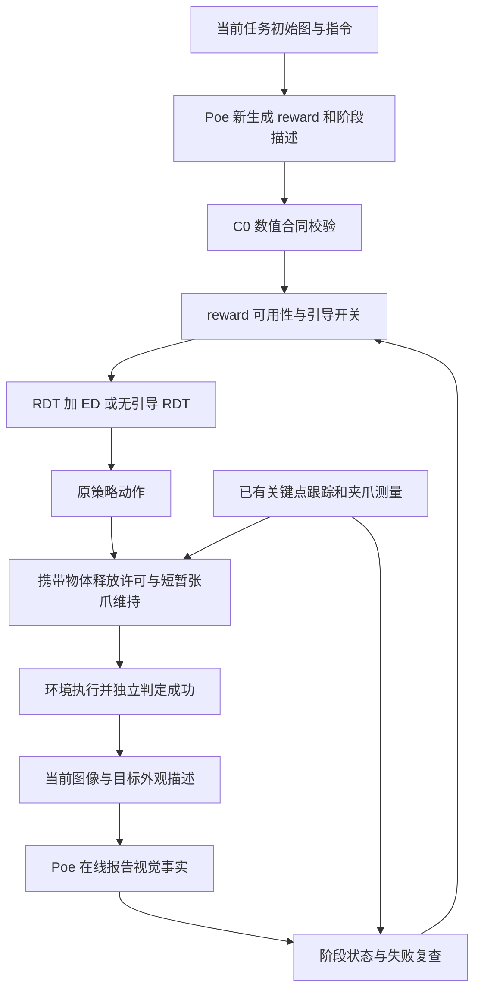

# 在线 Stage 闭环恢复报告（进行中）

当前尚未达到整批 3/10 的恢复门槛，不开始新的 QD/ED 性能优化。该文件是工作记录，待完整验收后更新结论。

## 已完成及在运行的独立批次

| 批次 | reward 条件 | 有效性 | 环境成功数 | 墙钟秒数 |
|---|---|---|---|---|
| contact_v2_dev389 | fresh_frozen | 有效 | 0/3 | 1761 |
| grasp_v3_dev389 | fresh_frozen | 有效 | 0/3 | 1100 |
| proprio_v4_dev389 | fresh_frozen | 无效（不作成功率验收） | 1/3 | 760 |
| proprio_v4_fresh_full10 | regenerate | 无效（不作成功率验收） | 0/10 | 160 |
| proprio_v4_fresh_full10_r2 | regenerate | 有效 | 1/10 | 4265 |
| proprio_v4_historical_reward_dev389 | historical | 有效 | 0/3 | 1641 |
| payload_release_v5_r2_task8 | r2任务8固定reward，在线Stage | 有效，定向回归 | 1/1 | 180 |
| payload_release_v5_c0_contract_online_full10 | 全新C0合同reward，在线Stage | 有效 | 2/10 | 4325 |
| recovery_priority_v6_c0_contract_online_full10 | 全新C0合同reward，在线Stage | 无效（task6解析错误） | nominal 1/10 | 4846 |
| physical_carry_v7_c0_contract_online_full10 | 全新C0合同reward，在线Stage | 进行中 | 待完整结束 | — |

无效批次的分数不能当作性能结果。fresh_full10 启动失败是新运行器只向 Stage 客户端注入了密钥而 reward 客户端仍读取占位值；r2 修复后十任务均完成。这与模型控制能力是两个问题。旧结果和失败日志都保留。

## 目前有证据支持的发现

- 完整新 reward + 在线 Stage 的 r2 批次有效 1/10，320 次逻辑 Stage 查询、333 次 HTTP 尝试（含10次身份识别、2次SDK重试、1次格式重试）。这次失败并非由接口中断导致。两个完成审计均通过。
- 新模型自由生成的 reward 与历史 C0 不同，8/10 个任务改变了测试轨迹排序；同一初始粒子与随机数条件下，reward 改变已经导致不同动作选择。但仅此不能解释全部失败，旧 reward 三任务对照最终仍为有效0/3。
- 视觉“held”可能与近乎空闭合的夹爪、目标远离手部冲突。现在结合连续机器人观测进行失败恢复，原始模型回复与控制判定分开记录，未使用环境成功/接触/附着标签控制动作。
- r2 task8 的目标在篮子上方时，原策略 OPEN 在97–101步被手部中心对齐规则挡住；102–103只短暂开放，104重新闭合。修复后同任务回归为1/1，前97步动作完全相同，97步放行原策略OPEN，116步环境成功。该局部因果证据不能当作完整十任务恢复。
- r2 唯一环境成功 butter 的视频显示搬动篮子，并非干净的抓取 butter 再入篮；保留基准环境分数，但不夸大行为质量。旧 C0 三个成功视频则具有目标搬运与入篮行为。
- 数值等价还取决于执行精度。实际奖励输入是 bfloat16；固定 C0 合同现在检查原始 norm→square 顺序、float32时间权重及两种输入精度。新 API 生成的三个程序通过64个探针且差值0。该有限检查不是数学证明，也不是成功率证据。

## 比较协议

development 子集用 per_seed_v1，以实现任务顺序无关的成对比较。它与历史连续随机流不同，所以 development/r2不能声称是完全相同历史 setting。v5及后续正式完整十任务已恢复 continuous policy RNG 和原环境种子，单独报告，不从不同批次凑足3个成功。

每个正式验收任务通过 Poe Gemini-3-Flash 新生成 reward 与阶段描述；数学目标固定为 C0 两阶段函数。身份描述按当前任务初始图重新生成，Stage 查询读取当前帧。没有旧 Stage 回复回放。Poe 已更换模型，任何新性能恢复都不是旧 Gemini-2.5-Flash 服务的严格在线复现。

## 证据索引

- 计划与所有后续决定：`experiments/iteration_001_execution_intent/stage-closed-loop-recovery-20260929.md`
- 所有批次、源码快照、配置、审计及视频：`artifacts/stage_closed_loop_20260929/runs/`
- reward 初始粒子对照：`initial-particle-control-task3.json`
- 行为代理分析：r2 的 `motion-diagnostic.json`（非 simulator grasp 真值）
- 视频接触图：`butter-success-r2-contact-sheet.jpg`、`historical-c0-success-contact-sheet.jpg`

更新时间：2026-09-29T12:35:09.431774+00:00

## 已验证的局部修复

固定旧reward三任务对照最终有效0/3。payload放置修复在同一失败样例上得到有效1/1：前97步动作完全相同，97步放行原策略OPEN，116步环境成功，视频目标入篮。证据为 payload_release_v5_r2_task8/paired-prefix-comparison.json。187项集成检查通过。完整十任务验收正在运行，尚未达到最终完成条件。

正式候选task0首个动作块已经与历史C0逐值核对：关键点，以及ED全10轮的动作、轨迹、reward和重采样索引均完全相同。新API生成程序在此真实bfloat16输入上实现了同一初始控制计算；后续线上Stage改变路径后的轨迹不要求相同。证据：formal-initial-particle-vs-historical-task0.json。

## 修复后的运行机制

LLM不再直接控制最终引导开关；它报告五项视觉事实。阶段完成须有间隔的确认，且完成假设可以被后续观测撤销；环境成功判定才终止回合。关闭引导后仍定期复查。constant-zero Stage2 reward 不进入ED。格式无效时对同一请求做有界重试，接受第一份格式正确回复，包括负面或unknown回复，不按成功语义挑选回答。

payload release只补充原策略OPEN的执行许可；观察到物体在篮子上方且符合携带条件才允许短暂保持张爪，不凭几何代理宣告任务成功。六维手臂动作不改写。关键点沿用本仓库现有仿真跟踪机制，不能据此宣称无仿真状态辅助的真实机器人感知系统。

## v5完整结果与下一修复

v5全新在线十任务有效2/10，成功任务为ketchup和butter，视频均显示目标搬运入篮，尚未达到3/10。308次Stage查询、324次HTTP尝试，全批没有任务中断。另有5次已确认抓取失败的恢复请求被接触窗口覆盖；已修复该控制优先级冲突并通过190项检查。v6在同条件下完整重新评测中，不能预先称性能已经恢复。

## 新发现：携带保护超时不能等同于抓取失败

v5 task3的视觉hold从480步开始；560步达到80步超时，当时目标仍抬升0.118m、夹爪宽0.030m、距手0.052m，最新视觉回复也为held。566步策略OPEN被放行，576步目标落下。task8在272→352步出现同一模式，目标仍抬升0.183m且距手0.027m，随后361步OPEN并掉落。证据为`physical-carry-timeout-diagnostic.json`。这支持修复过期逻辑；尚不能从静态日志断言修复后的任务必定成功。

待应用修复仅在既有Stage2/visual_hold上用连续测量续期：目标抬升≥3cm、距手<10cm、夹爪宽度在5–75mm之间、最后执行CLOSE、没有负面抓取证据，持续至少8步。明确失败与释放窗口优先；没有新证据仍按80步过期。不建立新的抓取事实、不改语义Stage、不主动生成放置动作。15项草案CPU检查通过，目前未接入正在运行的v6。

## 新发现：temperature=0也不能保证同图同判定

对task0 step488两份已存请求分别固定完整提示词、图像、模型、temperature0和8192输出上限，各重复3次。v5请求返回held/held/unknown，v6请求返回not_held/not_held/unknown；六次回复格式均有效。组内payload hash完全相同，说明本样本存在语义不确定性。两组目标外观文本亦有差异，因此不能将组间差异单独归因于随机性或身份文字。请求及回复保存在`exact_input_repeat_probe_488/`，这些离线回复从未进入机器人控制。

本研究没有证据支持“恢复某个账号setting即可保证3/10”。接口连通、输出完整、数值reward一致、视觉事实正确和动作执行正确是不同层面，应分别验收。已发现并修复的代码机制问题也不能用“新模型不行”代替解释。

## v7正在实际验收

239项集成检查通过后，统一carry一致性和单一JSON围栏无损解码已接入并冻结。v7完整新在线十任务15:24 UTC在GPU2启动，仍未达到验收目标。此前v6的名义1/10因一个解析中断不作有效性能结论。carry测量只用于既有视觉hold的许可、续期和矛盾否定降unknown，不凭其建立新的grasp或任务成功；原始模型回复完整保留，物理失败和释放优先。

## 16:43 UTC V7 完整结果

`physical_carry_v7_c0_contract_online_full10` 已完成且两层审计均有效：1/10，仅 task5 tomato sauce 成功（188 个动作，干净抓取放置，0 次夹爪覆盖）。338 次有效 Stage 查询、354 次 HTTP 尝试、6 次 SDK 重试、0 次格式重试；完整 JSON 围栏回复被正确接收。运行 4705.758 秒，10 个新生成 reward/阶段描述均通过 C0 数值检查，未读缓存，冻结源码在运行结束时保持不变。

仍未达到 3/10。task1/3/6 有持续抓持却未完成放置，分别 306/368/414 次强制 CLOSE；这说明稳定抓持与任务成功不是同一件事，不能把 v7 的代码修复称为性能恢复。后续按已记录的历史初始化控制及夹爪原生动作消融执行。

## 17:08 UTC：历史初始化校准与当前目标输入修复

历史回放记录校准有效3/10，127条Stage事件、10个视频与10个首批粒子SHA完全一致，20个RNG状态已保存但当前V8不使用。校准worker正常退出；审计字符串路径类型问题已在独立审计中规范化并恢复，未重跑或改写轨迹。

新的离线对照显示当前目标定位是可修复的输入问题：pudding160/192两图，原身份信息及仅移除初始位置的8次回复均为not_held；加当前跟踪目标圈后，160两次均occluded/unknown，192两次均held/above_goal。位置圈新增了模型此前缺少的当前目标身份定位，不含抓持答案，不能等同于全任务成功。

因此新全在线V8先只增加当前目标圈，保留continuous RNG、V7控制和C0数值参数；不采用此前备好的历史RNG初始化，以便优先验证输入修复且避免改变原随机流协议。158项相关CPU检查通过，17:07:45 UTC在GPU2启动，尚待完整结果。

## 2026-09-30 02:08 UTC：V8完整在线结果仍失败

当前目标标记V8全十任务有效0/10，363次Stage请求均有效；有抓起目标但未放入篮子的明确案例，且存在1414次夹爪执行覆盖。因此目标定位输入的离线改善不足以恢复完整算法。下一轮只消融新增的夹爪执行保护，保持V8其余设置，以检验是否压制了RDT原生放置动作。
