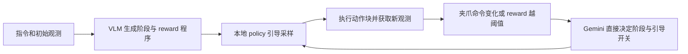

# VLS 在线控制比较、远端分支解释与非核心清理

核对日期：2026-10-15。本地起点 `b6455655f47fd3c6326721d8d1a238782b2c4f4a`。
本轮按用户要求：分析 `core`，但不修改其中任何文件；只处理证据充分的非核心清理项。不删除远端分支，也不重新运行 GPU 实验。

## 1. 比较的源码身份

从官方 [Vision-Language-Steering/code](https://github.com/Vision-Language-Steering/code) 读取的 HEAD 为 `b6e87edc217a2a7682caadba285677fc79eb6f81`，提交日期 2026-03-29。
将其下载到临时目录只读审查，没有执行上游程序，没有新增项目 worktree。
上游 `main.py`、`core/gemini_grounder.py`、`vlm_query/vlm_agent.py`、`vlm_query/stage_template.txt` 四个文件与本仓库最初提交 `1e72702` 的对应文件逐字节相同。因此这里比较的确实是本仓库继承的实现，不是仅据论文猜测。

## 2. 上游在线 Agent 和闭环如何工作

上游有两种不同职责的模型调用，并不是完全没有在线 Stage。

- **任务准备**：`VLMAgent` 经 OpenAI-compatible SDK，根据指令、初始标注图和关键点映射生成分阶段 Python reward、元数据及阶段描述；也支持读取已有函数目录。生成后的函数在本地加载、评分/求梯度，不为每个动作候选调用远端模型。[上游 VLMAgent](https://github.com/Vision-Language-Steering/code/blob/b6e87edc217a2a7682caadba285677fc79eb6f81/vlm_query/vlm_agent.py)
- **执行中重判**：`GeminiStageRecognizer` 经 `google.generativeai` 调用 Gemini；输入当前图像、可选初始标注图、阶段描述、关键点映射与触发原因。模型直接回答下一阶段及是否引导。代码用正则解析；异常返回 stage 1 / guidance on，字段未匹配也可能沿用默认值。[上游 recognizer](https://github.com/Vision-Language-Steering/code/blob/b6e87edc217a2a7682caadba285677fc79eb6f81/core/gemini_grounder.py#L215)

在动作块边界，`Main._update_stage()` 根据夹爪命令开闭变化或归一化 reward 上下越阈值触发查询，默认阈值 0.8/0.6、上限 10 次。采用返回阶段和开关后，若阶段改变则重置 policy reward 状态，再生成、执行动作并取得下一观测。这里读的是动作块中的夹爪**命令**，不等于传感器已经证实抓住物体。注释提到 periodic/chunk interval，但该版本函数内实际只有夹爪变化和 reward 越阈值四种触发分支。[上游控制循环](https://github.com/Vision-Language-Steering/code/blob/b6e87edc217a2a7682caadba285677fc79eb6f81/main.py#L384)

另一个时序差别是，上游在 `action_executed == 0` 的新块边界读取旧动作块的第 0 项；当前在线控制使用最后实际执行的夹爪命令。这是可核验的实现差异，不能仅凭静态差异就量化其成功率贡献。

上述能力需要相应引导配置开启；上游配置文件中 `use_guidance: false`，不能将“代码支持”理解为默认每次运行都会调用。公开上游 Stage 使用 Google SDK，历史本地 C0 的 Poe 接入是后续本地条件，两者不能混为一谈。

## 3. 当前实现增加了什么

当前三种 steering 方法共用在线控制层。搜索算法、在线服务、控制器应分开理解，Stage/Codex 文件不是 QD 算法本体。

| 维度 | 继承的 VLS 实现 | 当前已验收公共协议 |
| --- | --- | --- |
| reward | 生成或缓存分阶段程序 | 每任务 fresh，受 target-distance 合同约束；候选评分本地执行 |
| 模型回答 | stage / guidance 命令 | 可见性、目标位置、抓取、支撑和证据五项视觉事实 |
| 决策者 | 直接采用模型返回值 | 本地控制器综合事实、机器人观测与 reward 能力决定 |
| 查询调度 | 命令边沿、reward 越阈值 | 初始查询、边沿保留、最小间隔、周期复查、完成复查 |
| 图像时序 | 初始与当前图像一起请求 | 初始图用于身份描述；随后依据当前图，减少旧姿态混淆；当前目标有标记 |
| 完成判断 | 模型可直接给 stage 0 | 满足可见、在目标区、未被抓持且有支撑，间隔确认两次；仍是可撤销控制假设 |
| 抓取恢复 | 无当前这一组独立控制模块 | 夹爪宽度、目标距离/几何、carry 保持、空抓复查与恢复优先级 |
| 引导开关 | 模型回答及函数是否存在 | 主开关、阶段、控制请求和 reward 有效性共同决定；VLS 另需可用梯度 |
| 服务错误 | 部分错误回到 stage 1 / guidance on | 有限传输/格式恢复；仍失败时登记基础设施错误，不伪装成正常预测 |
| 接入 | reward 的 OpenAI-compatible SDK + Stage 的 Google SDK | 当前 Codex CLI 登录，共用视觉 transport；固定模型/effort、捕获与请求计数 |

当前入口和职责见 [main.py](../../main.py)、[stage_evidence.py](../../core/stage_evidence.py)、[stage_observation.py](../../core/stage_observation.py)、[VLMAgent](../../vlm_query/vlm_agent.py)、[公共协议](../../configs/evaluation/libero_object_swap.yaml)。当前机制也使用 simulator 提供的几何/机器人信息，并非纯 RGB 的端到端 Agent。任务成功仍由环境判定，不能以控制器 stage 0 代替成功。

## 4. 为什么文件多，能否精简

当前是 **15 个 `stage_*` 文件 + 3 个 `codex_*` 文件，共 2443 行**；上游将 Stage 查询和决策主要放在 `main.py` 与 `gemini_grounder.py` 内。数量差异同时来自新增行为和更细的拆分，不全是重复代码。

确有结构性问题：12 行 JSON 外层解码、29 行身份描述和 33 行响应校验各占根目录文件；contact、robot、physical/fused carry、recheck 共同读写同一个状态字典，决策顺序散落；Codex 视觉传输继承名为 Stage 的类，当前工厂还保留 Gemini 命名；旧 replay/capture 与在线生产路径混放。它们适合组织重构，但不能按前缀批量删除。

建议下一轮单独评审以下方案，本轮未实施：

| 目标模块 | 建议整合来源 | 应保持的边界 |
| --- | --- | --- |
| `core/stage/controller.py` | `stage_evidence`、`stage_contact_handoff` | 查询调度、阶段状态、contact grace、reward gate 的执行顺序 |
| `core/stage/observation.py` | `stage_observation`、`stage_observation_json`、`stage_response_validation`、`stage_identity_memory`、`stage_target_marker` | 图像/身份构造、严格事实 schema 和格式校验；不执行控制策略 |
| `core/stage/grasp.py` | `stage_robot_evidence`、`stage_grasp_guard` | 机器人一致性、夹爪状态与动作适配；不要与纯视觉事实混同 |
| `core/stage/carry.py` | `stage_carry_hold`、`stage_fused_carry_hold` | carry 证据和状态保持 |
| `core/stage/recovery.py` | `stage_failed_contact_recheck`、`stage_release_guard` | 恢复与释放各保留独立函数、原先优先级和调用时点 |
| `core/online/codex.py`、`policy.py` | 3 个 `codex_*` 文件的 transport / 公共策略职责 | Stage 和 reward 共用；保留超时、完整回复判定、计数及请求捕获 |
| 独立 diagnostics 包 | `stage_capture_trace_replay`、`trace_replay_stage`；梳理 `stage_capture` 的共用捕获部分 | replay 保留可用，生产路径不依赖诊断类；捕获与 replay 职责分开 |

目标是减少顶层噪声并形成 5 个有内聚职责的 Stage 模块，不是合并成一个巨型文件。可以先整理 import/包边界，再合并小模块，最后处理状态类型；首次重构不更改阈值、prompt、RNG、reward reference 或决策顺序。

特别注意 `grasp_action_guard_enabled=false` 只关闭最终动作覆盖，之前的 held 检查、状态更新和证据计算仍执行；`stage_capture` 仍被 observation 顶层导入；当前 Codex factory 仍经过 `gemini_grounder`。不能据名字或一个开关认定它们没用。

该方案需要更新公共 import、测试、捕获/源码身份索引，完成原始轨迹输入下的决策和动作一致性检查。若科学条件改变，登记新配置并重新在线验收。当前 3/10 不能单独证明未来重构行为不变，也没有证据证明所有新增规则分别带来收益；要判断哪些机制可以去掉，应另做消融。

## 5. 为什么 GitHub 有 99 个分支

本轮实际执行 `git ls-remote --heads origin`，核实 99 个，远端 main 为上述起点提交。分类依据为 [机器索引](historical-source-index-20261015.json) 和 [远端入口](historical-source-index-20261015.md)。

| 来源 | 数量 | 用途 |
| --- | ---: | --- |
| 当前 main | 1 | 后续开发起点 |
| 原有远端非 main 分支 | 7 | 上次归档前已经存在；保留共享历史 |
| 历史 WT 对应快照 | 72 | 71 个带分支 WT + 1 个 detached WT；符合保存每个 WT 的目的 |
| 没有 WT 的旧本地分支 | 4 | 保留其提交，不属于 WT 数量 |
| stash | 2 | 工作状态与第三父提交里的未跟踪文件分开保存 |
| 补充源码快照 | 13 | dirty/ignored 源码、实验冻结副本、外部路径、符号链接目标等补充来源 |
| 合计 | **99** | 不是 99 套独立算法 |

相对“历史 72 个 WT + main”的 73 个分支，多出 **26 = 7 + 4 + 2 + 13**。
上次实际新增 91 个归档分支 = 72 + 4 + 2 + 13，原有远端 8 个保留。当前本地已经退休了 72 个 WT，不能用清理后仅 1 个活动工作区的数量，反推原先只有 1 份历史来源。

4 个无 WT 的原分支为 `chore/integrate-rdt-libero-vls`、`codex/rdt-steering-integration`、`exp/eds-quality-diversity`、`exp/n36-engineering-adapter-001482`。7 个原远端分支中还包含上述第一个分支的原引用，因此有些来源同时有旧引用和新增 manifest 快照；不代表源码完全独立。

13 个补充快照按来源目录拆分，包括历史实验树、整合/ultra 管理目录、两个不同根目录的 outputs、LIBERO 源码、物化后的文件符号链接和外置 ultra runs。它们保护了未包含在旧提交里的源码，但不需要长期各自成为活跃开发分支。

**归档粒度确实比用户期望更细。** 当时为了不遗漏未提交/外部源码，选择了按来源建立多个分支；它是保全实现的选择，不是 Git 的必需条件。更符合用户意图的后续方案是保留每 WT 的可查阅分支，把其他补充内容和 stash 整理为一个带映射的补充归档分支。必须先验证全部文件、提交及索引覆盖，再安排删除被替代引用；原 7 个共享远端分支需另行判断。不会只为减少数字而直接删除本轮不明归属的远端引用。

## 6. 本轮清理清单

所有移除项在远端已发布的起点提交中均可取回；详见 [逐文件原 SHA-256 和恢复链接](noncore-cleanup-inventory-20261015.json)。本轮不改写历史研究证据。

| 处理 | 路径 | 依据 |
| --- | --- | --- |
| 删除 | `NOTES.md` | 仅创建日期/作者/仓库表，信息并入本报告；不承载算法或运行说明 |
| 原字节归档 | `HANDOFF.md` → `docs/08_archive/HANDOFF-20260915.md` | 2026-09-15 状态已过时；不再占根目录；当前入口为 Research Progress |
| 删除 | `utils/hydra_plugins/__init__.py`、`task_searchpath.py` | 未注册、无调用；search path 方法为 `pass`；真实 Hydra task 配置保留 |
| 删除 | `utils/plot_results.py` | 未被当前入口、测试或文档命令调用；带旧示例成绩，当前结果不用此脚本生成；可从 Git 历史取回 |
| 删除 | `ablations/door_left_k10.yaml`、`door_left_no_fkd.yaml`、`door_left_no_gradient.yaml`、`door_left_no_rbf.yaml` | 旧 CALVIN 单任务平面消融配置，未进入当前 Hydra defaults 或三模式协议；按历史工具退役，不删除 CALVIN backend |
| 删除孤立条目 | `.gitmodules` 中 `sam3` | HEAD 无该路径 gitlink；3 个真实子模块条目不变，不影响 `core` 内 SAM 可选实现 |
| 保留 | `environment.yml`、`requirements.txt`、`run.sh`、`setup.sh`、`scripts/run_libero_suites.sh` | 仍是旧 policy/backend 的兼容安装/入口链，不属于无引用代码；若退役应先明确不再支持这条兼容流程 |
| 保留 | 所有 `core/`、当前配置、测试、fixtures、模型与研究归档 | 保护科学行为与证据；未验证的可选能力也不按最近没运行就删除 |

`NOTES.md` 原信息：创建日期 2026-04-19，作者 Zhuo Li，仓库 `https://github.com/RIP4KOBE/vla-pilot-plus.git`。

截图中的其余根文件作用：

| 文件 | 保留原因 |
| --- | --- |
| `AGENTS.md` | agent 开发约束与权威文档导航 |
| `CONTRIBUTING.md` | 协作者开发和验收流程 |
| `README.md` | 安装、三模式运行与结果入口 |
| `LICENSE` | 源码许可与原始权利声明，不是可清理的历史杂项 |
| `main.py` | 公共 worker 最终执行的环境/动作/Stage 主循环 |
| `environment-steering.yml` | 当前验证过的 Conda 系统/Python 依赖层 |
| `requirements-steering.txt` | 当前直接 Python 依赖入口 |
| `requirements-steering-lerobot-base.txt` | 固定 LeRobot base 依赖，被上一文件 `-r` 引用 |
| `constraints-steering.txt` | 当前依赖约束，被上一入口 `-c` 引用 |

旧 `setup.sh` 有 Poe 提示，旧 requirements 有旧 CUDA/NumPy 版本及机器相关 editable 引用；它们不是当前 Codex/RDT 基线的推荐安装方式。保留不代表这些旧命令已重新验收。当前安装只按 [installation](../steering/installation.md)。

## 7. 验证与工作区边界

验证记录见 [清理检查](noncore-cleanup-validation-20261015.json)：核对 `core` 所有源码字节、三模式配置、运行时 source manifest 的实际差异、子模块映射、文档导航以及相关 CPU 回归。当前 source manifest 会因移除三个未调用的 utils 文件而变化；这不是旧实验 receipt 的源码哈希，旧 receipt 不修改。

已通过 114 项 runner/asset-admission CPU 回归；三模式清理前后解析配置相同，公共 CLI 的三份配置预览均通过。所有 `core` 跟踪文件字节不变，实际 source manifest 仅移除上述三个 utils 文件，其余条目无新增或修改。首次 CLI 预览使用不存在的 `/assets` 示例路径被目录检查拒绝，改用已有机器配置后通过；配置预览不验证模型/GPU/API。

开始时工作区已有 `CLAUDE.md` 删除，本轮保留该用户改动，不恢复、不混入本次提交。根 AGENTS 的职责不变。不新增实验、不更改服务设置、不删除远端分支；清理不产生新的成功率结果。
