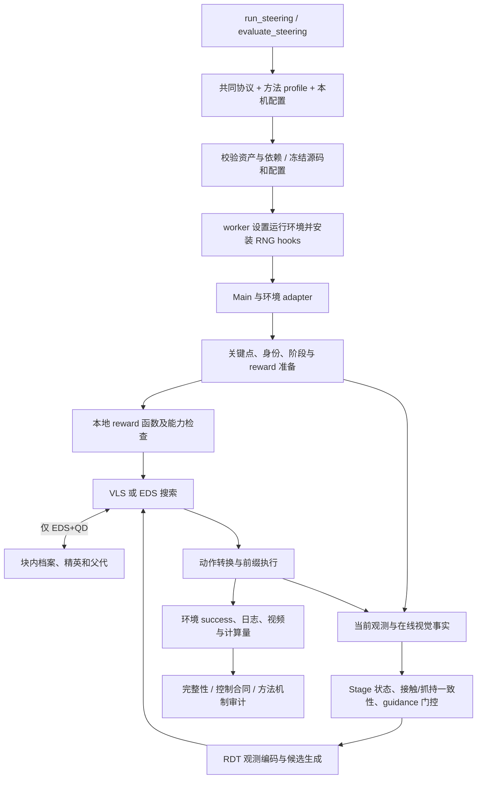

# Project Overview

本文是当前 main 的代码导览。先读 [Proposal](research/research_proposal.md) 理解研究目标，再读 [Progress](research/research_progress.md) 了解能力与证据，随后用本文定位实现。安装和完整运行命令以 [README](../README.md) 为入口；详细公式和数值合同见 [Architecture](steering/architecture.md)。

当前已验收主路径包括 **RDT + VLS / EDS / EDS+QD（LIBERO ObjectSwap OOD）** 和 **π0.5 + VLS（标准 LIBERO Object）**，均使用 fresh Codex 在线内容生成与 Stage 判断。两者是独立协议，不直接比较成功率；π0.5 EDS/QD 尚未支持。共同框架提供工程起点，尚未证明 QD 性能优势。兼容代码、可选实验接口和未来研究目标不自动属于验收范围。

## 一次评测如何运行



1. [run_steering.py](../scripts/run_steering.py) 接收模式、机器配置和新输出目录；[evaluate_steering.py](../scripts/evaluate_steering.py) 是完整评测入口。`--print-config` 只解析配置，`--tasks` 产生诊断子集，不能拼成正式十任务组。
2. [steering_runtime.py](../scripts/steering_runtime.py) 合并固定协议与 profile，校验模式和 archive 的对应关系，设置路径、CUDA/EGL 和依赖导入环境；launcher 核验资产、记录提交、源码/配置/环境身份，再启动 worker。
3. [steering_worker.py](../scripts/steering_worker.py) 在启动前再次检查冻结身份，将 prepare/rollout RNG hooks 安装到 `main`，通过 Hydra 调用 [main.py](../main.py)。正式运行不能绕开 launcher 直接继承任意 shell 环境。
4. `Main` 创建 adapter 和 policy。`perform_task_for_episode` 获取关键点和物体对应关系，为任务生成新的阶段描述和 reward 程序，加载函数并验证数值合同。在线身份描述以实际初始图像为依据，在任务内复用，不跨任务冒用。
5. `_run_episode` 在每个新动作块前更新 Stage，选择当前 reward 与引导开关，再调用 policy。块内其余步从动作缓存执行；不会每个动作都重新生成整个候选种群。
6. 引导开启时，RDT 根据模式运行 VLS 或 EDS；EDS+QD 由 EDS 内部的 archive 分支供给父代和最终候选。关闭引导时走单候选路径。
7. 选定动作经过固定动作/夹爪转换，执行前缀并记录实际命令与观测。环境 success 决定任务结果；Stage 的视觉完成判断和 reward 高分不能替代它。
8. launcher 保存完成/失败/中断状态并调用审计。审计有效表示证据符合协议，不表示任务必然成功；离线审计不重新运行完整仿真。

上述流程以 RDT 为主。π0.5 从 [run_pi05.py](../scripts/run_pi05.py) 进入，共用 worker、`Main`、Stage/reward 控制与 LIBERO adapter，使用独立配置、资产校验及 [audit_pi05.py](../scripts/audit_pi05.py)。它运行标准 LIBERO Object、每块执行 10 个动作、采用 per-seed 初始化；不使用 RDT ObjectSwap 的 RNG fixtures。π0.5 的 Stage 进度来自内部梯度 reward 归一化，RDT 使用所选候选的独立外层反馈；共用控制器不表示这两个数值合同相同。

## 目录地图

以下覆盖主线所有开发顶层目录；第三方内部源码与同类测试按职责归组。机器生成目录和历史材料另列，不作为运行依赖。

| 路径 | 职责与边界 |
| --- | --- |
| [main.py](../main.py) | 环境、模型与感知初始化；任务准备；Stage、搜索、动作执行和评测记录的编排 |
| [core/](../core) | 模型 steering、适配器、QD、Stage/online 控制、reward 和机制证据 |
| [configs/](../configs) | 科学协议、方法 profile、backend/policy/perception 及机器配置示例 |
| [scripts/](../scripts) | 公共 CLI、预检、资产准备、生命周期、独立审计和归档 |
| [utils/](../utils) | reward 加载、关键点/图像处理、可视化、日志和显式诊断 |
| [vlm_query/](../vlm_query) | 在线任务内容生成与提示词；不是候选评分的远端服务 |
| [tests/](../tests) | CPU 回归、冻结行为参考、RNG/控制捕获 fixtures、机制审计测试 |
| [third_party/](../third_party) | 固定 RDT、LeRobot、CALVIN 子模块；安装器另准备 LIBERO 源码/资产 |
| [patches/](../patches) | 保留的 CALVIN light 兼容实现；不是 RDT 搜索算法或 Robosuite 安装补丁目录 |
| [docs/](README.md) | 研究、工程、验收与历史证据；当前入口见下表 |
| 根目录安装配方 | `environment-steering.yml`、`requirements-steering.txt`、`requirements-steering-lerobot-base.txt`、`constraints-steering.txt` 分别管理环境、依赖入口、LeRobot 基础依赖和版本约束 |
| 根目录协作文件 | [AGENTS](../AGENTS.md)、[CONTRIBUTING](../CONTRIBUTING.md)、[LICENSE](../LICENSE)、`.gitmodules`、`.gitignore`、`.gitattributes`：指导、许可、依赖定位、生成文件边界与固定文件的属性规则 |

本机路径和设备配置按 README 放在 ignored `.local/`；兼容的 `configs/local.yaml` 也被忽略，不放凭据。`outputs/` 保存新运行；大型模型、视频及历史归档不随普通 clone 提供。`.worktrees/exp/` 的历史别名/归档用于追溯，当前主路径不应从旧研究工作树导入源码。`.venv/`、缓存和 `__pycache__/` 是环境或生成内容，不是项目模块。

| 文档区域 | 如何使用 |
| --- | --- |
| `docs/research/` | Proposal 定义研究问题，Progress 定义实际进度；来源记录说明原文依据 |
| `docs/steering/` | 安装、机制、运行审计、独立结果和 provenance；`validation/` 保存小型派生证据 |
| `docs/maintenance/` | 发布/整理记录、分支映射、依赖审查与本轮核验记录 |
| `docs/00_overview`、`01_specs`、`02_analysis`、`03_evidence`、`04_plans`、`05_runs`、`08_archive` | 历史材料，按原路径保留；旧计划和限制不覆盖当前开发规则 |

旧 `docs/02_analysis/project_notes/project_overview.md` 是带归档标记的历史快照。本文件是当前工程导览的权威入口，不回写旧快照来消除历史差异。

## 核心源码与调用关系

### 策略、观测与动作

| 文件 | 关键入口与实际职责 |
| --- | --- |
| [core/rdt_policy_steer.py](../core/rdt_policy_steer.py) | `RDTSteer.from_pretrained/post_init/select_action`；加载 RDT/编码器、共享条件编码、动作缓存；`_vls_guided_denoise_loop` 与 `_eds_guided_denoise_loop` 分派搜索；评分、几何投影、父代/输出选择、计数和机制 trace 均在此接入 |
| [core/rdt_libero_obs_processor.py](../core/rdt_libero_obs_processor.py) | `RDTLiberoObsProcessor` 将 LIBERO 图像、机器人状态和语言任务组织为 RDT 输入；维护观测状态，控制相机和 state 编码边界 |
| [core/rdt_libero_action_converter.py](../core/rdt_libero_action_converter.py) | RDT action 与 LIBERO 7D 命令转换；旋转表示、夹爪映射和动作块解码；属于科学行为，不只是格式处理 |
| [core/policy_observation_sampling.py](../core/policy_observation_sampling.py) | 根据 policy 决定观测复制数，避免 RDT 的粒子批量与外层观测复制混淆 |
| [core/fkd_class.py](../core/fkd_class.py) | FKD potential、权重、ESS 和重采样；VLS 调用它，实际是否重采样由条件决定 |
| [core/pi05_steer.py](../core/pi05_steer.py) | `PI05PolicySteer` 严格加载本地权重及声明的 tied aliases；执行流采样、reward/RBF 梯度、按整数 Euler 步调度 FKD；在归一化前去除 padded action 维度，记录实际模型/梯度/FKD 计数。已有独立 VLS 验收，没有 EDS/QD |
| [core/diffusion_policy_steer.py](../core/diffusion_policy_steer.py) | LeRobot diffusion policy 的 guided conditional sampling；保留的其他策略路径 |

`rdt_policy_steer.py` 既有固定 reference，也有研究选项。默认之外的初始采样、方向描述符、自适应父代/调度和 `EDSChunkMemory` 不应因存在代码而写成已验收功能。`chunk_population_mode=fresh` 不启用跨块 warm start。

### QD 描述、档案与父代

[core/qd_ed.py](../core/qd_ed.py) 将与模型加载无关的 QD 规则集中在一个模块；RDT 搜索调用它，独立审计器另行重建记录。

| 入口 | 职责 |
| --- | --- |
| `qd_descriptor` / `execution_intent_descriptor` | 默认以候选轨迹终点相对目标的 XY 表示行为；执行意图是另一个可选描述，不混为默认结果 |
| `freeze_bounds` / `cell_ids` | 从初始候选确定边界并分配格；默认 4×4、初始边界固定、越界 clamp |
| `QDArchive.update` | 记录访问、插入/替换/拒绝，按质量保留格内精英，使用稳定 fingerprint 处理平手 |
| `QDArchive.select_global_best` | 从跨搜索轮次保留的档案中选最终最高质量候选；不等于只选末代 |
| `allocate_parent_slots` | 在已占用格间分配父代槽位；默认 sparse 按累计访问数的倒数偏好稀疏格，并用局部 RNG 处理分配平手 |
| `rebin`、secondary、quality anchor 等 | 可选研究接口；默认 profile 不启用这些扩展，需各自验证 |

档案在每个 guided 动作块新建。它在同一块的初始评分和后续搜索轮次间保留精英，不跨环境执行自动保留策略知识。仅开启 `qd_metrics_observer` 产生观测指标，也不等于档案参与了父代或输出选择。

### 环境与感知

| 文件 | 职责 |
| --- | --- |
| [core/env_adapters/base_adapter.py](../core/env_adapters/base_adapter.py) | `BaseEnvAdapter` 以及 `Pose3D`、相机/物体数据类型；定义观测、坐标、动作投影、任务、执行与成功接口 |
| [core/env_adapters/libero_adapter.py](../core/env_adapters/libero_adapter.py) | `LiberoEnv` 创建任务、初始化状态和 ObjectSwap 扰动；`LiberoAdapter` 提供图像、实测状态、对象几何、关键点输入和动作执行 |
| [core/env_adapters/calvin_adapter.py](../core/env_adapters/calvin_adapter.py) | CALVIN 坐标、状态、动作及任务适配；兼容路径，不由 ObjectSwap 结果验证 |
| [core/env_adapters/__init__.py](../core/env_adapters/__init__.py) | `create_adapter` 按 backend 创建环境；延迟导入避免不相关依赖阻断主路径 |
| [core/keypoint_detector.py](../core/keypoint_detector.py) | DINO 特征、掩码内聚类/合并、候选关键点和计算量；主协议使用固定 DINO 资产 |
| [core/keypoint_tracker.py](../core/keypoint_tracker.py) | 注册关键点与物体关系，使用 adapter 的对象位姿更新位置；不是单纯图像光流跟踪 |
| [core/gemini_grounder.py](../core/gemini_grounder.py) | 保留物体 grounding、Stage recognizer 基类、请求计数及工厂；Codex 类和 observation 类仍复用其接口/图像工具。文件名包含 Gemini 不代表当前协议调用 Poe/Gemini，也不能据名字认定无依赖 |
| [core/sam_segmenter.py](../core/sam_segmenter.py) / [sam3_segmenter.py](../core/sam3_segmenter.py) | SAM/GroundingDINO 或 SAM3 分割及组合管线；当前已验收协议不启用对应外部 grounding/SAM3 分支 |
| [core/__init__.py](../core/__init__.py) | 公共类型导出及延迟加载兼容入口，不是第三套执行框架 |

当前 `delta_actions_to_ee_trajectory` 是候选平移的近似累计投影。它没有为每个候选分支运行 MuJoCo，也不预测完整碰撞或接触。当前观测还使用仿真状态和物体几何，不能据 VLM 图像输入宣称系统完全不依赖真值。

### Stage、在线服务与 reward

| 模块 | 职责与关键边界 |
| --- | --- |
| [core/stage/controller.py](../core/stage/controller.py) | `update_stage` 编排查询、视觉事实与机器人证据、语义状态、reward 能力和 guidance 门控；`decide` 只处理语义，`apply_guidance_gate` 再处理实际开关；`apply_handoff` 使用 policy 提供的进度与距离做接触交接，反馈来源按模型区分 |
| [core/stage/observation.py](../core/stage/observation.py) | 初始目标身份描述、当前图像标记、视觉事实请求；`ObservationMixin` 组合在线/捕获 transport，区分身份复用与 fresh 当前观测 |
| [core/stage/contract.py](../core/stage/contract.py) | 去除无损外包装、严格结构校验和受限修复请求；错误不静默转为合法 Stage |
| [core/stage/grasp.py](../core/stage/grasp.py) | 抓持几何、夹爪宽度与命令一致性、恢复优先级、可选动作保护；默认关闭动作覆盖，不应将可选分支归入默认行为 |
| [core/stage/carry.py](../core/stage/carry.py) | 携带物体的物理证据、有限期限保持、视觉/传感器融合和审计条件 |
| [core/stage/recovery.py](../core/stage/recovery.py) | 失败接触的观测复查、支撑/位置证据及恢复状态；不实现 QD 策略学习 |
| [core/online/codex.py](../core/online/codex.py) | `CodexStageRecognizer` 与 `CodexVisionTransport`：CLI 命令、图片输入、事件解析、超时/重试、完成规则、计数和捕获；generation 与 Stage 共用 transport |
| [core/online/policy.py](../core/online/policy.py) | 固定调用参数/环境策略、技能禁用路径、可接受传输事件与 policy hash |
| [core/online/capture.py](../core/online/capture.py) | 输入、图像、回复和元数据的可审计记录；保存捕获不等于启用回放 |
| [core/diagnostics/stage_replay.py](../core/diagnostics/stage_replay.py) | 显式历史 trace/capture 回放及身份匹配；仅离线诊断，不计入 fresh 在线成绩 |
| [vlm_query/vlm_agent.py](../vlm_query/vlm_agent.py) | `VLMAgent.generate_guidance` 构建任务提示词、请求并解析阶段/reward 程序，保存输出与元数据；也保留兼容 segmentation planning 接口 |
| [vlm_query/target_distance/](../vlm_query/target_distance) | 当前 reward/阶段生成受控提示词；[stage_observation_v1.txt](../vlm_query/stage_observation_v1.txt) 定义视觉事实输出；其他旧模板不自动进入主协议 |
| [core/target_distance_reward.py](../core/target_distance_reward.py) | `validate_task/reference/audit` 检查新生成 reward 的任务与数值合同；有限探针不构成任意输入正确性的证明 |
| [utils/guidance_utils.py](../utils/guidance_utils.py) | 解析、加载和包装生成函数，处理 device 及 reward 执行；不是任意不可信 Python 的通用安全隔离环境 |

三件事需要分开理解：**在线生成**在每任务准备阶段产生身份、阶段和 reward；**在线 Stage**在运行触发点查询当前视觉事实，控制器融合后决定是否引导；**本地评分**对候选调用已经生成的 reward，VLS 所需梯度也在本地计算。176 个 EDS 候选评分不是 176 次 API 请求。

### 初始化、指标与可视化

| 文件/组 | 职责 |
| --- | --- |
| [core/episode_rng_fixture.py](../core/episode_rng_fixture.py)、[episode_rng_hooks.py](../core/episode_rng_hooks.py) | RNG 捕获、签名、恢复及 prepare/rollout 边界安装；固定 seed 不能替代正确恢复时点 |
| [core/eds_eval_metrics.py](../core/eds_eval_metrics.py) | 块/迭代指标、几何统计、JSONL、延迟与区间摘要 |
| [core/eds_mechanism_trace.py](../core/eds_mechanism_trace.py) | 保存候选、父代、评分、选择及可选 tensor；供可视化和独立机制审计 |
| [utils/eds_eval_vis.py](../utils/eds_eval_vis.py)、[eds_mechanism_pretest_vis.py](../utils/eds_mechanism_pretest_vis.py) | population、轨迹、archive 热图、父代/记忆/调度诊断图与报告；图不能替代执行证据 |
| [utils/vis_utils.py](../utils/vis_utils.py)、[keypoint_utils.py](../utils/keypoint_utils.py) | 图像/轨迹投影、带标记视频、点云、深度及关键点预处理 |
| [utils/config_utils.py](../utils/config_utils.py)、[logging_utils.py](../utils/logging_utils.py) | 任务配置合并/匹配与日志；公共协议仍由 launcher 显式解析 |
| [utils/cuda_egl_guard.py](../utils/cuda_egl_guard.py)、[render_lifetime_diagnostics.py](../utils/render_lifetime_diagnostics.py)、[mujoco_phase_diagnostics.py](../utils/mujoco_phase_diagnostics.py) | CUDA/EGL 保护、上下文生命周期和阶段耗时诊断；可选诊断由配置显式启用 |

## 配置、启动与独立审计

| 入口/目录 | 作用 |
| --- | --- |
| [configs/evaluation/libero_object_swap.yaml](../configs/evaluation/libero_object_swap.yaml) | 共同科学协议：任务/seed、资产选择、模型、在线服务、控制、执行和搜索默认值 |
| [configs/evaluation/libero_object_pi05.yaml](../configs/evaluation/libero_object_pi05.yaml) | π0.5 在共同控制配置和 VLS profile 上覆盖标准 Object suite、per-seed RNG 与模型类型；它不是 RDT OOD 配置的同条件替换 |
| [configs/steering/](../configs/steering) | `vls`、`eds`、`eds_qd` 的显式方法差异；EDS+QD 复用 EDS，不复制全套推理 |
| [configs/local.example.yaml](../configs/local.example.yaml) | 本机路径和设备示例；复制/生成本地配置后校验，不能把机器路径混入科学 profile |
| `configs/backend/`、`env/`、`task/`、`stage_controller/` 及根配置 | 原生 Hydra、后端、任务和控制变体；不是所有配置均由公共 launcher 默认使用 |
| [scripts/check_steering.py](../scripts/check_steering.py)、[list_steering_devices.py](../scripts/list_steering_devices.py) | 资产预检；显式 GPU/render/API 检查；UUID/CUDA/EGL 映射 |
| [prepare_steering_assets.py](../scripts/prepare_steering_assets.py)、[steering_model_assets.py](../scripts/steering_model_assets.py) | 安装/核验 LIBERO 与 RNG、模型文件及机器配置；资产 manifest 定义固定身份 |
| [prepare_public_models.py](../scripts/prepare_public_models.py)、[public_model_sources.json](../scripts/public_model_sources.json) | 固定 revision 下载 RDT/π0.5 及编码器，重建匹配的 DINO 源码，核对文件并保留许可证；生成 π0.5 本机配置；不替用户取得 gated tokenizer 权限 |
| [run_pi05.py](../scripts/run_pi05.py)、[pi05_runtime.py](../scripts/pi05_runtime.py)、[audit_pi05.py](../scripts/audit_pi05.py) | π0.5 独立 launcher、配置/资产 receipt 和 cohort 审计，复用公共生命周期、控制及部分合同检查；`--preflight` 只核验资产/依赖/设备，不加载模型或请求 API |
| [steering_dependency_compat.py](../scripts/steering_dependency_compat.py)、[dependency_patches/](../scripts/dependency_patches) | 对已知 Robosuite 输入安装固定补丁并核验输出；拒绝未知文件替换 |
| [codex_only_runtime.py](../scripts/codex_only_runtime.py)、[steering_process.py](../scripts/steering_process.py) | 限定在线 provider 与环境；管理本 launcher 拥有的 worker、信号和持久状态 |
| [audit_steering.py](../scripts/audit_steering.py) | 完整 cohort、环境/资产、方法和有效性总审计，分别统计任务成功与运行状态 |
| [audit_steering_contract.py](../scripts/audit_steering_contract.py)、[steering_transport_audit.py](../scripts/steering_transport_audit.py) | prompt/image/reward/marker/动作证据及传输生命周期一致性 |
| [audit_qd_mechanism.py](../scripts/audit_qd_mechanism.py) | 独立重建 descriptor/cell、精英、父代与最终选择；不能由只写 active flag 替代 |
| [prepare_steering_archive.py](../scripts/prepare_steering_archive.py)、[steering_archive.py](../scripts/steering_archive.py)、[steering_source_layout.py](../scripts/steering_source_layout.py) | 冻结证据的支持包、原执行身份与搬迁后路径解析；不重写原始 receipt |

典型输出包含 `manifest.json`、`environment.json`、`resolved-config.yaml`、`status.json`、`progress.json`、`console.log` 和 `audit.json`。当前逐任务/方法记录在 `output/evaluation/`，在线 Stage 捕获在 `output/captured_stage_inputs/`，任务生成与视频在 `output/episode_*/`。冻结源码及 support 位置以 manifest 和[评测说明](steering/evaluation.md)为准；旧记录可能使用历史布局，不能通过改名破坏哈希。

模型权重、编码器、任务资源及依赖补丁都属于复现身份。源码、配置、模型/资产身份、在线捕获和结果之间应可追溯；下载链接可访问、文件相同、实际模型加载成功是不同验证层级。[公开模型来源](steering/model-assets.md)记录固定版本及下载范围。π0.5 还保存 `output/evaluation/pi05_metrics.jsonl`，其模型 calls 是流模型调用，不直接当作 RDT DiT 计数比较。

## 从哪里开始贡献

| 修改目标 | 首读模块 | 必要检查与科学边界 |
| --- | --- | --- |
| 描述符与分区 | `core/qd_ed.py`、RDT 的 `_eds_qd_descriptor` | 单位、有限值、边界、可控性与实际行为；描述符变更是新科学条件 |
| 档案与精英 | `QDArchive`、`tests/test_qd_ed_archive.py`、独立 QD 审计器 | 插入/替换/平手、来源、实际输出；不能只验证日志字段 |
| 父代选择 | `allocate_parent_slots`、RDT 的 `_eds_qd_allocate_parent_slots` | 槽位守恒、局部 RNG、实际父代 tensor、质量/覆盖对照 |
| 执行反馈/跨块经验 | `Main._run_episode`、adapter、`EDSChunkMemory` | 只给已执行候选真实标签；状态对齐、reset、过期/重评；当前可选 warm-start 不是已验收持久 QD |
| 新 VLA 或环境 | policy wrapper、观测/动作 converter、`BaseEnvAdapter` | batch/action/state/夹爪合同、单任务诊断及独立完整协议；不把 RDT 数值照搬至其他模型 |
| Stage/reward | `core/stage/`、`core/online/`、`vlm_query/` | 能力门控、时序、失败复查、fresh 身份、请求完成规则；会改变共同科学条件 |
| 安装、入口与审计 | `scripts/`、资产与兼容 manifest | 路径隔离、未知资产拒绝、冻结检查、进程所有权及搬迁后重审 |
| 研究与工程文档 | Proposal / Progress / 本文 | 原文来源、实现事实、结果协议、链接和导航；无需重复 GPU 实验 |

相关 CPU 测试按作用分组：`test_rdt_*` 和 `test_steering_eds_parity.py` 保留策略/EDS reference；`test_pi05_online.py` 检查 π0.5 适配与协议；`test_qd_ed_archive.py` 验证 QD；`test_stage_*`/`test_codex_*` 验证控制与 transport；`tests/steering_audit/` 验证独立审计；`test_steering_*`、RNG 和 adapter 测试覆盖安装、启动、资产及生命周期。`tests/fixtures/` 保存固定输入和来源，不是可挑选的线上成绩。

在按安装指南配置的环境、仓库根目录运行 CPU 回归：

```bash
env -u VLA_CODEX_ONLY CUDA_VISIBLE_DEVICES='' PYTHON_DOTENV_DISABLED=1 \
  PYTHONDONTWRITEBYTECODE=1 PYTHONNOUSERSITE=1 \
  python -m pytest tests -q --disable-warnings -p no:cacheprovider
```

该命令不等于网络隔离，也不能替代在线验收。文档改动检查引用和事实；路径/安装改动运行相应回归；触及模型、输入、初始化、Stage/reward、搜索、动作执行或评分顺序时，登记科学影响并完成对应行为与在线验证。保留 `eds` 对照，从 main 派生功能分支，按 [CONTRIBUTING](../CONTRIBUTING.md) 提交可审核改动。
