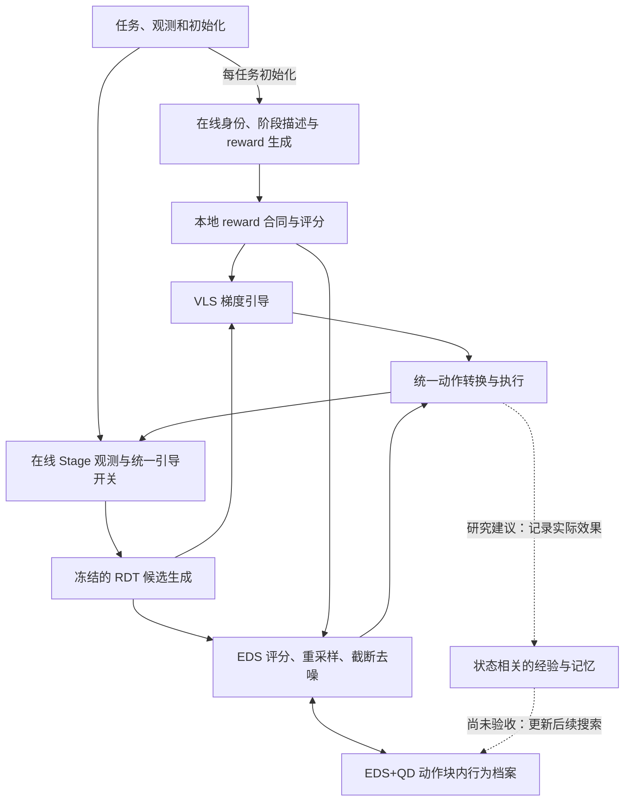

# VLA-Pilot++ Research Proposal

本提案研究如何利用 quality-diversity 改进冻结 VLA 的推理时搜索，并进一步建立执行反馈驱动的适应机制。它定义研究问题与验证路线；当前实现和实验结论见 [Research Progress](research_progress.md)，安装与运行见 [README](../../README.md)。

研究目标与实验假设会随证据修订。本文中的预期收益不代表已经取得的结果。

## 研究问题与适用范围

预训练 VLA 能产生多种低层动作，但部署时的对象替换、任务语义变化、抓持状态歧义和接触误差可能使高概率动作无法完成任务。项目研究如何在**不更新预训练策略权重**的条件下，利用任务与执行观测，在推理阶段搜索更合适的动作。

RDT 是当前动作生成底座；VLS 是梯度引导对照；EDS 通过 reward 评分、父代选择、加噪和截断去噪改进候选，并带有 RBF 多样性项；EDS+QD 要进一步维护“行为不同而各有质量”的候选集合，使探索不只围绕单一高分解展开。这是希望验证的机制价值，现有成绩尚未证明 QD 优于 EDS。

π0.5 + VLS 作为模型适用范围检查，采用同一在线控制框架及独立的标准 LIBERO Object 协议；其证据与 RDT ObjectSwap 对照分开记录。π0.5 的 EDS/EDS+QD 扩展尚未实现，也不属于当前 QD 结论的依据。

首要实验场景为 **LIBERO ObjectSwap OOD**。当前系统使用仿真机器人状态、目标几何/关键点与带标记的视觉输入，不能描述为纯 RGB、无真值依赖或已部署到真实机器人。其他 policy、CALVIN 和真实机器人接口的保留不等于已完成本项目验收。

## 可检验假设

| ID | 问题与假设（均待验证） | 应观察的证据 | 反证或失败条件 |
| --- | --- | --- | --- |
| RQ1 | 在相同 EDS 底座和明确计算预算下，按行为分区维护精英能保留对完成任务有用的替代动作 | 真实入档、父代张量与最终选择；执行后的覆盖和任务成功改善 | 档案覆盖提高但执行行为同质、成功率不升，或收益仅来自额外计算 |
| RQ2 | 与接触/操作有关且可观测的 BD 比单一末端 XY 更有用 | BD 与实际夹持、接近、搬运等行为的关系；固定 reward 的描述符消融 | BD 只区分投影误差、不可控变量或无意义空格 |
| RQ3 | 质量约束与多样性父代分配能平衡探索、利用和可执行性 | 相同候选/去噪预算下，父代谱系、质量分布、执行反馈与失败类型变化 | 稀疏偏好持续选择低质量父代，或收益可由普通精英保留解释 |
| RQ4 | 执行反馈驱动的记忆更新能提高后续搜索效率与稳定性 | 独立阶段/任务边界、reset、过期与重新评分记录；和 fresh archive 的配对对照 | 复用陈旧状态导致错误；只提高预测 reward，没有执行收益 |
| RQ5 | MLLM 可生成有类型约束、可解释且能迁移的任务相关 BD | 固定生成协议、未见任务评测、手工 BD 与通用 BD 对照 | 根据测试成功标签反复调 BD，或无效 descriptor 经人工补改后混入成绩 |

ObjectSwap 十任务 **≥5/10** 是本项目的阶段目标，不是已取得成绩，也不是统计显著性的替代。后续需多 seed、重复在线 cohort 和保留评测任务验证稳定收益。

## 方法框架

三模式共享输入输出适配、Stage/reward、执行和审计框架。`eds_qd` 使用 EDS 引擎并启用 archive，不复制第三套推理实现。运行入口为 `scripts/evaluate_steering.py --method vls|eds|eds_qd`，机器路径通过 `--local-config` 提供。

| 组成 | 当前实现事实 | 研究边界 |
| --- | --- | --- |
| RDT | 条件动作生成，5 步完整去噪，执行前 8 个动作 | 不训练或更新模型权重 |
| VLS | reward 梯度、RBF 与自适应 FKD；默认 20 候选 | 合法零梯度、ESS 跳过必须照实记录 |
| EDS | 16 候选、10 轮演化、RBF 初始/截断采样；reward 不要求梯度 | RBF 仍用自动微分，不能宣称整体完全无梯度 |
| EDS+QD | 目标相对末端 XY、4×4 网格、每格 1 个精英、稀疏优先父代、archive 全局最好输出 | 每个动作块重建；尚未证明收益 |
| 在线 agent | 每任务生成身份/阶段/reward，执行中按触发条件查询 Stage | reward 对候选的评分在本地；不是每个候选都请求 API |
| 控制合同 | selected reward 进度、视觉/接触/抓持/释放证据共同门控 guidance | Stage 判断不能代替环境 success |

当前候选几何采用动作投影，不等于真实动力学分支仿真。具体评分、采样、张量切片和 RBF 定义见[架构说明](../steering/architecture.md)；实现假设应纳入后续误差分析。

## Quality-diversity 的设计原则

**质量 objective 与行为 descriptor 分离。** Reward 评价某个候选在当前任务/阶段下是否有价值；BD 描述它“以什么方式行动”。BD 不应只重复 reward 排序，也不能自动被当作成功标签。当前 reward 是目标距离，BD 是末端相对目标 XY；两者相关，是否足以提供有用多样性需要验证。

**档案与精英维护。** 当前各网格保留最高质量候选，并以稳定 fingerprint 解决平手。研究需解释容量、边界、越界、重复候选、不可行候选和状态变化时的行为。档案占用率高并不自动意味着质量或任务收益高。

**父代选择与输出。** 当前按 `(累计候选访问数+1)^(-1)` 分配父代槽位，最终取 archive 中质量最优候选。它同时改变父代分配和最终精英保留，必须分别消融，避免把“保留过去最好候选”的收益全部归于 QD。

**执行反馈。** 候选的投影质量与实际效果不同。下一阶段优先分析已执行动作后的末端位移、夹爪/物体关系、阶段进展与预测误差，明确哪些反馈只能更新已执行候选、哪些未执行候选没有真实标签。不能给未执行动作补造“实际成功”信息。

**MLLM 自动 BD。** 研究方向是在任务语义约束下生成描述符。应先建立固定维度、单位、输入权限和有限值合同，再允许模型提出描述符，并分开使用开发与验收数据。当前尚未实现经过验收的自动生成链。

## 执行反馈与递归改进

本项目暂将其定义为：**执行 → 获取效果/误差 → 更新可追溯的搜索状态或策略 → 在后续相同或新情境下验证改善**。更新对象可以是档案、候选复用、父代分配或描述符；并不要求训练 RDT 权重。

必须区分三个层级：

1. **动作块内迭代：已实现。** 同一观测下反复评分、变异和选择，是推理搜索；本身不能证明跨执行的自我改进。
2. **单任务跨动作块适应：研究阶段。** 已有可选状态复用接口，但默认每个动作块重新搜索。可靠的档案迁移、状态有效性和反馈更新仍需独立开发与验收。
3. **跨任务递归改进：研究设想。** 需要状态/任务条件化、知识有效性、遗忘与负迁移机制，以及独立未见任务的前后对照。当前没有支持这一结论的验收证据。

验收需证明改善来自保留和利用的经验，而不是重试次数、在线模型变化、更多计算或测试集调参；固定搜索预算对照、reset 消融和防止评测信息泄漏是必要条件。

## 实验设计

首阶段沿用已验收协议：RDT/固定资产、ObjectSwap task 0–9、十个规定 seed、prepare/rollout RNG fixtures、H=8、720 执行步上限、fresh reward/identity、在线 Codex Stage。**当前默认是 gpt-6-astra/ultra**；历史 low 与当前 ultra 分组报告，不静默切换服务。软件版本和模型请求名固定不能保证服务端输出永久不变。

主要对照为 VLS、EDS（含 RBF）、EDS+QD。另行登记的机制消融建议按单变量推进：

| 消融 | 保持项 | 要回答的问题 |
| --- | --- | --- |
| 当前 EDS vs 只保留全局精英 vs QD | reward、Stage、候选/去噪预算 | QD 是否超出普通精英保留的价值 |
| XY vs 执行相关 BD | 同一 archive/父代/质量规则 | 行为分区是否有用 |
| uniform vs sparse vs 质量受约束父代 | descriptor、质量、预算 | 探索是否挤占必要利用 |
| RBF 开/关 × QD 开/关 | 显式保持预算、其余条件 | 两种多样性机制互补还是重复 |
| fresh vs 有状态复用，含 reset 对照 | Stage/reward 不改、计算量报告 | 跨块保留是否有效，何时失效 |
| 固定手工 BD vs MLLM BD | 同任务拆分与生成预算 | 自动化是否真正可迁移 |

指标至少包括环境成功率及逐任务结果、有效/无效/未完成数量、动作步数、阶段/失败类型、实际 DiT calls 与 batch rows、评分/梯度量、在线调用/重试与墙钟时间。QD 另报覆盖、质量分布、父代谱系/有效性、最终候选来源和执行后的行为多样性。定义 QD-score 的质量标度和空格处理后再使用它；不同 BD 网格的覆盖率不可直接等同。

固定模型回复回放可用于定位确定性代码差异，但必须与 fresh 在线成绩分开。合法任务失败不重试替换；基础设施重测有新 run ID、明确纳入规则和完整尝试记录。多 seed 结果需报告不确定性，十任务一次通过不是泛化证明。

## 研究路线与风险

| 阶段 | 交付 | 进入下一阶段的条件 |
| --- | --- | --- |
| A：共同开发起点 | 三模式主线、固定 EDS 对照、资产/证据索引、开发规则 | 代码与已验收 runtime 对应；可检查、可追溯 |
| B：先解释 QD 当前失效 | 配对轨迹、Stage 门控、父代质量与行为覆盖分析 | 至少一个有证据和可反驳预测的机制假设；区分感知变化与搜索变化 |
| C：单块 QD 改进 | 小步 descriptor/精英/父代消融 | 真实机制生效、完整同协议在线对照；争取 ≥5/10 并用重复/多 seed 验证 |
| D：跨块反馈闭环 | 状态有效性、reset、过期与反馈更新 | 不损害 EDS 对照；fresh/reset/预算消融支持改善 |
| E：自动 BD 与迁移 | 受约束 MLLM BD、未见任务与跨任务实验 | 独立评测支持可迁移性；才讨论 recursive self-improving 贡献 |

主要风险是 reward 与真实操作成功错位、投影忽略接触动力学、BD 被无效行为占满、Stage 误判改变 guidance、在线模型波动、小样本偶然性，以及持久记忆产生负迁移。优先用现有失败轨迹与有限离线诊断缩小假设，再注册在线实验；不要同时改 reward、Stage、BD 和父代策略而失去归因能力。

## 实现入口与维护

- 搜索与模式边界：[rdt_policy_steer.py](../../core/rdt_policy_steer.py)、[三种 profile](../../configs/steering)。
- BD、档案、精英与父代：[qd_ed.py](../../core/qd_ed.py)；独立机制重建：[audit_qd_mechanism.py](../../scripts/audit_qd_mechanism.py)。
- 执行与反馈边界：[main.py](../../main.py)、[LIBERO adapter](../../core/env_adapters/libero_adapter.py)。
- Stage/reward：[Stage controller](../../core/stage/controller.py)、[target_distance_reward.py](../../core/target_distance_reward.py)、[固定提示词](../../vlm_query/target_distance)。
- 状态、结果、下一步验收：[Research Progress](research_progress.md)；开发约束：[AGENTS.md](../../AGENTS.md)。

研究问题、假设或路线发生变化时，说明新增证据并同步更新 Progress。具体受测提交、配置和历史实现映射统一保存在[来源与实验追溯](../steering/provenance.md)，不在提案正文维护版本流水。

## 研究来源

项目方向来自 Notion [VLA-Pilot ++ / Proposal](https://app.notion.com/p/319803e44a5c80699dd2f2077f19bb61) 和已确认的研究目标，并结合当前代码与实验报告整理。可读原文支持 QD、objective/descriptor 区分和 MLLM 描述符等方向；原始图片细节尚未完整读取，本文的问题分解和实验路线属于待验证的研究设计。来源范围与缺口见[来源记录](notion-source-20261015.json)。
