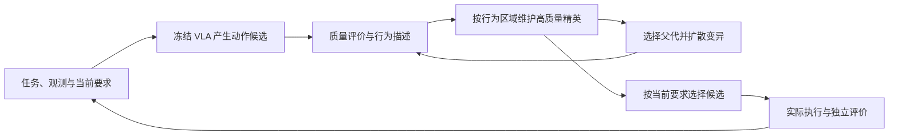

# VLA-Pilot++ Research Proposal

**From Policy Steering to Policy Exploration — Quality-Diversity at Inference Time for Deploying VLA Without Fine-Tuning**

VLA-Pilot++ 研究如何在完成主要任务的同时，让机器人保留多种高质量行为，以适应额外且不断变化的用户偏好、环境约束、安全风险和协作要求。核心思想是将 **quality-diversity（QD）** 引入 evolutionary diffusion steering：从寻找单一高分动作，推进到系统性地产生、维护和利用多样化的可行解集。

当前实现和实验证据见 [Research Progress](research_progress.md)，工程导览见 [Project Overview](../project_overview.md)。

## 研究动机：任务成功之外，为什么需要多样性

预训练 Vision-Language-Action（VLA）模型将多模态观测和语言指令映射为机器人动作，为通用操作提供了基础。但部署到下游环境时，场景、对象、接触条件和人类要求的变化，仍可能使已有动作模式失效。即使模型能够完成某个任务，也不意味着它能以当前情境下合适的方式完成任务。

真实部署中的要求往往不止是“抓起杯子”，还可能是“慢慢抓起杯子，且不要碰到旁边的花瓶”。用户希望机器人在完成任务的同时，兼顾安全、可靠、效率、物体与硬件保护，以及协作规范；这些要求还可能随情境改变。因此，研究问题是一个**多目标、受约束的控制问题**：如何保留任务成功能力，同时提供多种有效行为，让系统有条件地选择不同的权衡方式。

QD 的价值是系统性地产生并维护这些维度上的高质量多样解集。同一个任务可以有不同的接近方向、运动路径、接触方式或执行节奏；其中一些解可能更快，另一些解可能对障碍、扰动或特定偏好更合适。多样性只有在这些差异可执行、与任务有关、能够被选择和利用时，才具有部署价值。

这也带来四个困难：偏好与约束可能隐含且非平稳；VLA 生成的不确定性不等于可控的行为多样性；真实交互昂贵，探索必须兼顾任务质量和风险；多目标评价难以被一个通用标量完整表达。增加候选数量或扩大随机噪声，不能直接解决这些问题。

## Inference-time steering：从候选筛选走向行为探索

Inference-time steering 在部署阶段利用外部评价信号引导预训练策略，无需为每个下游情境重新微调基础模型。按本项目的分析视角，可以区分两种机制：**selection-only** 从已采样候选中选择；**optimization-augmented** 进一步搜索、变异或细化候选。这一划分用于说明方法差异，不替代完整的相关工作综述。

本项目保留 VLS 作为已有 steering 对照；它利用视觉语言信息形成引导信号，并在动作生成过程中施加引导。EDS（Evolutionary Diffusion Steering）在冻结策略上开展种群搜索，通过质量评分、父代选择和扩散变异改进候选。EDS+QD 在 EDS 基础上增加按行为差异组织的精英档案，让搜索同时关注质量与覆盖。

三者的研究关系是：**VLS 提供现有引导方法的对照，EDS 提供可优化候选的搜索基础，EDS+QD 探索多样化解集的额外价值。** VLS 本身也有多样性机制；不能将 QD 的贡献简化为“首次引入多样性”，更不能把 VLS 归为只做静态筛选。需要验证的是，显式维护不同的行为精英，是否比仅提高单个候选质量或加入粒子排斥更有用。

RDT 是当前三种方法共同验证的 VLA 基座，负责提供预训练动作先验；steering 层在推理阶段改变搜索与选择。将这种研究思路推广到其他 VLA，需要分别检查动作表征、评价能力和执行效果，不能由一个基座的结果直接推出通用性。

多模态语言模型可以提供任务语义、阶段解释和质量评价依据，但语义判断与真实执行之间仍有误差。外部评价器应提供可检验的信号，不能同时充当未经约束的最终成功判据。

## 核心思想：从单一解搜索到高质量解集覆盖

真实部署中可能同时存在多个合理解。本项目将这一问题视为多峰搜索：在保证任务质量的前提下，主动发现并保留互补的行为，而不让所有搜索资源过早集中到同一个高分模式。

EDS+QD 的目标是形成一组“既能做成、又有不同做法”的候选。当偏好改变，或者一个方案在交互中表现不佳时，系统有机会从其他行为家族中选择备选方案，减少重新开始搜索的成本。这是需要验证的收益；候选在旧状态下可行，不代表在执行后仍可直接复用，状态有效性和重新评价不可省略。

### 质量与行为描述分工

给定任务情境 $c$ 和候选动作序列 $a$，质量评价 $q(a,c)$ 回答“这个候选有多好”，行为描述符 $b(a,c)$ 回答“它以什么方式行动”。质量可包含任务进展、可行性与偏好满足；描述符刻画接近方向、路径形态、接触方式等可解释差异。

**Objective ≠ measures。** 描述符不必被最大化，也不应只是 reward 的另一种写法。它用于划分行为空间，让不同区域各自保留高质量候选。对行为区域 $k$，概念上可写为：

$$
\mathcal{A}_k = \arg\max_{a:\,b(a,c)\in B_k,\ a\in\mathcal{F}(c)}q(a,c),
$$

其中 $\mathcal{F}(c)$ 表示通过规定可行性约束的候选集合。它是研究目标的表达：预测通过约束检查不能自动保证真实接触安全，执行后仍需独立检验。若约束确属硬约束，应单独定义可接受条件，不能任由其他高分抵消违规。

按行为分区维护的 QD 档案也不自动构成多目标 Pareto 前沿。是否需要每个区域维护多个权衡解、如何表达偏好和硬约束，是后续应独立验证的设计选择。

### 两个核心模块

**质量评价器（quality objective / verifier）** 为候选提供任务相关的质量信号。EDS 的候选评分可以使用不可微评价，但代理评分与真实成功必须区分。多目标场景下应明确质量、偏好和约束各自的含义，避免一个含混的总分掩盖失败。

**QD-enhanced evolutionary diffusion search** 以行为档案维护精英，从档案中选择父代，再通过 evolutionary diffusion 产生新候选。借鉴 MAP-Elites 类方法的按区域保留原则，既改进已有区域的质量，也探索尚未充分覆盖的行为区域。网格、CVT 分区或其他档案表示属于可比较的研究选择，不预设其中某一种必然最好。

### 推理时闭环

1. **候选生成。** 从预训练 VLA 采样动作序列，并以任务相关的共同表征进行比较，例如末端轨迹或关键点关系。跨模型、跨具身的适用性需要分别验证。
2. **评价与描述。** 分别计算候选质量和行为描述。描述符应尽量刻画可控、与执行有关的差异，避免把随机扰动或投影误差当作多样性。
3. **档案与演化。** 根据描述符更新各区域精英，从档案选父代，经扩散变异产生子代，再评价并回填。最后按当前任务和约束选择候选执行，利用真实反馈检验代理评价。

探索与利用的分配也是研究变量：候选数、搜索轮数、档案容量以及父代分配会共同影响质量、覆盖和耗时。“先探索更多行为、再加强质量选择”是可检验的调度设想，不应直接当作最优规则。

## 研究假设与预期贡献

| 研究问题 | 待验证假设 | 不支持该假设的证据 |
| --- | --- | --- |
| RQ1：有用的行为多样性 | 在明确且可比的计算条件下，QD 能保留更多高质量、可执行且互补的行为 | 只有档案占用增加，执行行为仍同质，或质量/成功率显著下降 |
| RQ2：偏好与约束适应 | 多样化解集支持在相同任务下选择满足不同要求的行为 | 改变要求后仍选择同一种行为，或满足偏好以违反硬约束为代价 |
| RQ3：鲁棒性与恢复效率 | 在扰动或失败后，经过状态校验的替代行为能减少恢复所需交互和搜索 | 收益仅由更多重试、更多计算或普通全局精英保留解释 |
| RQ4：可迁移的描述与评价 | 任务相关描述符能组织具有执行意义的行为，并在未见情境保持作用 | 描述符只编码测试任务标签、不可控噪声或预测误差 |

预期贡献对应作者原文的四个层次：提出多目标、多约束的 VLA steering 问题；构建 QD 增强的 evolutionary diffusion 搜索方法；验证多样解集对鲁棒性和高效重试的价值；通过可复现实验说明任务质量、约束满足与行为覆盖的权衡。它们是研究计划，不能据此宣称已获得显著提升、完成真实机器人实验或建立方法优先权。

## 实验设计与评价

首先保留 VLS、EDS 和 EDS+QD 的共同对照，明确基础策略、输入、初始化、在线评价条件和执行方式。当前 OOD 任务成功率实验是研发起点；它本身不足以验证多偏好、多约束的核心研究主张。

随后应构建**同一主要目标、不同额外要求**的任务组，例如改变允许的接近方向、避障区域或动作幅度要求。每种要求都需要可观测、独立于搜索 reward 的验收指标。涉及安全、社会协作或真实机器人时，先定义测量条件与适用边界，不能仅凭语言描述视为已覆盖。

| 对照或消融 | 需要排除的替代解释 |
| --- | --- |
| EDS、只保留全局精英的 EDS、EDS+QD | 收益是否只是保留了过去最高分候选 |
| 相同容量的随机候选库与 QD 档案 | 收益是否只是保存了更多候选 |
| 固定质量评价，替换描述符或父代分配 | 哪种行为划分和探索分配有效 |
| 粒子排斥开启/关闭 × QD 开启/关闭 | 两种多样性机制是互补还是重复 |
| 固定计算与交互上限的恢复实验 | 收益是否只是增加了重试或搜索成本 |
| 未见要求、扰动和多 seed 的配对评测 | 是否具有可迁移性，而非在少数任务上偶然成功 |

同时报告：任务成功率、约束违反率、偏好满足程度、具有质量门槛的行为覆盖、解集质量分布、执行后的行为差异、恢复成功率与重试成本，以及模型计算量、在线调用和墙钟时间。不同描述符的覆盖率不可直接比较；QD-score 需固定质量标度、分区和空区域处理。默认设置下计算量不同的结果，与等计算对照分开解释。

主要风险包括代理 reward 与操作成功错位、候选投影忽略接触动力学、低质量行为占据档案、在线判断波动、描述符与真实行为脱节，以及小样本过度归因。每轮实验应聚焦一个可反驳假设，保留合法失败与完整尝试，使用独立评估检查改进。

## Future Work：Diversity-driven Agentic Recursive Self-Improvement

下一步可以研究：如何将一次推理搜索获得的多样行为，转化为后续决策可以利用和改进的知识。这里 agentic 的含义是系统能依据情境选择策略、观察执行效果并更新后续决策依据，而不是仅增加一个语言模型调用。

必须区分三个层级：**动作块内搜索**在同一观测下改进候选；**跨执行的持续适应**把真实反馈用于后续动作块或任务；**recursive self-improvement（RSI）**则要求更新后的系统参与下一轮知识获取和改进，并在多个轮次的独立评估中证明持续收益。当前每动作块重建的档案属于第一层，不能证明后两层。

多样性在 RSI 中的假设价值，是避免反复选择和学习少数高分经验，使系统保留能够适应不同情境的替代策略。需要证明的对象是**可调用、可验证且能持续改进的知识覆盖**，不是记忆条数或生成文本的差异。

两条路线都应在实验前确定质量门槛、允许的约束违反与旧能力退化范围、最低有意义收益及不确定性报告方式。不能在看到测试结果后更换成功标准。

### 路线 A：冻结 VLA，演化外部策略与经验

优先研究一个有限范围的系统：**情境条件化的 steering 策略档案**。每个条目包含一种接近/路径策略、有限的搜索选择参数及其适用情境和执行证据。先固定基础 VLA、任务评价器、Stage/reward 合同和描述符定义，只演化策略选项及档案的保留、选择与有效性；暂不同时自动修改提示词、工具、reward 和描述符。

- **核心假设：** 同等容量、计算和交互条件下，保留行为互补的有效经验，比单一最佳策略或普通相似性检索更能应对要求变化，并减少重复失败。
- **描述与质量：** 描述符记录可测的接近方向、路径形态或接触顺序等差异；质量由真实任务结果、约束满足和成本共同评价。将预测高分与已执行有效的条目分开保存，不给未执行候选补造成功标签。
- **更新闭环：** 执行后记录误差和约束违例，更新条目的情境适用性与可靠度；状态或任务改变时重新评分，必要时失效、修订或淘汰。后续动作块使用经过校验的策略先验重新生成动作，避免直接复用陈旧动作张量；跨任务使用必须另测迁移。
- **最小实验：** 在一个受控任务族中设置有限的接近约束变化。先验证任务内跨块复用，再冻结第一轮得到的档案，在未见初始状态或要求上评估；完成至少两轮“执行采集—档案更新—冻结评估”，记录每轮增益及退化。
- **数据边界：** 将开发交互与独立评测预先分开；测试反馈不回流至档案更新或策略选择。若另研究测试时适应，应单列协议并比较相同反馈权限。
- **必要对照：** 无持久记忆、单一全局精英、同容量普通检索/随机记忆、QD 档案；另做重置档案、移除执行反馈和打乱行为分区消融。限制一致的候选计算、记忆容量、真实交互和重试数。
- **成功判据：** 独立评估中约束合格的成功率或单位交互收益改善，并且替代行为确实被调用；多轮收益不能仅来自累积了更多样本。若只有预测分数或档案占用上升，或者匹配资源后收益消失，则不支持 RSI/QD 主张。
- **前提与风险：** 需要先解决单块 QD 的有效性、跨块状态对齐、记忆过期和执行反馈归因。主要风险是负迁移、对失败状态过拟合、错误成功标签和评价器漂移。

这一方向优先于权重更新。可先建立固定描述符的策略档案，再研究受约束的描述符或搜索策略演化；即使允许更新内部评价器，也始终保留独立、固定的外部任务评价。

### 路线 B：将多样化演化知识蒸馏回 VLA

在能够稳定收集高质量、多样且执行可验证的经验后，研究将这些知识吸收进基础策略。这是在当前冻结权重的 inference-time 方法之上增加的后续研究路线，不能把其训练收益归到原有免微调基线。预期闭环是：

**搜索与执行 → 质量及多样性筛选 → 数据构建 → 模型更新 → 独立评估 → 新一轮搜索。**

- **核心假设：** 相同训练数据量和更新计算下，质量合格且行为覆盖均衡的经验，比仅使用最高分轨迹更能改善基础策略，并为下一轮搜索提供更丰富、更可靠的初始候选。
- **蒸馏对象：** 先选择实际执行的状态—动作轨迹，以及对应的任务、偏好、行为类别和结果。未执行的高分候选不直接当作成功示范；如未来采用它们，需单列监督来源和独立验证机制。
- **数据与目标：** 依据任务质量、硬约束和行为分区筛选数据，避免少数易成功任务占满训练集。对互不兼容的动作模式，用情境或策略条件区分，避免直接平均成不可执行动作；保留原有能力的回归数据与独立测试集。
- **最小实验：** 先完成一次受控蒸馏，分别测试更新后的 VLA 单独执行和带固定 steering 执行；再用新模型采集下一轮经验，进行第二次更新与冻结评估。更新方案、数据规模、计算量和测试要求事先固定。
- **必要对照：** 不更新权重、仅最高质量数据、同量随机质量合格数据、QD 均衡数据；比较同等训练算力，并报告采集和搜索成本。消融行为条件、覆盖平衡和旧任务保留机制，以区分多样性、更多数据和更多训练的贡献。
- **成功判据：** 未见情境下质量与约束指标改善，行为覆盖未坍缩，旧任务能力不发生不可接受的退化；新模型进一步降低后续搜索成本或提升解集质量。一次微调改善只证明一次更新有效，不能单独证明 RSI。
- **前提与风险：** 当前仍缺少训练数据合同、稳定的高质量多样经验、权重更新链和多轮评估协议。需防范模式坍缩、灾难性遗忘、负迁移、教师错误固化，以及训练数据或自生成评价对测试信息的泄漏。

建议顺序是：**先验证单块 QD 的有效多样性 → 建立路线 A 的跨执行反馈与策略档案 → 验证多轮、未见情境的持续收益 → 在有可靠数据后开展路线 B。** 两条路线共享独立评价与证据要求；不以增加 agent 调用、持久化档案或完成一次训练替代 RSI 的实验证明。
