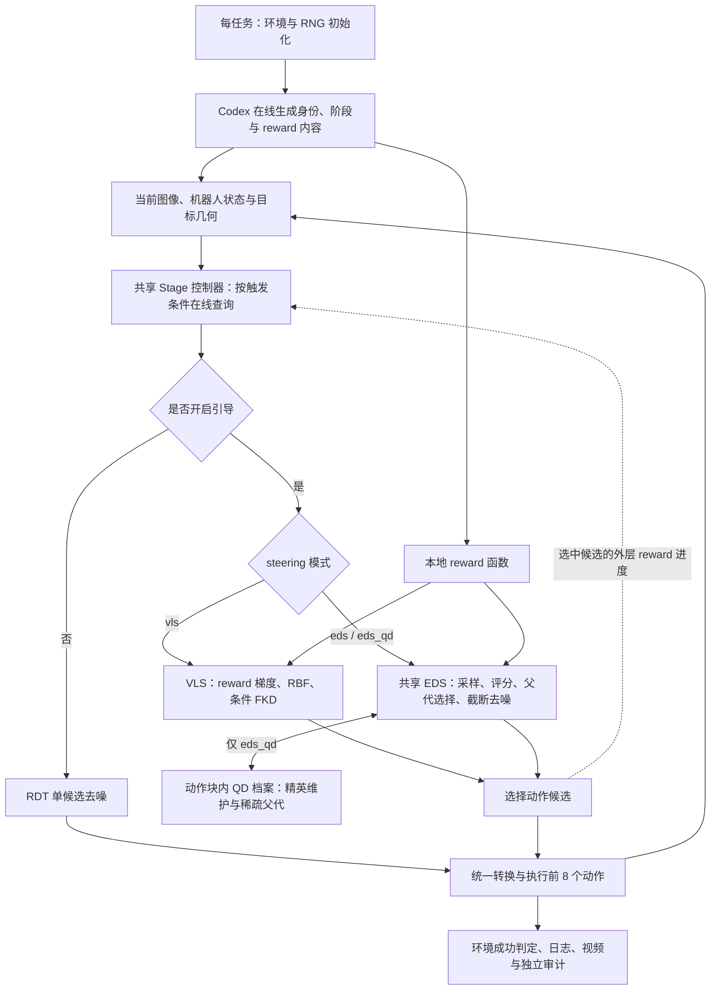

# RDT steering 架构与算法合同

三模式CLI、profile、统一Stage进度与独立机制审计已实现。2026-10-13的low协议在同一冻结runtime完成EDS 3/10、VLS 1/10、EDS+QD 1/10，三组均通过完整v2与机制审计；验收后基础设施修复也通过两环境各1436项CPU测试。下文所引在线机制计数来自这轮low验收，不能当作当前ultra计数。当前默认ultra的独立结果及研发状态见[Research Progress](../research/research_progress.md)，入口见[README](../../README.md)，原low证据见[整合状态](integration-status.md)。

## 共享链路与执行边界

一次动作块的链路是：观测 → Stage 更新与 guidance 开关 → RDT 条件编码 → 候选生成/选择 → 动作转换 → 顺序执行。公共方法只使用 VLS、EDS、EDS+QD 三个名称。内部使用两个采样路由 `guidance_type=vls/eds`，以 `qd_archive_mode` 控制 EDS 的 archive；不需要复制第三套引擎。

每个任务准备阶段在线生成新的身份/阶段描述与reward Python程序，并检查reward合同；必要的修复请求也属于准备阶段。执行中的候选评分随后在本地Torch运行，VLS梯度由本地自动微分计算。EDS每个guided动作块176个候选评分不代表176次API请求；unguided块走单候选路径。

图中为概念流程：环境成功或达到720个执行步时结束；在线Stage查询按触发条件发生，不是每个动作一次。精确prepare/rollout RNG恢复时点以hook合同为准。

| 组件 | 实际职责 |
| --- | --- |
| `scripts/steering_runtime.py`、`run_steering.py`、`steering_worker.py` | 合成科学配置与机器配置；冻结源码/配置；设置导入、CUDA/EGL/Hydra 环境；安装 RNG hooks；启动及审计 |
| `main.py` | episode/动作块执行；每个新动作块前更新 Stage，再采样；记录 raw 与 executed 动作 |
| `core/rdt_policy_steer.py` | 共享 RDT 编码、VLS/EDS、轨迹投影、评分、候选选择和动作缓存 |
| `core/stage/controller.py` | 视觉与 reward 能力判定、接触交接、guidance/reference 生命周期 |
| `core/target_distance_reward.py`、`vlm_query/target_distance/` | 新生成 reward 的数值合同与固定提示词 |
| `core/online/codex.py`、`core/online/capture.py` | 图像/提示词/模型回复捕获，合法事件生命周期及请求元数据 |
| `core/episode_rng_hooks.py` | 在规定的 preparation/rollout 边界恢复初始化 RNG 状态 |

RDT latent 是 `[B,64,128]`，使用当前图像、机器人状态和文本条件。执行只解码前 **8** 个 7D 动作，控制频率 20 Hz；夹爪二值化与动作后处理属于算法语义。多样性/reward 梯度只允许修改这 8 步的平移槽位。当前配置关闭外部抓取动作覆盖。

## EDS：评分与多样性采样

每个 **guided** 动作块重新生成 16 个候选。完整初始去噪并评分后，执行 10 轮“按已有分数选父代 → 重新加噪 → 截断去噪 → 对新候选评分”；每轮复用前一批分数，不重复计算它。未开启 CEM 拟合；配置里的 `cem_iters` 是迭代次数，不能由名称推断启用了 CEM。

| 固定项 | 当前 EDS 设置 |
| --- | --- |
| population / rounds / elites | 16 / 10 / 16；`use_cem=false` |
| 初始采样 | `rbf_diverse_denoise`，`absolute_eef`，scale=20，start ratio=0.8 |
| 每轮截断采样 | `rbf_diverse`，同一 descriptor，scale=20，start ratio=0.6，所有 10 轮 |
| 父代权重 | `legacy_temperature`，temperature=0.1；无覆盖锚点、无精英直通 |
| 噪声深度 | `linspace(3,1,10).astype(int)` = `[3,2,2,2,2,1,1,1,1,1]` |
| 动作块间记忆 | fresh；没有 warm start |
| QD | `none`；metrics observer 只观察 |

checkpoint 的 `noise_scheduler.num_inference_timesteps=5`，当前配置不覆盖它，因此初始去噪是 **5 步**。不要把训练扩散 1000 步、latent 长度 64 或其他 policy 配置的步数当作这里的推理步数。

初始 start ratio=0.8 转成 `timesteps[floor(5×0.8)]`，只在严格大于该 timestep 时施加 RBF，因此当前五步 schedule 的前四步生效。截断采样的 ratio 是另一种判定：某轮长度 n 的前 `ceil(0.6n)` 步生效；不是“等最后 60% 才开始”。

设候选 j 的 reward 为 r_j、cost 为 c_j=-r_j，父代概率为：

\[
w_j=\operatorname{softmax}(0.1r_j)=\operatorname{softmax}(-0.1c_j).
\]

实现先在 float64 算 logits/softmax，再转 float32 并重新归一化。**这里 temperature 是乘数，不是除数。** 父代有放回抽样，随后使用独立 `randn_like` 噪声，在完整 scheduler 的 `timesteps[-n]` 加噪，再走其最后 n 步。不要将之替换成高斯拟合、除温度、固定父代或新的噪声 schedule。

普通 EDS 最终选择第 10 轮当前 population 的最高 reward 候选；没有默认保留所有轮次全局最好候选。初始评分加每轮后评分共有 11 批、176 个候选评分。完整运行的额外 reward 调用、可视化与诊断开销仍应以计算日志为准。

### 实际“RBF”与轨迹投影

`LiberoAdapter.delta_actions_to_ee_trajectory` 使用当前实测末端位置 p_0，将候选平移量线性累计：

\[
p_h=p_0+0.01\sum_{t=0}^{h-1}a_{t,xyz},\quad h=1,\dots,8.
\]

这是可微近似投影，不是对每个候选执行 MuJoCo 环境分支，也不是完整机械臂前向运动学/碰撞/接触预测。代码里的截断 rollout 指截断扩散去噪。真正仿真执行发生在选定候选之后。

将每条轨迹的 p_1…p_8 展平为 z_i，当前 `absolute_eef` 多样性势函数是：

\[
U=\sum_{i\ne j}\frac{1}{\sqrt{\|z_i-z_j\|^2+10^{-6}}+10^{-6}}.
\]

实现对整个 batch 的 `∇latent U` 做全局范数归一化（分母加 10^-8），再遮罩到前 8 步平移槽位，以 `model_output -= 20×masked_gradient` 注入去噪输出。它是逆距离势，不是 Gaussian RBF。EDS 不需要 reward 对动作求梯度，但此多样性项仍使用自动微分；不能把整个 EDS 描述为完全无梯度。

### Reward 的时间片与数值合同

投影产生 p_0…p_8 共 9 点。EDS 评分和 VLS 最终候选/FKD 评分使用 **p_1…p_7**；多样性使用 p_1…p_8；VLS 内部 reward 梯度使用 p_0…p_7。这个切片差别是当前实现，不在接口清理时顺手修正。

Stage 1 为目标距离：对传入的 L 个点，前 `floor(0.7L)` 个点权重 1，其余权重 3，再归一化。单候选：

\[
r=-\sum_{h=0}^{L-1}\bar w_h\|p_h-q\|_2^2.
\]

这里 p 是已经切片的轨迹，q 是指定目标关键点。合同实现先 `norm` 再 `square`，时间权重使用 float32；尤其 bfloat16 下，不可将其改写成另一运算顺序并声称逐值等价。Stage 2 返回常数 0，当前控制器将其视为没有可用引导信号并关闭 guidance。有限探针验证可发现已知公式漂移，不是对生成程序所有输入的数学证明。

## VLS：保留内部梯度参考

VLS 在一个去噪过程的高噪声区间使用多样性项，后续使用reward对轨迹/latent的梯度，并按自适应FKD决定是否重采样。默认20粒子路径按最终候选reward选择；单候选及FKD terminal的直接返回是兼容分支。

内部引导 scale 随内部归一化 reward g 与噪声变化：

\[
s=\frac{\text{guide_scale}}{1+\exp(k(g-x_0))}\sqrt{1-\bar\alpha_t}.
\]

公共 [VLS profile](../../configs/steering/vls.yaml) 显式固定 20 粒子、guide_scale=80，并给十个任务都指定有效值80；diversity_scale=10、k=25、x_0=0.75。FKD 开启，potential=max、lambda=10、adaptive_resampling=true、resample_frequency=5。完整在线验收中368个guided块记录1472次reward梯度与368次RBF应用；FKD的368次评分机会全部因ESS足够而跳过，实际重采样0次。本 RDT 循环读取 `MCMC_steps=4`，但没有据此执行四次 Langevin/MCMC 内循环。不要把其他策略实现或未使用参数计算进预算。

固定checkpoint的五步schedule是 `[999,799,599,400,200]`。默认正常guided块有1次RBF、4次reward梯度尝试；FKD调用3次，frequency=5安排其中1次评分机会。非末步ESS≥10时跳过multinomial，实际重采样0次合法。当前RDT循环排除了terminal timestep的FKD调用，不把兼容terminal分支登记为默认路径已执行。

VLS 与 EDS 的粒子数、重复去噪、reward 梯度、RBF、FKD/父代抽样成本不同。对照同时报告任务成功率、实际 DiT batch rows/calls、reward 调用、梯度次数、延迟和服务调用；默认每个guided块VLS为20×5个DiT batch rows，EDS/QD为16×21；整episode仍需结合guided/unguided块数。telemetry的CPU读取含CUDA同步开销，测得延迟不等同于纯kernel时间。等计算预算比较需另立条件。

## EDS+QD：动作块内的 archive

公共 [EDS+QD profile](../../configs/steering/eds_qd.yaml) 已通过 `guidance_type=eds` + `qd_archive_mode=grid_archive` 激活 archive，共用初始采样、reward 和截断去噪。

当前 profile 采用目标相对末端 XY 描述符、4×4 网格、每格容量 1、初始固定边界、`sparse_priority` 父代分配、稳定 fingerprint tie-break。格权重为 `(累计候选访问数+1)^(-1)`；按权重分配16个槽位，整数余数平手使用局部 RNG，访问数包括未入档候选。共享底座中的 `uniform_cells` 被 QD profile 显式覆盖为 `sparse_priority`；普通 EDS 不使用 archive。边界来自初始候选 5%/95% 分位数，扩张 10%，每轴最小跨度 0.08m，越界 clamp 到边格。每次运行以解析后的配置为准。当前GPU4数值诊断的318组确定性输入与独立CPU审计逐位一致，完整QD cohort的284个guided块均记录active archive、45,440行archive父代和284次archive最终选择；有限诊断不能保证全部GPU输入，具体证据见[整合状态](integration-status.md)。

archive 在一个 guided 动作块中创建，接收初始 population 与 10 轮结果，保留各格高质量候选，并影响父代选择；最终从 archive 选全局最好。它可以保留早期轮次候选，这和普通 EDS 的最终 population 选择不同。当前 fresh 模式下，每个新动作块重新开始；没有跨任务 archive、在线模型训练或递归自我改进。

`qd_metrics_observer=true` 可以在普通 EDS 中产生 shadow 指标，**不证明 archive 已参与搜索**。验收需同时证明 active flag、176 次评价/11 批评分、cell 更新、父代来源和最终选择一致。离线重建记录能核对机制日志；若没有实际父代 tensor 证据，就不能额外宣称已证明执行时 tensor 重采样。未来 QD 优化与长期记忆应分开命名配置和验收。

## Stage 进度与接触门控

Stage 在新动作块采样前读取上一 guided 块的 reward 进度。当前 EDS 已记录最终选中候选 r，首个有效 selected reward 为 reference r_0：

\[
g=\operatorname{clip}(1-r/r_0,0,1.2)\text{，若 }r_0<-10^{-6};\quad g=0\text{ otherwise}.
\]

它参与接触交接：fresh guided progress≥0.8、实测目标距离≤0.10m、接近至少16步，可开启64步 contact grace。单独 proximity 触发当前关闭。不能因为某个视觉事件字段写着 reward 未用于基础视觉判定，就断言整个在线控制器不消费 reward。

语义 Stage 改变会重建 reference；同 Stage 的 guidance 关闭/恢复保留 reference。先前 unguided 块不应把陈旧进度重新送入交接。接触、携带、释放与失败接触复查共同控制 guidance；最终成功以环境结果为准，不由 reward 高或视觉回复直接替代。

视觉查询最小间隔16步、常规复查32步、最多50次；完成证据需要间隔至少16步的两次明确视觉判断。unknown/遮挡不自动等于成功。失败接触恢复结合可见的篮外支撑/未持物证据与实测夹爪状态，不覆盖策略动作。

### 已实现的统一外层接口

策略提供纯读取 `get_stage_reward()`，`core.stage.controller.update_stage` 优先使用它。EDS 分支直接返回已有进度，不重新评分、写 reference 或调用 RNG；接口的实际行为仍须结合回归与新公共版本在线验收判断。

VLS 建立独立的**最终选中候选** score/reference，argmax 路径复用已有最终评分；单候选/FKD terminal 直接返回路径补一次所选候选评分并计入计算量。内部梯度 reward/reference 与 scale 计算保持独立。无法评分时外层进度为不可用，不回退到内部梯度 reward。`get_last_vls_metrics()` 返回实际梯度状态、FKD 重采样/ESS skip、选择与外层进度的缓存记录；记录能力不等于所有在线分支已验收。

Stage 继续为 EDS 使用可评分能力检查，只为 VLS 增加确定性 CPU 梯度探针，并恢复检查前 RNG 状态。探针要求有限、连通，且至少一个非最优探针在可控p1…p7上有非零梯度；p0是固定当前状态，仅p0有梯度不足以引导。最优点的零梯度合法。detached、round 等无法提供有效梯度的 reward 可以被 VLS 禁用，同时仍允许 EDS 按分数搜索。受控CPU before/after回归使用独立冻结reference；全套CPU和设备/数值预检已完成，在线cohort进度单独记录。

## 感知、初始化与证据限制

当前系统依赖仿真提供的机器人/末端状态、目标/关键点跟踪与几何测量，且 Stage 图像包含投影标记。它不是仅凭原始 RGB 的零真值部署方案，也没有在真实机器人上验证。几何近似 reward 不表达完整抓持、碰撞、支撑或放置稳定性。

20 个 RNG 状态文件只定义 10 个任务 preparation 与 rollout 两个时点的 Python/NumPy/Torch 初始化；不包含历史动作、reward、模型回复或环境回放。SHA 校验确认文件身份，运行 hook 才确认生效时点。普通固定 seed 不能直接替换该协议。

基础 run 审计核对 cohort 完整性与机制字段；细粒度的 prompt/image/code/marker/transport/动作一致性审计和独立 QD 日志重建已接入 `scripts/audit_steering_contract.py`、`scripts/steering_transport_audit.py` 与 `scripts/audit_qd_mechanism.py`。测试可使用裁剪的真实捕获 fixture，但合成的结束 receipt 只是测试输入，不能作为在线任务成绩。日志中的请求模型标记、CPU合同探针和视频各有证明范围。fresh表示本程序发送当前任务/观测的新请求并保留捕获，不使用本地回复回放；provider报告的cached_input_tokens可非零，它记录服务端输入前缀计费，不能据此推断本地回复重放或声称服务端缓存已关闭。

## 公共配置与证据布局

公共 launcher 合并 [共享协议](../../configs/evaluation/libero_object_swap.yaml)、[方法 profile](../../configs/steering) 与机器配置，默认十个任务，`--tasks` 只产生子集。`--print-config` 是配置预览，不验证模型内容、GPU 或服务。真实启动前必须通过固定 LIBERO、RNG 与 [模型清单](../../scripts/steering_model_assets_manifest.json) 的校验，确认加载选择。`VLA_LIBERO_ROOT`绑定实际源码树，LIBERO路径配置四项绑定也必须匹配该已验树，保存到环境记录的 `libero_paths`；随后冻结配置、源码和环境记录。

新运行将公共计算/Stage/方法指标放在 `output/evaluation/`，具体路径写入 `manifest.json`。`eds` 和 `eds_qd` 共用搜索引擎，VLS 使用自己的实际机制日志；不能因为保存目录或日志字段含某个引擎名称就认定运行的方法。以 profile、实际分支、父代/最终选择来源和保存记录共同判断。

离线合同审计不重新执行保存的 reward 代码或模型回复，也不独立重演模拟器。动作证据证明后处理命令向 adapter 的传递；模拟器内部控制缩放属于另一个边界。QD 的 candidate stream 可重建记录的 archive 更新，父代 tensor 校验只覆盖实际保存的迭代，不能推广到未记录路径。完整有效 cohort、机制正确和任务成功分别报告。

运行目录、有效性口径与验收后接入的生命周期/归档功能统一见[运行与审计](evaluation.md)。

## π0.5 + VLS adapter

π0.5 uses the same `Main`, LIBERO adapter, online Codex clients and Stage/reward controller, with `core/pi05_steer.py` providing flow-matching action generation. Its public checkpoint contains the vision/language and action-expert weights; the checkpoint's pre/postprocessors supply state and action normalization, and a separately fixed local PaliGemma tokenizer supplies language inputs.

The π0.5 runner binds standard `libero_object`, ten flow steps, twenty particles and ten executed actions per block. It uses the existing gradient-reward normalization for Stage feedback, rather than RDT's selected-candidate reward computation. The diversity term follows its existing trajectory-distance repulsion; the legacy MCMC argument does not execute MCMC. FKD scores actual integer Euler steps and sorts terminal particles before candidate 0 is executed. Padded latent dimensions are removed before robot-action normalization.

This adapter is not an EDS or QD implementation. Its separate [protocol and evidence](pi05-evaluation.md) must not be interpreted as a controlled comparison against RDT ObjectSwap results. Shared controller changes require RDT regressions; π0.5-only model/normalizer corrections do not redefine the accepted RDT parameters.
