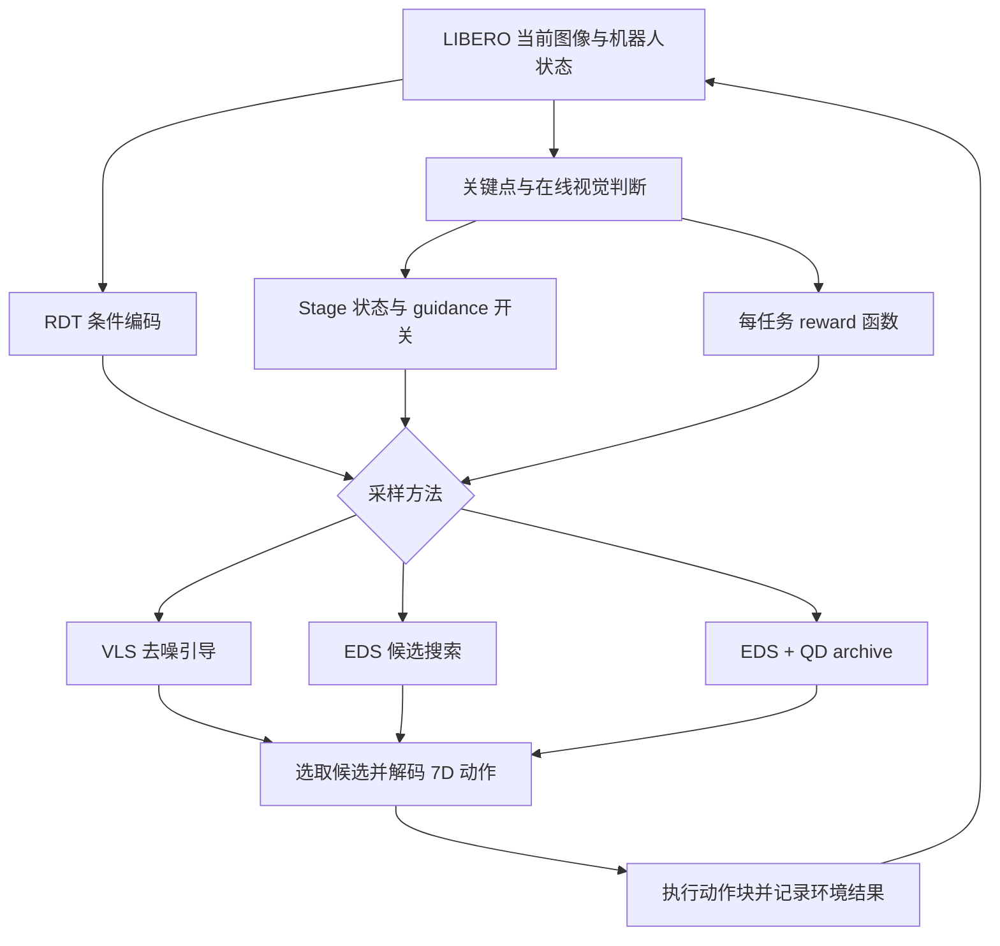

# RDT steering 架构与机制

本文说明整合目标与已有算法合同。当前迁移、测试和在线验收进度以 [整合状态](integration-status.md) 为准；本文不声明新版本已经取得历史成绩。

## 共享执行链

目标方法为 `vls`、`eds`、`eds_qd`。**当前公共 launcher 只开放 `eds`**；另外两种方法在 EDS 十任务验收后接入。下图说明整合目标，不代表三个入口已经发布。方法共享环境观测、RDT 条件编码、动作转换、Stage 与日志接口。

当前 `scripts/run_steering.py` 与 `scripts/evaluate_steering.py` 使用同一 launcher。它从 `configs/evaluation/libero_object_swap.yaml` 加载科学设置，从 `--local-config` 读取机器路径与 GPU/EGL 编号，写入新的运行目录并冻结配置和源码。两个入口默认均为十任务，`--tasks` 才限定任务子集；`--print-config` 只解析配置。资产准备、显式模型/GPU 预检与实际 cohort 是三个独立步骤。

资产脚本负责验证固定 LIBERO 文件和初始化 fixture，并生成当前 clone 的路径配置。设备编号是机器配置，不是算法参数：CUDA 可用与 EGL 渲染可用需要分别检查，二者的物理 GPU 对应关系还需单独实证，不能仅由编号或一次成功渲染推断。

RDT 使用 raw agentview/wrist 图像、7 个关节位置、2 个夹爪 qpos 和任务文本。历史 LIBERO 路径将机器人状态写入 128 维表示的槽位 `[0..6, 10, 11]`。模型输出形状为 `[B, 64, 128]`，动作解码读取槽位 `[39..44, 10]`，得到平移、旋转和二值夹爪命令。多候选粒子共享一次当前观测；候选数不是环境观测重复次数。

V17 使用动作块长度 8、控制频率 20 Hz。引导作用于执行块内的平移槽位，最终仍由策略输出解码动作。外部抓取动作覆盖在该基线中关闭。任何更改槽位、图像方向、夹爪符号或动作块长度的修改都应单独验证，不能当作无行为变化的清理。

## VLS

VLS 直接在 RDT 的去噪过程中修改模型输出。初始高噪声区间可加入候选轨迹之间的多样性作用，后续区间计算关键点 reward 对轨迹的梯度，映射回允许修改的动作平移槽位。引导强度结合 reward 进度与当前噪声量缩放。

启用 FKD 时，对候选的 reward 势函数进行粒子重采样；最终按对应选择规则取出动作候选。是否启用 diversity、FKD、Stage 与具体强度均属于方法设置，不能仅凭 `vls` 名称推断。

代码历史名称中出现 `RBF`，但现有共享的 absolute-EEF 多样性实现使用候选三维轨迹的逆距离势函数，不应写成未经实现核验的 Gaussian kernel。VLS 的 reward 梯度与多样性梯度也应分别说明。

## EDS

EDS 在动作候选空间迭代搜索：先得到候选动作轨迹，按当前阶段 reward 评分，再选父代、重新加噪、执行截断去噪，形成下一轮候选。最后选出高 reward 的候选用于执行。reward 在这里参与评分和选择；EDS 不等同于把 VLS 的 reward 梯度重复迭代。

V17 保留的 EDS 设置为：

| 参数 | 设置 |
| --- | --- |
| population / iterations / elites | 16 / 10 / 16 |
| CEM | 关闭 |
| temperature | 0.1，含义以实现的父代权重计算为准 |
| 重新加噪深度 | 3 → 1 |
| 初始采样 | `rbf_diverse_denoise`，absolute EEF，scale 20，start ratio 0.8 |
| 截断去噪 | `rbf_diverse`，absolute EEF，scale 20，start ratio 0.6 |
| QD archive | `none` |
| 指标观察 | 开启，但不改变 archive/选择行为 |

初始和迭代去噪中的多样性作用仍需要轨迹梯度，因此不能把整个 EDS 实现描述为“完全不用梯度”。与 VLS 的区别在于 reward 如何进入搜索，而不是是否存在任何自动微分。

Stage2 的 reward 为常数 0，缺乏有效搜索信号，该阶段关闭 ED，交给原生策略继续动作。对于 guidance 开关、无效 reward、数值错误和回退，应记录实际发生的机制，不能只根据顶层配置声称整个回合都在使用 EDS。

## EDS + QD

QD archive 将候选按照行为描述符分入单元，并在单元内保留质量较好的轨迹；父代和候选选择可使用这些保留项，以维持搜索覆盖。描述符、网格边界、质量比较、archive 生命周期和回退策略共同定义具体方法。

已有实现包含目标相对末端 XY 描述符，也包含其他实验描述符和选择变体。`eds_qd` 尚未开放到新入口；接入时，其实际描述符与参数必须写入解析后配置和运行记录，不能把不同变体合为一个成绩。

`metrics_observer=true` 只记录指标；只有启用并实际使用 archive 的路径才属于 QD 搜索。V17 的历史 3/10 来自 archive 关闭的 EDS，不能作为 `eds_qd` 的成绩或 QD 优势证据。整合时应先验证 QD 的行为开关，再用相同环境条件的独立完整 cohort 检查性能。

## 在线 reward 与 Stage

V17 每任务新生成身份描述、reward 和阶段描述。数值 reward 随控制过程在本地计算，不是每个 reward 值都向模型请求。`c0_xyz_v1` 合同要求 Stage1 为轨迹到目标的加权负 XYZ MSE，后 30% 轨迹点权重更高；Stage2 返回常数 0。

reward reference 仅在语义 Stage 改变时重建。同阶段关闭再开启 guidance 保持原 reference，否则归一化进度会被人为改变，进而影响交接与恢复。

Stage 查询同时使用间隔控制和事件信号：最小间隔 16 步，常规复查 32 步，不确定时 16 步，每任务最多 50 次。视觉完成需要两次相隔至少 16 步的明确证据：目标可见、受支撑、未被抓持且已在篮内。遮挡或 unknown 不足以宣告完成。

控制器还使用携带证据和失败接触复查。V17 的新增恢复规则需要一次明确篮外受支撑且未抓持的视觉证据与实测空闭夹爪，随后在有效时间窗内出现新的篮外支撑证据、充分张开夹爪与 OPEN 命令；在没有当前携带证据时恢复 ED。规则不改写原始视觉判断，不直接宣告任务成功，也不覆盖原生动作。

目标标记利用跟踪关键点和相机几何；这是额外感知条件，评测必须披露。历史固定标记还存在遮挡目标文字/篮沿的案例，不能默认它总是帮助识别。

## 初始化与运行证据

V17 的 `historical_fixture_v1` 只在规定的 prepare/rollout 时点恢复 Python、NumPy、Torch 的 RNG 状态。它不回放历史环境、动作、reward 或模型回复。[仓库 fixture](../../tests/fixtures/steering_rng/README.md) 中的 manifest、20 个状态文件及其哈希共同定义初始化协议。普通固定 seed 不能自动替代该协议。`verify-rng` 只检查文件身份，运行时 hooks 才验证恢复时点与状态。

可比较的运行应同时保存解析后配置、源码身份、资产与 fixture 哈希、每任务结果、实际机制日志和在线调用记录。模型调用成功、Stage 语义正确和环境任务成功分别统计。历史报告证明的是来源设置下的一轮完整结果，新目录中的代码需要自己的验证记录。

## 已知限制

- reward 近似几何接近程度，并不完整表达接触、抓持稳定性、支撑和长期放置。
- 接触恢复可提前重新开启 EDS，但历史上部分触发仍失败，不能把触发次数当收益。
- Stage 历史与 reward reference 的耦合会改变交接时机；相同 raw reward 可能得到不同的归一化进度。
- 释放后目标仍在篮外且视觉持续不确定时，可能长期停留在 Stage2/ED off。
- 模型服务可用不保证每个视觉判断正确；在线结果也不保证逐字或逐动作重现。
- 固定十任务已经用于开发。一次完整 cohort 只能支持该设置与该任务集的观测，不等同于独立泛化或统计稳健性结论。
