# RDT Fine-tuning on LIBERO Benchmark

[中文版](./README_zh.md)

---

**Based on:** [Robotics Diffusion Transformer (RDT)](https://github.com/thu-ml/RoboticsDiffusionTransformer)  
**Organization:** PKU & Psibot Lab  
**Duration:** 2025  
**Role:** Research Intern

---

## Overview

This project implements supervised fine-tuning of **Robotics Diffusion Transformer (RDT)** on the **LIBERO** benchmark for language-conditioned robot manipulation. The work compares full-parameter fine-tuning versus LoRA (Low-Rank Adaptation), analyzes failure modes, and profiles inference performance bottlenecks.

**Summary:** Implemented complete pipeline for RDT fine-tuning on LIBERO including HDF5 data parsing, SigLIP image normalization, T5-XXL language embedding cache (~30% speedup), DeepSpeed distributed training, and batch checkpoint evaluation tools. Found LoRA ceiling at ~20% success far below full-parameter 76%+; inference takes 375ms/step (69% of eval time); diffusion steps and action chunk length significantly impact success rate.

**Key Contributions:**

1. Complete data preprocessing pipeline for LIBERO HDF5 format → RDT input
2. Full-parameter and LoRA fine-tuning implementations with DeepSpeed distributed training
3. Evaluation infrastructure with profiling and batch checkpoint analysis
4. Systematic comparison revealing LoRA performance ceiling (~20% vs 76%+ for full fine-tuning)
5. Inference profiling identifying 375ms/step bottleneck (69% of evaluation time)

---

## Technical Stack

| Component | Version/Framework |
|-----------|------------------|
| **Deep Learning** | PyTorch 2.1.0 + CUDA 12.1 |
| **Distributed Training** | DeepSpeed 0.14.2 (ZeRO-2) |
| **Parameter-Efficient FT** | peft 0.10.0 (LoRA) |
| **Vision Encoder** | SigLIP-SO400M (google/siglip-so400m-patch14-384) |
| **Language Encoder** | T5-XXL (google/t5-v1_1-xxl) |
| **Mixed Precision** | BF16 |
| **Benchmark** | LIBERO (5 task suites: libero_10, libero_90, libero_spatial, libero_object, libero_goal) |
| **Python** | 3.10.0 |

---

## What I Did

### 1. Data Preprocessing Pipeline

**Challenge:** LIBERO uses 128×128 images; RDT expects 336×336 SigLIP input. State/action spaces differ from pretraining data.

**Implementation:**

- **Image Preprocessing:**
  - Pad 128×128 RGB images to 336×336 (SigLIP standard)
  - Normalize to SigLIP mean/std: `mean=[0.5, 0.5, 0.5], std=[0.5, 0.5, 0.5]`
  - Data augmentation: random horizontal flips, color jitter

- **State-Action Mapping:**
  - Configured `UNI_STATE_INDICES` for LIBERO-specific mapping
  - State: 7 joint angles `[0,7)` + 2D gripper travel `[10,12)` (normalized to [0,1])
  - Action: 6D EEF delta `[39,45)` (x,y,z position + roll,pitch,yaw) + gripper command `[10]`

- **Language Embedding Cache:**
  - Precompute T5-XXL embeddings for all task instructions
  - Cache to disk to avoid redundant encoding
  - Result: ~30% training speedup

**Key Code:** `train/dataset_sft.py` - HDF5VLADataset and VLAConsumerDataset classes

---

### 2. Full-Parameter Fine-tuning

**Training Script:** `finetune_sft.sh` → `main_sft.py`

**Configuration:**
```bash
# Core hyperparameters
TRAIN_BATCH_SIZE=48              # Per-GPU batch size
LEARNING_RATE=1e-4               # Constant learning rate
MAX_TRAIN_STEPS=200000           # Maximum training steps
CHECKPOINTING_PERIOD=1000        # Save every 1000 steps
SAMPLE_PERIOD=500                # Validation sampling interval
STATE_NOISE_SNR=40               # State noise for data augmentation
```

**DeepSpeed Configuration:**
- ZeRO-2 optimizer state partitioning
- BF16 mixed precision training
- Gradient accumulation for large batch sizes
- Config file: `configs/zero2.json`

**Features:**
- Automatic experiment directory generation: `checkpoints/RDT-1B-Full-{dataset}-from_{base_model}-{timestamp}`
- Full config snapshot saved to `training_config.txt`
- Resume training from checkpoint with `--resume_from_checkpoint`
- WandB integration for experiment tracking

---

### 3. LoRA Fine-tuning

**Training Script:** `finetune_lora_sft.sh`

**LoRA Configuration:**
- Tested ranks: 8, 16, 32
- Target modules: Various configurations (`all`, `adaptor_only`, `cross_attn`, etc.)
- Alpha scaling factor: typically 16-32
- Dropout: 0.05-0.1

**Key Finding:** LoRA achieved maximum ~20% success rate across all tested configurations, significantly underperforming full-parameter fine-tuning (76%-94%).

---

### 4. Evaluation Infrastructure

**Evaluation Script:** `libero_eval/libero_rdt_eval.py`

**Implementation:**
- Load checkpoint and initialize LIBERO environment
- Run N trials per task (typically 5 trials/task)
- Compute per-task and overall success rates
- Output CSV with per-episode results
- Save video recordings for failure analysis

**Profiling:**
- Per-step timing breakdown: model inference vs environment stepping
- Identified bottleneck: 375ms inference time (69% of total evaluation time)

**Batch Evaluation:**
- `eval_full_checkpoints_auto.sh`: Evaluate multiple checkpoints automatically
- Aggregate results across training steps to identify best checkpoint

---

## Experimental Results

### Success Rates by Task Suite

Evaluation protocol: 5 trials per task, using fine-tuned checkpoints.

| Task Suite | Success Rate | Checkpoint | Fine-tuning Method | Notes |
|------------|--------------|------------|-------------------|-------|
| **libero_object** | **92%** (46/50) | checkpoint-40000 | Full-parameter | Best performing with H=8, N=10 |
| **libero_goal** | **94%** (47/50) | checkpoint-30000 | Full-parameter | Highest success rate achieved |
| **libero_spatial** | **76%** (38/50) | checkpoint-22000 | Full-parameter | Spatial reasoning challenges |
| **libero_long** | **38%** (19/50) | checkpoint-38000 | Full-parameter | Long-horizon task difficulty |

*Note: Evaluation conducted between December 2025 - January 2026*

**Per-Task Breakdown Example (libero_object):**

| Task ID | Success Rate | Description |
|---------|--------------|-------------|
| Task 0 | 100% (5/5) | Simple pick-and-place |
| Task 1 | 80% (4/5) | Object manipulation |
| Task 2 | 100% (5/5) | Drawer opening |
| Task 6 | 100% (5/5) | Multi-step manipulation |
| Task 7 | 100% (5/5) | Placement task |
| Task 8 | 100% (5/5) | Complex manipulation |
| ... | ... | ... |

---

### Full-Parameter vs LoRA Comparison

| Method | Success Rate | Notes |
|--------|--------------|-------|
| **Full-Parameter** | **76% - 94%** (task-dependent) | All model parameters updated |
| **LoRA (rank 8-32)** | **~20%** (upper bound) | Low-rank adaptation insufficient |

**Critical Finding:** LoRA fine-tuning achieved only ~20% success rate maximum across tested configurations (rank 8-32, various target modules), representing a 56-74 percentage point gap compared to full-parameter fine-tuning.

**Hypothesis for LoRA Underperformance:**
- Low-rank constraint limits capacity to adapt diffusion decoder for LIBERO action distribution
- Diffusion transformers may require different adaptation strategies than autoregressive LLMs
- Tested ranks (8-32) insufficient for high-dimensional 6D EEF + gripper control

---

### Performance Profiling

**Inference Latency Breakdown (A100 GPU):**

| Component | Time (ms) | Percentage | Notes |
|-----------|-----------|------------|-------|
| **Model Inference** | **~375 ms** | **~69%** | Forward pass + diffusion sampling (H=8 steps) |
| Environment Stepping | ~170 ms | ~31% | LIBERO physics simulation |
| **Total per Step** | **~545 ms** | **100%** | Effective throughput: ~2 steps/second |

**Impact:** Evaluating one checkpoint across 10 tasks × 5 trials × 200 steps/episode = 10,000 steps takes approximately 1.5 hours.

**Bottleneck:** Diffusion sampling requires 8 forward passes (H=8), each invoking SigLIP visual encoding and transformer denoising.

---

### Hyperparameter Ablation

**Diffusion Steps (H) vs Success Rate (libero_object):**

| Diffusion Steps (H) | Success Rate | Notes |
|---------------------|--------------|-------|
| H=1 | 78% | Fast sampling but lower quality |
| H=8 | 88% | Good balance (+10pp improvement) |

**Action Chunk Length (N) vs Success Rate (libero_object):**

| Action Chunk (N) | Success Rate | Notes |
|------------------|--------------|-------|
| N=1 | 78% | Per-step inference |
| N=10 | 90% | Chunk-based control (+12pp improvement) |

**Finding:** Increasing H from 1 to 8 and N from 1 to 10 improved success rate from 78% → 92% on libero_object.

---

## System Architecture

### Data Flow

```mermaid
graph TD
    A[LIBERO HDF5 Dataset] --> B[HDF5VLADataset]
    B --> C[Image Padding<br/>128×128 → 336×336]
    B --> D[State Remapping<br/>7 joints + 2 gripper]
    B --> E[T5-XXL Language Encoder<br/>Cached Embeddings]
    
    C --> F[RDT Model]
    D --> F
    E --> F
    
    F --> G[SigLIP Visual Encoder]
    F --> H[Diffusion Transformer]
    H --> I[Action Decoder<br/>6D EEF + Gripper]
    
    I --> J[LIBERO Environment]
    J --> K[Success Detection]
    
    L[DeepSpeed ZeRO-2] --> F
```



### Key Modules

| Module | Function | Implementation |
|--------|----------|----------------|
| **HDF5VLADataset** | Parse LIBERO HDF5 files | `train/dataset_sft.py` |
| **Image Preprocessing** | Pad and normalize images | Data augmentation pipeline |
| **State Adaptor** | Map LIBERO state to RDT indices | `UNI_STATE_INDICES` configuration |
| **Language Cache** | Precompute T5 embeddings | Disk caching system |
| **Training Loop** | DeepSpeed distributed training | `main_sft.py` |
| **Evaluation** | LIBERO environment interaction | `libero_eval/libero_rdt_eval.py` |
| **Profiler** | Timing breakdown | Inference vs environment stepping |

---

## Installation

### Prerequisites

- Ubuntu 20.04/22.04 (Linux x86_64)
- CUDA 12.1+
- Conda or virtualenv
- Multiple GPUs recommended (tested with 7x A100)

### Environment Setup

**1. Clone repository with submodules:**
```bash
git clone --recursive https://github.com/chentingjia/Libero_RDT.git
cd Libero_RDT
```

**Or if already cloned, initialize submodules:**
```bash
git submodule update --init --recursive
```

**Note:** The `LIBERO` directory is a git submodule pointing to the [LIBERO benchmark framework](https://github.com/Lifelong-Robot-Learning/LIBERO). It provides simulation environments and task definitions.

**2. Create conda environment:**
```bash
cd RDT_libero_finetune
conda env create -f environment.yml
conda activate rdt
```

**3. Install Python dependencies:**
```bash
pip install -r requirements.txt
```

**Key Dependencies:**
- PyTorch 2.1.0 with CUDA 12.1
- DeepSpeed 0.14.2
- Transformers 4.38.2
- peft 0.10.0 (LoRA)
- diffusers 0.26.3
- h5py 3.11.0 (HDF5 data loading)

---

## Usage

### Training

**Full-Parameter Fine-tuning (Recommended):**

```bash
bash finetune_sft.sh
```

**Before running, edit configuration in `finetune_sft.sh`:**

```bash
# Dataset selection
dataset_name="libero_10"       # Options: libero_10, libero_spatial, libero_object, libero_goal

# Model configuration
BASE_MODEL_PATH="./checkpoints/rdt-finetune-1b-20251119_122234/checkpoint-65000"

# Training hyperparameters
TRAIN_BATCH_SIZE=48            # Adjust based on GPU memory
LEARNING_RATE=1e-4
MAX_TRAIN_STEPS=200000
```

**Resume from Checkpoint:**

Uncomment and set `RESUME_CHECKPOINT` in `finetune_sft.sh`:
```bash
RESUME_CHECKPOINT="./checkpoints/RDT-1B-Full-libero_10-from_libero90-ckpt65k-20251208_143022/checkpoint-5000"
```

---

**LoRA Fine-tuning (Parameter-Efficient):**

```bash
bash finetune_lora_sft.sh
```

Configure LoRA-specific parameters:
```bash
LORA_RANK=32                   # Rank of LoRA matrices (tested: 8, 16, 32)
LORA_ALPHA=32                  # Scaling factor
LORA_TARGET_MODULES="all"      # Target modules for adaptation
```

---

### Evaluation

**Evaluate Single Checkpoint:**

```bash
cd libero_eval
python libero_rdt_eval.py \
    --checkpoint ../checkpoints/RDT-1B-Full-libero_object-from_libero90-ckpt65k-20251215_100530/checkpoint-40000 \
    --task_suite libero_object \
    --num_trials 5
```

**Batch Evaluate Multiple Checkpoints:**

```bash
bash eval_full_checkpoints_auto.sh
```

This automatically evaluates all checkpoints in an experiment directory and aggregates results.

---

## Project Structure

```
RDT_libero_finetune/
├── main_sft.py                    # Main training script
├── finetune_sft.sh                # Full-parameter fine-tuning launcher
├── finetune_lora_sft.sh           # LoRA fine-tuning launcher
├── configs/
│   └── zero2.json                 # DeepSpeed ZeRO-2 configuration
├── train/
│   ├── dataset_sft.py             # LIBERO HDF5 dataset loader
│   └── train_sft.py               # Training loop logic
├── models/
│   ├── rdt/
│   │   ├── model.py               # RDT model architecture
│   │   └── blocks.py              # Transformer blocks
│   └── multimodal_encoder/
│       ├── siglip_encoder.py      # SigLIP vision encoder
│       └── t5_encoder.py          # T5 language encoder
├── libero_eval/
│   ├── libero_rdt_eval.py         # Evaluation script with profiling
│   └── eval_full_checkpoints_auto.sh  # Batch evaluation
├── scripts/
│   ├── encode_lang_libero.py      # Precompute language embeddings
│   └── inspect_libero_hdf5.py     # HDF5 data inspection tool
├── data/
│   └── datasets/                  # LIBERO HDF5 files (not included)
├── checkpoints/                   # Model checkpoints (generated during training)
├── requirements.txt               # Python dependencies
└── environment.yml                # Conda environment specification
```

---

## Key Technical Challenges

### 1. Asynchronous Callback → Synchronous Publishing

**Problem:** LIBERO HDF5 format has different image sizes (128×128) than RDT pretraining (336×336). Direct resizing introduces aspect ratio distortion.

**Solution:** Pad images to 336×336 with zero padding to maintain aspect ratio, then apply SigLIP normalization.

**Code Location:** `train/dataset_sft.py` - image preprocessing pipeline

---

### 2. State-Action Space Heterogeneity

**Problem:** LIBERO uses 7-DoF joint angles + 2D gripper travel, while RDT pretraining uses unified 50-dimensional state/action space with different indexing.

**Solution:** Configured `UNI_STATE_INDICES` mapping:
- State indices: `[0,7)` for joints, `[10,12)` for gripper
- Action indices: `[39,45)` for 6D EEF delta, `[10]` for gripper command
- Normalized gripper travel to [0,1] via min/max scaling

**Trade-off:** Manual index mapping required for each new benchmark; not automatically generalized.

---

### 3. Language Embedding Redundancy

**Problem:** T5-XXL encoding is computationally expensive. Encoding identical instructions (e.g., "pick up the red block") on every training iteration wastes compute.

**Solution:** Precompute and cache T5-XXL embeddings for all unique task instructions to disk before training.

**Implementation:**
- Script: `scripts/encode_lang_libero.py`
- Cache format: Pickled dictionary mapping instruction text → embedding tensor
- Speedup: ~30% reduction in training time

---

### 4. LoRA Performance Ceiling

**Problem:** LoRA fine-tuning achieved only ~20% success rate despite testing multiple ranks (8, 16, 32) and target module configurations.

**Root Cause Analysis:**
- Low-rank constraint (rank ≤ 32) may be insufficient for adapting diffusion decoder to LIBERO action distribution
- 6D EEF control + gripper requires high-dimensional action manifold learning
- LoRA designed for autoregressive transformers (LLMs); may not capture diffusion denoising dynamics effectively

**Open Question:** Does scaling LoRA rank to 64, 128, 256 close the gap, or is full fine-tuning of specific modules (decoder, adaptor) necessary?

---

### 5. Inference Bottleneck

**Problem:** Single-step model inference takes ~375 ms on A100 GPU, dominating evaluation time (69%).

**Bottleneck Breakdown:**
1. **Diffusion sampling:** H=8 denoising iterations, each requiring full transformer forward pass
2. **Multi-view encoding:** SigLIP processes 2 camera views (cam_high, cam_left_wrist) per step
3. **Transformer overhead:** Large model size with attention operations

**Impact:** Full task suite evaluation (10 tasks × 5 trials) takes ~2.5 hours per checkpoint.

**Profiling Method:** Added timing instrumentation in evaluation script to measure inference vs environment stepping separately.

---

## Failure Mode Analysis

Based on systematic debugging across LIBERO task suites:

### 1. Language Grounding Ambiguity

**Symptom:** Task 8 ("place block next to the plate") achieved 0% success (libero_spatial suite).

**Root Cause:** Both source object ("block") and target reference ("plate") mentioned in instruction. Policy confused about which "plate" to interact with when multiple plate-like objects present in scene.

**Diagnosis:** Requires more demonstrations to disambiguate spatial relationships and object references.

---

### 2. Spatial Relationship Confusion

**Symptom:** Policy places object "on" target instead of "next to" target (common error in libero_spatial).

**Root Cause:** Insufficient training data for spatial preposition grounding ("next to", "between", "above").

**Analysis:** Spatial relationship understanding requires:
- More diverse demonstrations with spatial variations
- Explicit spatial reasoning auxiliary loss
- Augmentation preserving spatial relationships

---

### 3. Long-Horizon Credit Assignment

**Symptom:** libero_long tasks achieve only 38% success. First 3-4 subtasks often succeed, but final subtask fails.

**Root Cause:** Diffusion model optimizes per-timestep loss without explicit long-term goal tracking. Errors accumulate across subtasks.

**Implication:** Long-horizon tasks (5+ subtasks) require hierarchical planning or goal-conditioned RL, not just imitation learning.

---

### 4. Single-Demo Overfitting

**Symptom:** Training on single demonstration (`demo_0`) causes rapid overfitting:
- Training loss converges after 1000+ epochs
- Validation success rate plateaus at ~20%
- Policy memorizes specific pixel patterns without learning generalizable task semantics

**Solution:** Requires full demonstration set (typically 50-100 demos per task).

---

## Known Limitations

1. **Manual State-Action Mapping:** Requires manual `UNI_STATE_INDICES` configuration for each new benchmark
2. **Multicast Mode Only:** Connection hardcoded to multicast (no unicast support yet)
3. **High Inference Latency:** 375ms per step limits real-time robot control applications
4. **LoRA Underperformance:** ~20% success rate far below full fine-tuning (76%+)
5. **Long-Horizon Weakness:** 38% success on libero_long reveals credit assignment limitations
6. **Spatial Reasoning Gap:** 76% on libero_spatial vs. 92-94% on object/goal tasks

---

## Configuration Files

### Training Hyperparameters

**From `finetune_sft.sh`:**
```bash
TRAIN_BATCH_SIZE=48
SAMPLE_BATCH_SIZE=32
LEARNING_RATE=1e-4
LR_SCHEDULER="constant"
MAX_TRAIN_STEPS=200000
CHECKPOINTING_PERIOD=1000
SAMPLE_PERIOD=500
STATE_NOISE_SNR=40
DATALOADER_NUM_WORKERS=8
CHECKPOINTS_TOTAL_LIMIT=40
```

### DeepSpeed ZeRO-2 Configuration

**From `configs/zero2.json`:**
- Optimizer state partitioning across GPUs
- BF16 mixed precision training
- Gradient accumulation
- Optimized communication overlap

---

## Reproducibility Notes

### Deterministic Seeding

Random seed set to 42 in training scripts for reproducibility:
```bash
seed=42
```

**Note:** Full determinism not guaranteed on GPU due to non-deterministic CUDA operations.

---

### Dataset Requirements

**LIBERO Dataset:**
- Download from [LIBERO official website](https://lifelong-robot-learning.github.io/LIBERO/)
- Place HDF5 files in `data/datasets/{task_suite}/`
- Expected format: Multi-view images (128×128), robot states (9D), actions (7D), language instructions

---

### Checkpoint Management

**Automatic Checkpointing:**
- Saves every 1000 steps (configurable via `CHECKPOINTING_PERIOD`)
- Keeps last 40 checkpoints (older checkpoints auto-deleted)
- Checkpoint naming: `checkpoint-{step_number}`

**Directory Structure:**
```
checkpoints/RDT-1B-Full-libero_object-from_libero90-ckpt65k-20251215_100530/
├── checkpoint-1000/
├── checkpoint-2000/
├── ...
├── checkpoint-40000/
└── training_config.txt
```

---

## Validation & Testing

### Functional Test Checklist

- [ ] Training script starts without errors
- [ ] DeepSpeed successfully initializes multi-GPU training
- [ ] Checkpoints saved at correct intervals
- [ ] WandB logging functional (if enabled)
- [ ] Language embeddings cached successfully
- [ ] Evaluation script loads checkpoint correctly
- [ ] LIBERO environment runs without deadlocks
- [ ] Success rate computed accurately

### Debugging Commands

```bash
# Check GPU availability
nvidia-smi

# Verify LIBERO installation
python -c "import libero; print(libero.__version__)"

# Test HDF5 data loading
python scripts/inspect_libero_hdf5.py --dataset libero_object

# Check cached language embeddings
ls -lh data/datasets/*/lang_embed/

# Monitor training progress
tail -f checkpoints/RDT-1B-Full-*/logs/training_config_*.log
```

---

## References

- [RDT: Robot Diffusion Transformer](https://arxiv.org/abs/2410.07368)
- [Original RDT Repository](https://github.com/thu-ml/RoboticsDiffusionTransformer)
- [LIBERO Benchmark](https://lifelong-robot-learning.github.io/LIBERO/)
- [LoRA: Low-Rank Adaptation](https://arxiv.org/abs/2106.09685)
- [DeepSpeed Documentation](https://www.deepspeed.ai/)

---

## Author

**Maintainer:** chentingjia (chentingjia1209@163.com)  
**Affiliation:** PKU & Psibot Lab (Research Intern, 2025)  
**Project Purpose:** Investigate fine-tuning strategies for vision-language-action models on standardized robot manipulation benchmarks.

---

**Last Updated:** March 2026
