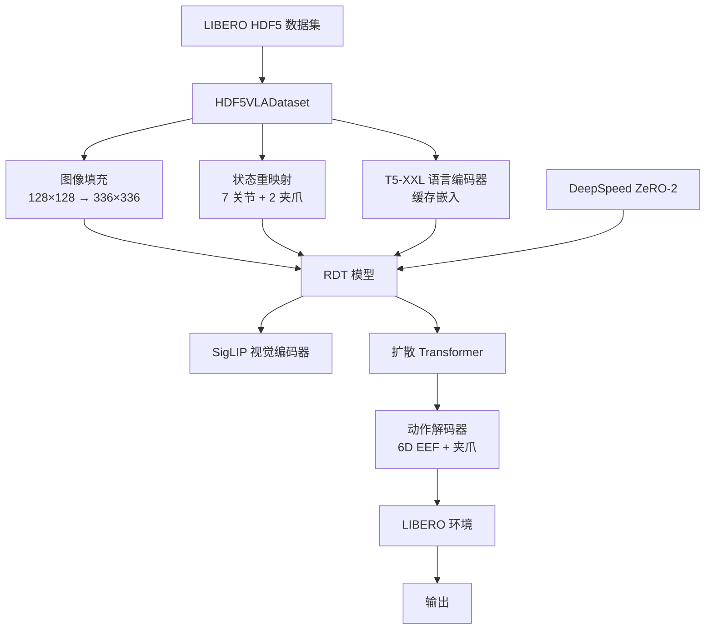

# RDT 在 LIBERO 基准上的微调

[English Version](./README.md)

---

**基于：** [Robotics Diffusion Transformer (RDT)](https://github.com/thu-ml/RoboticsDiffusionTransformer)  
**研究机构：** PKU & Psibot Lab  
**时间：** 2025  
**角色：** 研究实习生

---

## 项目概述

本项目实现了 **Robotics Diffusion Transformer (RDT)** 在 **LIBERO** 语言条件机器人操作基准上的监督微调。工作对比了全参数微调与 LoRA（低秩适配），分析了失败模式，并对推理性能瓶颈进行了剖析。

**工作总结：** 实现了 RDT 在 LIBERO 上的完整微调 pipeline，包括 HDF5 数据解析、SigLIP 图像归一化、T5-XXL 语言嵌入缓存（加速 30%）、DeepSpeed 分布式训练、以及批量 checkpoint 评估工具。发现 LoRA 上限仅 ~20% 远低于全参数 76%+；推理耗时 375ms/step 占评估 69% 时间；扩散步数和动作块长度对成功率有显著影响。

**核心贡献：**

1. 完整的 LIBERO HDF5 格式 → RDT 输入的数据预处理 pipeline
2. 基于 DeepSpeed 分布式训练的全参数与 LoRA 微调实现
3. 带性能剖析和批量 checkpoint 分析的评估基础设施
4. 系统对比揭示 LoRA 性能上限（~20% vs 全参数 76%+）
5. 推理剖析识别出 375ms/step 瓶颈（占评估时间 69%）

---

## 技术栈

| 组件 | 版本/框架 |
|------|----------|
| **深度学习** | PyTorch 2.1.0 + CUDA 12.1 |
| **分布式训练** | DeepSpeed 0.14.2 (ZeRO-2) |
| **参数高效微调** | peft 0.10.0 (LoRA) |
| **视觉编码器** | SigLIP-SO400M (google/siglip-so400m-patch14-384) |
| **语言编码器** | T5-XXL (google/t5-v1_1-xxl) |
| **混合精度** | BF16 |
| **基准测试** | LIBERO (5 个任务套件: libero_10, libero_90, libero_spatial, libero_object, libero_goal) |
| **Python** | 3.10.0 |

---

## 我做了什么

### 1. 数据预处理 Pipeline

**挑战：** LIBERO 使用 128×128 图像；RDT 期望 336×336 SigLIP 输入。状态/动作空间与预训练数据不同。

**实现：**

- **图像预处理：**
  - 将 128×128 RGB 图像填充到 336×336（SigLIP 标准）
  - 归一化到 SigLIP mean/std: `mean=[0.5, 0.5, 0.5], std=[0.5, 0.5, 0.5]`
  - 数据增强：随机水平翻转、颜色抖动

- **状态-动作映射：**
  - 配置 LIBERO 专用的 `UNI_STATE_INDICES` 映射
  - 状态：7 个关节角度 `[0,7)` + 2D 夹爪行程 `[10,12)`（归一化到 [0,1]）
  - 动作：6D 末端执行器增量 `[39,45)`（x,y,z 位置 + roll,pitch,yaw）+ 夹爪命令 `[10]`

- **语言嵌入缓存：**
  - 预计算所有任务指令的 T5-XXL 嵌入
  - 缓存到磁盘以避免重复编码
  - 结果：训练速度提升约 30%

**关键代码：** `train/dataset_sft.py` - HDF5VLADataset 和 VLAConsumerDataset 类

---

### 2. 全参数微调

**训练脚本：** `finetune_sft.sh` → `main_sft.py`

**配置：**
```bash
# 核心超参数
TRAIN_BATCH_SIZE=48              # 每 GPU 批次大小
LEARNING_RATE=1e-4               # 恒定学习率
MAX_TRAIN_STEPS=200000           # 最大训练步数
CHECKPOINTING_PERIOD=1000        # 每 1000 步保存
SAMPLE_PERIOD=500                # 验证采样间隔
STATE_NOISE_SNR=40               # 状态噪声信噪比（数据增强）
```

**DeepSpeed 配置：**
- ZeRO-2 优化器状态分片
- BF16 混合精度训练
- 大批次梯度累积
- 配置文件：`configs/zero2.json`

**功能特性：**
- 自动生成实验目录：`checkpoints/RDT-1B-Full-{dataset}-from_{base_model}-{timestamp}`
- 完整配置快照保存到 `training_config.txt`
- 通过 `--resume_from_checkpoint` 从 checkpoint 恢复训练
- WandB 集成用于实验追踪

---

### 3. LoRA 微调

**训练脚本：** `finetune_lora_sft.sh`

**LoRA 配置：**
- 测试的秩（rank）：8, 16, 32
- 目标模块：多种配置（`all`, `adaptor_only`, `cross_attn` 等）
- Alpha 缩放因子：通常 16-32
- Dropout：0.05-0.1

**关键发现：** LoRA 在所有测试配置下最高仅达到约 20% 成功率，显著低于全参数微调（76%-94%）。

---

### 4. 评估基础设施

**评估脚本：** `libero_eval/libero_rdt_eval.py`

**实现：**
- 加载 checkpoint 并初始化 LIBERO 环境
- 每个任务运行 N 次试验（通常 5 次/任务）
- 计算每任务和总体成功率
- 输出 CSV 格式的逐 episode 结果
- 保存视频录像用于失败分析

**性能剖析：**
- 逐步时间分解：模型推理 vs 环境步进
- 识别瓶颈：375ms 推理时间（占总评估时间 69%）

**批量评估：**
- `eval_full_checkpoints_auto.sh`：自动评估多个 checkpoint
- 聚合训练步数上的结果以识别最佳 checkpoint

---

## 实验结果

### 各任务套件成功率

评估协议：每任务 5 次试验，使用微调后的 checkpoint。

| 任务套件 | 成功率 | Checkpoint | 微调方法 | 备注 |
|---------|--------|------------|---------|------|
| **libero_object** | **92%** (46/50) | checkpoint-40000 | 全参数 | H=8, N=10 时表现最佳 |
| **libero_goal** | **94%** (47/50) | checkpoint-30000 | 全参数 | 达到最高成功率 |
| **libero_spatial** | **76%** (38/50) | checkpoint-22000 | 全参数 | 空间推理挑战 |
| **libero_long** | **38%** (19/50) | checkpoint-38000 | 全参数 | 长期任务难度 |


**逐任务分解示例 (libero_object)：**

| 任务 ID | 成功率 | 描述 |
|---------|--------|------|
| Task 0 | 100% (5/5) | 简单抓放 |
| Task 1 | 80% (4/5) | 物体操作 |
| Task 2 | 100% (5/5) | 打开抽屉 |
| Task 6 | 100% (5/5) | 多步骤操作 |
| Task 7 | 100% (5/5) | 放置任务 |
| Task 8 | 100% (5/5) | 复杂操作 |
| ... | ... | ... |

---

### 全参数 vs LoRA 对比

| 方法 | 成功率 | 备注 |
|------|--------|------|
| **全参数微调** | **76% - 94%**（任务相关） | 更新所有模型参数 |
| **LoRA (rank 8-32)** | **~20%**（上限） | 低秩适配不足 |

**关键发现：** LoRA 微调在所有测试配置下（rank 8-32，各种目标模块）最高仅达到约 20% 成功率，与全参数微调有 56-74 个百分点的差距。

**LoRA 性能不佳的假设：**
- 低秩约束（rank ≤ 32）可能不足以适配扩散解码器到 LIBERO 动作分布
- 扩散 transformer 可能需要不同于自回归 LLM 的适配策略
- 测试的秩（8-32）对于高维 6D 末端执行器 + 夹爪控制不足

---

### 性能剖析

**推理延迟分解（A100 GPU）：**

| 组件 | 时间 (ms) | 占比 | 备注 |
|------|----------|------|------|
| **模型推理** | **~375 ms** | **~69%** | 前向传播 + 扩散采样（H=8 步） |
| 环境步进 | ~170 ms | ~31% | LIBERO 物理仿真 |
| **每步总计** | **~545 ms** | **100%** | 有效吞吐量：~2 步/秒 |

**影响：** 评估一个 checkpoint 需运行 10 任务 × 5 次试验 × 200 步/episode = 10,000 步，约需 1.5 小时。

**瓶颈分析：** 扩散采样需要 8 次前向传播（H=8），每次都调用 SigLIP 视觉编码和 transformer 去噪。

---

### 超参数消融

**扩散步数 (H) vs 成功率（libero_object）：**

| 扩散步数 (H) | 成功率 | 备注 |
|-------------|--------|------|
| H=1 | 78% | 快速采样但质量较低 |
| H=8 | 88% | 良好平衡（+10pp 提升） |

**动作块长度 (N) vs 成功率（libero_object）：**

| 动作块长度 (N) | 成功率 | 备注 |
|---------------|--------|------|
| N=1 | 78% | 逐步推理 |
| N=10 | 90% | 基于块的控制（+12pp 提升） |

**发现：** 将 H 从 1 增加到 8 且 N 从 1 增加到 10，libero_object 成功率从 78% 提升到 92%。

---

## 系统架构

### 数据流



### 关键模块

| 模块 | 功能 | 实现 |
|------|------|------|
| **HDF5VLADataset** | 解析 LIBERO HDF5 文件 | `train/dataset_sft.py` |
| **图像预处理** | 填充和归一化图像 | 数据增强 pipeline |
| **状态适配器** | 将 LIBERO 状态映射到 RDT 索引 | `UNI_STATE_INDICES` 配置 |
| **语言缓存** | 预计算 T5 嵌入 | 磁盘缓存系统 |
| **训练循环** | DeepSpeed 分布式训练 | `main_sft.py` |
| **评估** | LIBERO 环境交互 | `libero_eval/libero_rdt_eval.py` |
| **性能剖析器** | 时间分解 | 推理 vs 环境步进 |

---

## 安装

### 前置条件

- Ubuntu 20.04/22.04 (Linux x86_64)
- CUDA 12.1+
- Conda 或 virtualenv
- 多 GPU 推荐（测试环境：7x A100）

### 环境配置

**1. 克隆仓库（包含子模块）：**
```bash
git clone --recursive https://github.com/chentingjia/Libero_RDT.git
cd Libero_RDT
```

**或者如果已克隆，初始化子模块：**
```bash
git submodule update --init --recursive
```

**注意：** `LIBERO` 目录是一个 git submodule，指向 [LIBERO benchmark 框架](https://github.com/Lifelong-Robot-Learning/LIBERO)。它提供仿真环境和任务定义。

**2. 创建 conda 环境：**
```bash
cd RDT_libero_finetune
conda env create -f environment.yml
conda activate rdt
```

**3. 安装 Python 依赖：**
```bash
pip install -r requirements.txt
```

**关键依赖：**
- PyTorch 2.1.0 with CUDA 12.1
- DeepSpeed 0.14.2
- Transformers 4.38.2
- peft 0.10.0 (LoRA)
- diffusers 0.26.3
- h5py 3.11.0 (HDF5 数据加载)

---

## 使用方法

### 训练

**全参数微调（推荐）：**

```bash
bash finetune_sft.sh
```

**运行前，编辑 `finetune_sft.sh` 中的配置：**

```bash
# 数据集选择
dataset_name="libero_10"       # 选项: libero_10, libero_spatial, libero_object, libero_goal

# 模型配置
BASE_MODEL_PATH="./checkpoints/rdt-finetune-1b-20251119_122234/checkpoint-65000"

# 训练超参数
TRAIN_BATCH_SIZE=48            # 根据 GPU 显存调整
LEARNING_RATE=1e-4
MAX_TRAIN_STEPS=200000
```

**从 Checkpoint 恢复训练：**

在 `finetune_sft.sh` 中取消注释并设置 `RESUME_CHECKPOINT`：
```bash
RESUME_CHECKPOINT="./checkpoints/RDT-1B-Full-libero_10-from_libero90-ckpt65k-20251208_143022/checkpoint-5000"
```

---

**LoRA 微调（参数高效）：**

```bash
bash finetune_lora_sft.sh
```

配置 LoRA 专用参数：
```bash
LORA_RANK=32                   # LoRA 矩阵的秩（测试：8, 16, 32）
LORA_ALPHA=32                  # 缩放因子
LORA_TARGET_MODULES="all"      # 适配的目标模块
```

---

### 评估

**评估单个 Checkpoint：**

```bash
cd libero_eval
python libero_rdt_eval.py \
    --checkpoint ../checkpoints/RDT-1B-Full-libero_object-from_libero90-ckpt65k-20251215_100530/checkpoint-40000 \
    --task_suite libero_object \
    --num_trials 5
```

**批量评估多个 Checkpoint：**

```bash
bash eval_full_checkpoints_auto.sh
```

这会自动评估实验目录中的所有 checkpoint 并聚合结果。

---

## 项目结构

```
RDT_libero_finetune/
├── main_sft.py                    # 主训练脚本
├── finetune_sft.sh                # 全参数微调启动器
├── finetune_lora_sft.sh           # LoRA 微调启动器
├── configs/
│   └── zero2.json                 # DeepSpeed ZeRO-2 配置
├── train/
│   ├── dataset_sft.py             # LIBERO HDF5 数据集加载器
│   └── train_sft.py               # 训练循环逻辑
├── models/
│   ├── rdt/
│   │   ├── model.py               # RDT 模型架构
│   │   └── blocks.py              # Transformer 块
│   └── multimodal_encoder/
│       ├── siglip_encoder.py      # SigLIP 视觉编码器
│       └── t5_encoder.py          # T5 语言编码器
├── libero_eval/
│   ├── libero_rdt_eval.py         # 带性能剖析的评估脚本
│   └── eval_full_checkpoints_auto.sh  # 批量评估
├── scripts/
│   ├── encode_lang_libero.py      # 预计算语言嵌入
│   └── inspect_libero_hdf5.py     # HDF5 数据检查工具
├── data/
│   └── datasets/                  # LIBERO HDF5 文件（不包含在仓库中）
├── checkpoints/                   # 模型 checkpoint（训练期间生成）
├── requirements.txt               # Python 依赖
└── environment.yml                # Conda 环境规范
```

---

## 关键技术挑战

### 1. 图像尺寸不匹配

**问题：** LIBERO HDF5 格式的图像尺寸（128×128）与 RDT 预训练（336×336）不同。直接缩放会引入长宽比失真。

**解决方案：** 用零填充将图像填充到 336×336 以保持长宽比，然后应用 SigLIP 归一化。

**代码位置：** `train/dataset_sft.py` - 图像预处理 pipeline

---

### 2. 状态-动作空间异构性

**问题：** LIBERO 使用 7-DoF 关节角度 + 2D 夹爪行程，而 RDT 预训练使用统一的 50 维状态/动作空间，索引不同。

**解决方案：** 配置 `UNI_STATE_INDICES` 映射：
- 状态索引：`[0,7)` 用于关节，`[10,12)` 用于夹爪
- 动作索引：`[39,45)` 用于 6D EEF 增量，`[10]` 用于夹爪命令
- 夹爪行程通过 min/max 缩放归一化到 [0,1]

**权衡：** 每个新基准需要手动索引映射；未自动泛化。

---

### 3. 语言嵌入冗余

**问题：** T5-XXL 编码计算量大。在每次训练迭代中编码相同指令（如 "pick up the red block"）浪费计算。

**解决方案：** 在训练前将所有唯一任务指令的 T5-XXL 嵌入预计算并缓存到磁盘。

**实现：**
- 脚本：`scripts/encode_lang_libero.py`
- 缓存格式：Pickle 字典映射指令文本 → 嵌入张量
- 加速：训练时间减少约 30%

---

### 4. LoRA 性能上限

**问题：** LoRA 微调仅达到约 20% 成功率，尽管测试了多种秩（8, 16, 32）和目标模块配置。

**根因分析：**
- 低秩约束（rank ≤ 32）可能不足以适配扩散解码器到 LIBERO 动作分布
- 6D EEF 控制 + 夹爪需要高维动作流形学习
- LoRA 为自回归 transformer（LLM）设计；可能无法有效捕捉扩散去噪动态

**开放问题：** 将 LoRA 秩扩展到 64、128、256 能否缩小差距，还是需要对特定模块（解码器、适配器）进行全参数微调？

---

### 5. 推理瓶颈

**问题：** 单步模型推理在 A100 GPU 上耗时约 375 ms，主导评估时间（69%）。

**瓶颈分解：**
1. **扩散采样：** H=8 次去噪迭代，每次需要完整的 transformer 前向传播
2. **多视角编码：** SigLIP 处理 2 个相机视角（cam_high, cam_left_wrist）
3. **Transformer 开销：** 大模型尺寸的注意力操作

**影响：** 完整任务套件评估（10 任务 × 5 次试验）每个 checkpoint 需约 2.5 小时。

**剖析方法：** 在评估脚本中添加时间测量，分别测量推理与环境步进。

---

## 失败模式分析

基于跨 LIBERO 任务套件的系统调试：

### 1. 语言定位歧义

**症状：** 任务 8（"place block next to the plate"）达到 0% 成功（libero_spatial 套件）。

**根因：** 指令中同时提到源对象（"block"）和目标参考（"plate"）。当场景中存在多个类似盘子的物体时，策略对要交互的"plate"产生混淆。

**诊断：** 需要更多演示来消除空间关系和物体引用的歧义。

---

### 2. 空间关系混淆

**症状：** 策略将物体放置"在"目标上而非"在目标旁边"（libero_spatial 中的常见错误）。

**根因：** 空间介词定位（"next to"、"between"、"above"）的训练数据不足。

**分析：** 空间关系理解需要：
- 更多样化的空间变化演示
- 显式的空间推理辅助损失
- 保持空间关系的增强

---

### 3. 长期任务信用分配

**症状：** libero_long 任务仅达到 38% 成功率。前 3-4 个子任务通常成功，但最终子任务失败。

**根因：** 扩散模型优化逐时间步损失，没有显式的长期目标追踪。错误在子任务间累积。

**启示：** 长期任务（5+ 个子任务）需要层次化规划或目标条件 RL，而非仅模仿学习。

---

### 4. 单演示过拟合

**症状：** 在单个演示（`demo_0`）上训练导致快速过拟合：
- 训练损失在 1000+ 个 epoch 后收敛
- 验证成功率在约 20% 处停滞
- 策略记住特定像素模式而未学习可泛化的任务语义

**解决方案：** 需要完整演示集（通常每任务 50-100 个演示）。

---

## 已知限制

1. **手动状态-动作映射：** 每个新基准需要手动配置 `UNI_STATE_INDICES`
2. **高推理延迟：** 375ms 每步限制实时机器人控制应用
3. **LoRA 性能不佳：** ~20% 成功率远低于全参数微调（76%+）
4. **长期任务弱点：** libero_long 38% 成功率揭示信用分配局限
5. **空间推理差距：** libero_spatial 76% vs libero_object/goal 92-94%

---

## 配置文件

### 训练超参数

**来自 `finetune_sft.sh`：**
```bash
TRAIN_BATCH_SIZE=48           # 训练批次大小
SAMPLE_BATCH_SIZE=32          # 采样批次大小
LEARNING_RATE=1e-4            # 学习率
LR_SCHEDULER="constant"       # 学习率调度器
MAX_TRAIN_STEPS=200000        # 最大训练步数
CHECKPOINTING_PERIOD=1000     # Checkpoint 保存间隔
SAMPLE_PERIOD=500             # 采样间隔
STATE_NOISE_SNR=40            # 状态噪声信噪比
DATALOADER_NUM_WORKERS=8      # 数据加载线程数
CHECKPOINTS_TOTAL_LIMIT=40    # 保留的 checkpoint 数量
```

### DeepSpeed ZeRO-2 配置

**来自 `configs/zero2.json`：**
- 跨 GPU 的优化器状态分片
- BF16 混合精度训练
- 梯度累积
- 优化的通信重叠

---

## 可复现性说明

### 确定性种子

训练脚本中随机种子设为 42 以实现可复现性：
```bash
seed=42
```

**注意：** 由于非确定性 CUDA 操作，GPU 上无法保证完全确定性。

---

### 数据集要求

**LIBERO 数据集：**
- 从 [LIBERO 官方网站](https://lifelong-robot-learning.github.io/LIBERO/) 下载
- 将 HDF5 文件放置在 `data/datasets/{task_suite}/`
- 期望格式：多视角图像（128×128）、机器人状态（9D）、动作（7D）、语言指令

---

### Checkpoint 管理

**自动 Checkpoint：**
- 每 1000 步保存（通过 `CHECKPOINTING_PERIOD` 配置）
- 保留最近 40 个 checkpoint（旧 checkpoint 自动删除）
- Checkpoint 命名：`checkpoint-{step_number}`

**目录结构：**
```
checkpoints/RDT-1B-Full-libero_object-from_libero90-ckpt65k-20251215_100530/
├── checkpoint-1000/
├── checkpoint-2000/
├── ...
├── checkpoint-40000/
└── training_config.txt
```

---

## 验证与测试

### 功能测试检查清单

- [ ] 训练脚本无错误启动
- [ ] DeepSpeed 成功初始化多 GPU 训练
- [ ] Checkpoint 在正确间隔保存
- [ ] WandB 日志功能正常（如启用）
- [ ] 语言嵌入成功缓存
- [ ] 评估脚本正确加载 checkpoint
- [ ] LIBERO 环境运行无死锁
- [ ] 成功率计算准确

### 调试命令

```bash
# 检查 GPU 可用性
nvidia-smi

# 验证 LIBERO 安装
python -c "import libero; print(libero.__version__)"

# 测试 HDF5 数据加载
python scripts/inspect_libero_hdf5.py --dataset libero_object

# 检查缓存的语言嵌入
ls -lh data/datasets/*/lang_embed/

# 查看训练日志
tail -f checkpoints/RDT-1B-Full-*/logs/training_config_*.log
```

---

## 常见错误与故障排除

### 问题：显存不足

**症状：**
```
RuntimeError: CUDA out of memory
```

**解决方案：**
- 减小 `TRAIN_BATCH_SIZE`（从 48 降到 24 或 16）
- 使用 LoRA 微调替代全参数微调
- 启用 gradient checkpointing（如未启用）

---

### 问题：HDF5 数据加载失败

**症状：**
```
KeyError: 'observations/images/cam_high'
```

**解决方案：**
- 使用 `scripts/inspect_libero_hdf5.py` 检查 HDF5 文件结构
- 验证数据集路径正确：`data/datasets/{task_suite}/`
- 确保 HDF5 文件完整下载（未损坏）

---

### 问题：评估环境死锁

**症状：** Episode 执行中途挂起，无状态更新。

**根因：** LIBERO 仿真偶尔死锁（物理引擎罕见 bug）。

**解决方案：**
- 在评估脚本中添加每步超时（5秒）
- 超时时重启环境
- 记录失败 episode 用于调试

---

## 参考资料

- [RDT: Robot Diffusion Transformer](https://arxiv.org/abs/2410.07368)
- [原始 RDT 仓库](https://github.com/thu-ml/RoboticsDiffusionTransformer)
- [LIBERO 基准](https://lifelong-robot-learning.github.io/LIBERO/)
- [LoRA: Low-Rank Adaptation](https://arxiv.org/abs/2106.09685)
- [DeepSpeed 文档](https://www.deepspeed.ai/)

---

## 作者

**维护者：** chentingjia (chentingjia1209@163.com)  
**单位：** PKU & Psibot Lab（研究实习生，2025）  
**项目目的：** 研究视觉-语言-动作模型在标准化机器人操作基准上的微调策略。

---

**最后更新：** 2026年3月
